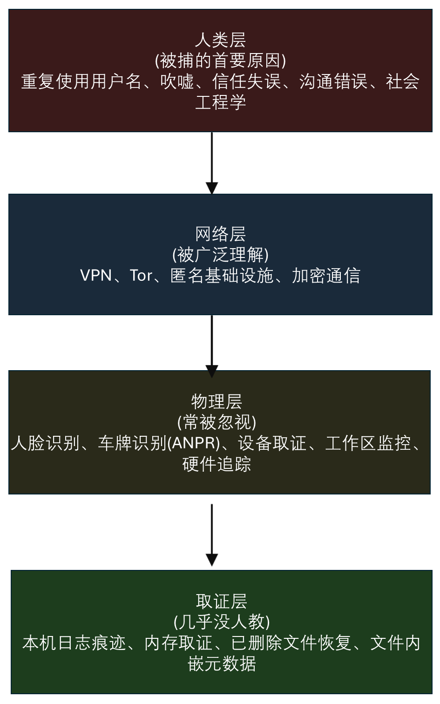

# 最大匿名工作流

**速查版匿名架构指南 —— 2027 版**

**作者：** Sagar Biswas ([@SagarBiswas-MultiHAT](https://github.com/SagarBiswas-MultiHAT))<br/>
**主仓库：** [The BlackHAT Roadmap](https://github.com/SagarBiswas-MultiHAT/The-BlackHAT-roadmap)<br/>
**许可：** [CC BY-SA 4.0](https://github.com/SagarBiswas-MultiHAT/The-BlackHAT-roadmap/blob/main/LICENSE-DOCS)<br/>
**版本：** v1.0.0 · 2027 版

<div align="right">

**一条链的强度，取决于它最弱的那一层。大多数操作者只造了一层。**

</div>

> 📚 **配套路线图文档：**
> * **[The BlackHAT Roadmap（主仓库）](https://github.com/SagarBiswas-MultiHAT/The-BlackHAT-roadmap)**：主课程、议题讨论与路线图的实时更新。
> * **[阶段 -1：作战安全与基础设施](../phases/PHASE_-1.md)**：完整的作战安全地基——本文匿名技术栈背后的一切技术细节。
> * **[BlackHat 长期生存战术](BlackHat_Long-Term_Survival_Tactics.md)**：权威的作战安全、物理作业手法与数字身份架构手册。
> * **[黑客心态](../field-guides/Philosophy_The_BlackHat_Mindset.md)**：认知信条、对抗性假设狩猎与原语思维的心智模型。
> * **[FAQ](../field-guides/FAQ.md)**：运维与职业转型的全面问答。
> * **[实验环境搭建指南](../field-guides/Lab_Setup_Guide.md)**：多层硬件规格与隔离的企业/内核实验蓝图。

> **推荐的精选路线图资源：**
> * **[Awesome Cybersecurity Paths](https://github.com/SagarBiswas-MultiHAT/awesome-cybersecurity-paths)**：面向渗透测试人员、红队、蓝队与安全研究者的精选学习路径。
> * **[Penetration Testing Roadmap](https://github.com/SagarBiswas-MultiHAT/penetration-testing-roadmap)**：实战评估流程、工具矩阵与项目方法论。
> * **[Awesome Cybersecurity Books](https://github.com/SagarBiswas-MultiHAT/awesome-cybersecurity-books)**：精选的攻击安全与底层系统文献。

---

> *“大多数指南只讲怎么安装 Tor。本文要讲的是：为什么光有 Tor 不够，完整的链路长什么样，以及当你跳过某一层时，哪里会崩。”*

---

## 本文为什么存在

[阶段 -1](../phases/PHASE_-1.md) 是权威而详尽的作战安全参考——四千多行，覆盖匿名、基础设施、取证与作战纪律的每一个侧面。[BlackHat 长期生存战术](BlackHat_Long-Term_Survival_Tactics.md) 把它延伸到三千多行的高级作业手法。

两篇都是必读。两篇都很厚。

本文的目的不同：给初学者和中级操作者一张**单一、清晰、端到端的总图**，说明匿名架构实际是怎么运转的——从你的本地机器到目标之间的完整链路，每一层做什么、每一层不做什么，以及它们如何叠加在一起。

把它当成架构蓝图。阶段 -1 和《长期生存战术》是完整的施工规范。先读蓝图，再照规范施工。

**本文覆盖：**
1. 完整的流量链路（从本地机器到目标）
2. 链路上每一跳，各类对手分别能看到什么
3. 网络链路之外的七层作战要素
4. 如何按你真实的威胁模型校准技术栈
5. 用来确认整套配置确实生效的验证清单

**本文不覆盖：**
- 工具的分步安装（见[阶段 -1，第 8-9 节](../phases/PHASE_-1.md)）
- VPS 深度加固（见[阶段 -1，第 8 节](../phases/PHASE_-1.md)）
- 加密货币的获取链路（见[阶段 -1，第 11 节](../phases/PHASE_-1.md)）
- 通信平台的安全性对比（见[阶段 -1，第 6 节](../phases/PHASE_-1.md)）
- 物理反监视（见[长期生存战术，第 6-7 节](BlackHat_Long-Term_Survival_Tactics.md)）

---

## 目录

1. [核心链路：从本地机器到目标](#1-核心链路从本地机器到目标)
2. [每个对手能看到什么](#2-每个对手能看到什么)
3. [作战安全失效金字塔：为什么只有链路还不够](#3-作战安全失效金字塔为什么只有链路还不够)
4. [最大匿名的七层结构](#4-最大匿名的七层结构)
5. [三身份模型](#5-三身份模型)
6. [Whonix：架构级的防泄漏保证](#6-whonix架构级的防泄漏保证)
7. [威胁模型分级：校准你的技术栈](#7-威胁模型分级校准你的技术栈)
8. [技术栈验证清单](#8-技术栈验证清单)
9. [会让链路断裂的常见错误](#9-会让链路断裂的常见错误)
10. [接下来去哪里](#10-接下来去哪里)

---

## 1. 核心链路：从本地机器到目标

追求最大匿名时的推荐配置（VPN 到 Tor）：

```
你的机器 --> VPN（自建）--> Tor 网络 --> 目标
```

[《长期生存战术》第 3.1 节](BlackHat_Long-Term_Survival_Tactics.md) 里的分层模型定义了这条作战链路：

<div align="center">
<table><tr><td>


</td></tr></table>
</div>

展开后的作战链路，把物理纪律也算了进来：

```
物理位置（公共 WiFi 或移动热点——绝不用家里的宽带）
  --> 伪造 MAC 的网卡 + 随机化的主机名
    --> 专用硬件（Qubes OS + Whonix 虚拟机）
      --> VPN-1（门罗币支付、非十四眼辖区的 VPS 上的 WireGuard）
        --> 带 obfs4 网桥的 Tor（入口 --> 中间 --> 出口）
          --> 目标
```

<div align="center">
<table><tr><td>


</td></tr></table>
</div>

当目标封禁 Tor 出口节点时，改用第二套配置（Tor 到 VPN）：

```
你的机器 --> Tor --> VPN-2（换一家服务商、换一个辖区）--> 目标
```

这种变体对目标隐藏 Tor 出口 IP。代价是：VPN-2 服务商能看到你的流量内容（但看不到你的真实 IP，因为流量是经 Tor 抵达它的）。

**关于 VPN 选择的关键规则：**

不要使用商业 VPN 链（ExpressVPN、NordVPN 之类）。[《长期生存战术》](BlackHat_Long-Term_Survival_Tactics.md) 记录了原因：
- 2017-2025 年间多起与执法部门合作的案例
- 尽管宣传“无日志”，仍然记录元数据（已在庭审中得到确认）
- 不少服务商所在的辖区与五眼联盟关系密切
- 用信用卡付款 = 你的身份就是他们的第一条记录

正确做法：在匿名 VPS 上自建 WireGuard。

```
VPS 要求：
- 服务商接受门罗币（XMR）——不要求 KYC
- 推荐：Njalla、1984 Hosting、FlokiNET、Alexhost、SporeStack
- 辖区优先级：冰岛 > 摩尔多瓦 > 罗马尼亚 > 荷兰
- 避开：英国、美国、澳大利亚、加拿大、新西兰（五眼）
- 避开：德国（与执法部门合作力度大）、法国（ANSSI/DGSI 活跃）
- 所有管理访问只经 Tor——VPS 永远看不到你的真实 IP
- 强制零日志（cron 任务每 30 分钟清一次日志）
```

> **来源：** [阶段 -1，第 9 节](../phases/PHASE_-1.md) · [长期生存战术，第 3.2 节](BlackHat_Long-Term_Survival_Tactics.md)

---

## 2. 每个对手能看到什么

弄清链路上每个参与者能看到什么、看不到什么，是判断这条链是否真的有效的基础。

<div align="center">
<table><tr><td>


</td></tr></table>
</div>

| 对手 | 能看到什么 | 看不到什么 |
|---|---|---|
| **你的 ISP** | 发往 VPN 服务器的加密流量 | 你在用 Tor；你的目的地；你的内容 |
| **VPN 服务商** | 你的 IP + Tor 流量 | 你的最终目的地（若无日志政策成立：什么都不留） |
| **Tor 入口节点** | VPN 的 IP（不是你的真实 IP） | 你的目的地；你的内容 |
| **Tor 出口节点** | 发往目的地的流量 | 你的真实 IP；你的 VPN IP |
| **目标** | 仅 Tor 出口节点 IP | 你的真实 IP；任何能回溯到你的线索 |

**为什么先 VPN 再 Tor（而不是只用 Tor）：**

1. 对你的 ISP 隐藏你在用 Tor。在很多国家和企业环境里，使用 Tor 本身就会被标记为可疑。VPN 让你的流量看起来只是普通的加密 VPN 流量。
2. 对 Tor 入口节点隐藏你的真实 IP。没有 VPN 这一层，Tor 的入口守卫就知道你的真实 IP。
3. VPN 服务商看不到你的最终目的地，因为流量是在经过 VPN 之后才进入 Tor 网络的。
4. 链路上没有任何单一节点同时知道“你是谁”和“你要去哪”。

> **来源：** [阶段 -1，第 9.4 节，第 1218-1243 行](../phases/PHASE_-1.md)

---

## 3. 作战安全失效金字塔：为什么只有链路还不够

这是本文最重要的概念。

流量链路（VPN --> Tor --> 目标）属于网络层。**网络匿名只是中间那一层。**真正导致被抓的层，在它的上面和下面。

<div align="center">
<table><tr><td>



</td></tr></table>
</div>

| 层 | 涵盖什么 | 导致被抓的频率 |
|---|---|---|
| **人的层** | 复用用户名、炫耀、信任崩塌、通信失误、社会工程 | 最常见原因（仅“炫耀”一项就占被捕案例的约 40%） |
| **网络层** | VPN、Tor、匿名化基础设施、加密通信 | 约 20% 的被捕源于技术失误 |
| **物理层** | 人脸识别、车牌识别、设备取证、工作场所监控、硬件轨迹 | 常被忽视；可用于“平行构造”证据 |
| **取证层** | 你自己机器上的日志痕迹、内存取证、已删除文件恢复、文件中的元数据 | 几乎从不被教；你自己的设备会成为指控你最强的证据 |

出自[阶段 -1](../phases/PHASE_-1.md)：

> *“大多数操作者首先想到的是网络匿名。网络匿名只是中间那一层。真正断送职业生涯的层，在它的上面和下面。”*

第 1 节讲的网络链路是必要的，但不充分。本文余下的部分，讲的是让这条链真正立得住的那几层。

---

## 4. 最大匿名的七层结构

最大匿名要求七层同时成立。任何单独一层失效，都可能把整条链路拆掉。

<div align="center">
<table><tr><td>


</td></tr></table>
</div>

---

### 第 0 层：物理纪律

你的物理存在不能与你的数字活动产生关联。

| 要求 | 细节 |
|---|---|
| **网络来源** | 公共 WiFi 或移动热点。作战活动绝不用家里的宽带。 |
| **地点轮换** | 同一个公共 WiFi 地点不要连续使用两次。 |
| **单次时长上限** | 每个物理地点最多 20-25 分钟。 |
| **个人手机** | 留在家里或放进法拉第袋。个人设备与作战设备绝不放在一起。 |
| **摄像头意识** | 背对摄像头。穿不起眼的衣服。不要佩戴可识别的饰物。 |

> **深入阅读：** [长期生存战术，第 6-7 节](BlackHat_Long-Term_Survival_Tactics.md)

---

### 第 1 层：硬件与操作系统

即使被查获，你的设备也不能出卖你。

| 要求 | 细节 |
|---|---|
| **专用设备** | 每个身份一台独立笔记本（理想情况）。至少要做到严格的虚拟机区隔。 |
| **推荐硬件** | 刷了 Libreboot 的 ThinkPad X230/T430（预算方案，久经检验），或刷了 Coreboot 的 ThinkPad T480（现代与均衡）。 |
| **购买方式** | 只用现金，实体店购买，不留可追溯的支付记录。 |
| **MAC 地址伪造** | 每次会话前随机化 MAC 地址。 |
| **主机名** | 每次会话前随机化。 |
| **摄像头 / 麦克风 / 蓝牙** | 物理断开，或用硬件熔断开关。 |
| **磁盘加密** | LUKS 全盘加密。没有商量余地。 |
| **序列号** | 撕掉所有贴纸。条件允许时通过 Coreboot 替换。 |

**按技能水平选择操作系统：**

```
初学者：        Tails OS（U 盘启动）
               - 失忆式：关机即清空一切
               - 默认走 Tor：所有流量自动经 Tor 路由
               - 在宿主硬件上不留痕迹
               - 适合：单次行动、最大程度的不留痕会话

中级：          Qubes OS
               - 区隔内建在操作系统架构里
               - 每个身份 / 任务一个独立虚拟机
               - dom0（管理域）没有网络访问
               - 适合：多身份行动、日常研究

高级：          Qubes OS + Whonix 虚拟机（2027 年的黄金标准）
               - Qubes 负责区隔
               - Whonix 网关虚拟机强制所有流量走 Tor
               - 即使工作站虚拟机被攻陷，真实 IP 也无法泄漏
               - 适合：持续的高安全等级行动
```

> **深入阅读：** [阶段 -1，第 13 节](../phases/PHASE_-1.md) · [长期生存战术，第 2 节](BlackHat_Long-Term_Survival_Tactics.md)

---

### 第 2 层：网络链路

这就是本文第 1 节里的流量链路。

```
你的机器 --> VPN-1（自建 WireGuard）--> Tor（三跳）--> 目标
```

关键实现细节：

```
VPN：
- 匿名 VPS 上自建 WireGuard（门罗币支付、非十四眼辖区）
- 熔断开关强制开启（PostUp/PreDown 的 iptables 规则）
- VPN 一旦断开，所有流量必须停止——绝不能回落到你的真实 IP

Tor：
- 如果你所在辖区对 Tor 的使用敏感，就走 obfs4 网桥
- 在 torrc 中排除五眼出口节点：
    ExcludeExitNodes {US},{GB},{AU},{CA},{NZ}
    StrictNodes 1
- 启用流隔离：
    IsolateDestAddr 1
    IsolateDestPort 1

泄漏防护：
- DNS：必须只经 Tor 或 VPN 解析
- WebRTC：在所有浏览器中禁用（media.peerconnection.enabled = false）
- WebGPU：在所有浏览器中禁用（dom.webgpu.enabled = false）
- 测试：dnsleaktest.com、browserleaks.com、ipleak.net（全部通过 Tor Browser 访问）
```

> **深入阅读：** [阶段 -1，第 9 节](../phases/PHASE_-1.md) · [长期生存战术，第 3 节](BlackHat_Long-Term_Survival_Tactics.md)

---

### 第 3 层：Whonix（防泄漏强制）

Whonix 提供的是一种超出配置层面的架构保证。完整解释见本文第 6 节。

---

### 第 4 层：身份区隔

三个身份。彼此之间绝对分离。完整模型见本文第 5 节。

---

### 第 5 层：财务作战安全

你的支付轨迹不能指回你本人。

```
规则：
- 所有与研究相关的采购：只用门罗币（XMR）
- 获取链路：法币 --> 比特币（P2P 或 ATM）--> 原子交换成门罗币
- 绝不使用个人信用卡、银行账户或 KYC 交易所
- 绝不重复使用钱包地址
- 每个身份一个钱包
- 推荐钱包：Feather Wallet (https://featherwallet.org)
- 交易所：Haveno（门罗币原生 DEX）、Bisq（比特币/XMR DEX）
```

> **深入阅读：** [阶段 -1，第 11 节](../phases/PHASE_-1.md) · [长期生存战术，第 5 节](BlackHat_Long-Term_Survival_Tactics.md)

---

### 第 6 层：通信

你的通信渠道是第一号被捕诱因。因通信记录被抓的操作者，比因任何技术失误被抓的更多。

```
追求最大匿名（2027）：
- SimpleX Chat：没有用户 ID、没有手机号、没有用户名，完全去中心化
  即使在元数据里，服务器也无法把发送方与接收方关联起来
  https://simplex.chat

可接受（端到端加密的黄金标准，但匿名性较弱）：
- Signal：Signal 协议（目前可用的最强端到端加密协议）
  密封发送方、阅后即焚（作战通信最长 1 小时）
  弱点：需要手机号（用经 Tor 的 VoIP/JMP.chat 获取预付费 SIM 号）
  弱点：Signal 服务器能看到你在和谁通信（元数据）
  结论：适合不要求完全匿名的通信；
           匿名关键的通信优先用 SimpleX

去中心化备选：
- Session：不需要手机号，Lokinet 覆盖网络
- Briar：点对点，经 Tor 路由，可通过蓝牙/WiFi 网状网离线工作

硬性禁止（2027）：
- Telegram：自 2024 年 8 月起与执法部门合作（Durov 被捕）
  所有普通/群组聊天都以可读形式存储在 Telegram 服务器上
- Discord：日志详尽，与执法部门合作非常积极
- WhatsApp：端到端加密内容，但记录大量元数据
- SMS：运营商层面没有加密，日志详尽
```

> **深入阅读：** [阶段 -1，第 6 节](../phases/PHASE_-1.md) · [长期生存战术，第 4 节](BlackHat_Long-Term_Survival_Tactics.md)

---

### 第 7 层：行为纪律

最难的一层。技术控制可以自动化，行为只能靠意志力维持。

```
时区掩蔽：
- 在随机时段发帖与操作，不要按你的真实时区来
- 固定的发帖规律会暴露你所在的地理区域

语言作战安全：
- 避免有辨识度的写作习惯（文体计量分析可以识别作者）
- 在不同身份之间变换句长、词汇和标点习惯
- 不同语境用不同身份——绝不混用风格

元数据清洗：
- 图片用 ExifTool（GPS 坐标、相机型号、时间戳）
- 文档用 mat2（作者名、软件版本、修订历史）
- 任何一次上传之前都清除所有元数据，每一次都要

会话卫生：
- 每次行动前运行会话启动脚本：
  1. 伪造 MAC 地址（两块网卡都要）
  2. 随机化主机名
  3. 设置尊重隐私的 DNS
  4. 清空 DNS 缓存
  5. 验证 IP（确认 VPN + Tor 正常工作）
  6. 验证没有 DNS 泄漏
  7. 验证没有 WebRTC 泄漏
```

> **深入阅读：** [阶段 -1，第 12、15-16 节](../phases/PHASE_-1.md) · [长期生存战术，第 3.5 节](BlackHat_Long-Term_Survival_Tactics.md)

---

## 5. 三身份模型

最大匿名要求三个身份之间绝对分离。它们之间不共用任何设备、IP、邮箱、用户名或账户。

<div align="center">
<table><tr><td>


</td></tr></table>
</div>

| 身份 | 用途 | 基础设施 | 规则 |
|---|---|---|---|
| **个人** | 真实姓名、真实设备、真实账户。个人邮箱、银行、社交媒体。 | 你日常的设备和网络。 | 绝不接触研究或行动。永远。 |
| **研究** | 化名，经 Tor 使用一次性邮箱。CTF、GitHub 安全仓库、漏洞赏金、论坛、会议注册。 | 专用研究设备或虚拟机。VPN + Tor。 | 绝不越界进入作战活动。 |
| **作战** | 每次行动都用全新基础设施。不复用 IP、域名或用户名。每次行动结束后彻底销毁。 | 一次性虚拟机（Tails 或 Qubes DispVM）。完全全新的基础设施。 | 不与研究身份交叉。不与个人身份交叉。用过即焚。 |

初学者最常犯的错误：拿研究身份去做作战活动。一个账户、一个邮箱、一个 GitHub 账号同时挂在两种语境上，调查者就可以从一头追到另一头。

> **深入阅读：** [阶段 -1，第 12 节](../phases/PHASE_-1.md) · [长期生存战术，第 1 节](BlackHat_Long-Term_Survival_Tactics.md)

---

## 6. Whonix：架构级的防泄漏保证

路线图为什么在 VPN + Tor 链路之外还推荐 Whonix？因为 Whonix 提供了配置给不了的东西：针对 IP 泄漏的架构级保证。

<div align="center">
<table><tr><td>


</td></tr></table>
</div>

Whonix 是一个双虚拟机系统：

| 组件 | 角色 | 网络访问 |
|---|---|---|
| **工作站虚拟机** | 你所有的工作都在这里做。 | 没有任何直接网络访问。所有流量经网关路由。 |
| **网关虚拟机** | 把所有流量经 Tor 路由。网络隔离的执行者。 | 到真实互联网的 NAT（网卡 1）+ 到工作站的内网（网卡 2）。 |

**为什么这很重要：**

即使恶意软件完全攻陷了工作站虚拟机，它也无法发现你的真实 IP。工作站没有通往真实互联网的网络接口。除了经网关的 Tor 链路，它在物理上就无法触达外部世界。这不是一个可以被软件绕过的配置——它是由 hypervisor 强制执行的架构边界。

对比一下只在宿主操作系统上跑 Tor Browser：一个配置错误的应用程序、一次 WebRTC 泄漏、或者一条绕开 Tor 隧道的 DNS 查询，就暴露了你的真实 IP。Whonix 消灭了这一整类失败。

```
QubesOS 集成（黄金标准）：
- sys-whonix qube 充当 Tor 网关
- 研究 AppVM 的所有流量经 sys-whonix 路由：
    qvm-prefs ResearchVM netvm sys-whonix
- dom0（管理域）完全没有网络访问
- 一次性任务的 DispVM 在关闭时自动销毁
```

> **深入阅读：** [阶段 -1，第 13.3 节](../phases/PHASE_-1.md)

---

## 7. 威胁模型分级：校准你的技术栈

不是每个场景都需要全套技术栈。让你的姿态匹配你的对手。准备不足很危险；过度准备会带来摩擦，而摩擦在压力之下会被你跳过。

下面这些分级，把[阶段 -1 第 5 节](../phases/PHASE_-1.md)的对手校准指导，与[《长期生存战术》的威胁建模框架](BlackHat_Long-Term_Survival_Tactics.md)综合成一个渐进式防御模型：

| 级别 | 对手 | 所需的匿名姿态 |
|---|---|---|
| **1** | 脚本小子、随手的开盒者、平台滥用处置团队 | 基础 VPN、独立研究账户、研究资料里不放个人信息 |
| **2** | 企业安全团队（SOC、IR）、当地执法部门 | 完整的 VPN --> Tor 链路、Whonix、门罗币采购、独立设备、加密通信 |
| **3** | 国家级情报机构（五眼及其同级机构） | 级别 2 的全部，加上物理位置纪律、Qubes OS、硬件隔离、一次性设备、反 OSINT 审计 |
| **4** | 国家级的持久化对手（APT 级反制行动） | 级别 3 的全部，加上法拉第纪律、死信箱、气隙系统、多国基础设施轮换、退出策略 |

**来自[阶段 -1](../phases/PHASE_-1.md)的最重要校准建议：**

> *“每一层作战安全都会增加摩擦。Tor 慢。独立设备不方便。门罗币交易要花时间。你不愿意接受的摩擦，就会成为你在压力之下跳过的那一层。诚实地面对自己的限度，并围绕这些限度来设计作战安全。一个你能一直坚持用的不完美系统，胜过一个一不方便就被你抛弃的完美系统。”*

大多数安全研究者现实中的对手是：**平台滥用处置团队**和**企业安全团队**，不是 NSA。对准正确的对手，决定了你实际需要什么保护。当你面对的是级别 1 的威胁，却对 NSA 级对手疑神疑鬼，既浪费时间，也会制造出导致走捷径的摩擦。

> **深入阅读：** [阶段 -1，第 5 节](../phases/PHASE_-1.md) · [长期生存战术，威胁建模框架](BlackHat_Long-Term_Survival_Tactics.md)

---

## 8. 技术栈验证清单

任何一次作战会话之前，端到端验证整套技术栈。不要因为上次能用就假定这次也能用。

<div align="center">
<table><tr><td>


</td></tr></table>
</div>

```bash
# 第 1 步：记录你的基础 IP（作战期间绝不能被暴露）
curl https://ifconfig.me
# 记下这个数字。记住它的开头。

# 第 2 步：连接 VPN。验证 IP 变化。
wg-quick up wg0
curl https://ifconfig.me
# 必须显示 VPN 服务器 IP，而不是你的真实 IP

# 第 3 步：经 Tor 路由。验证。
systemctl start tor
proxychains4 curl https://ifconfig.me
# 必须显示一个 Tor 出口节点 IP（与 VPN IP 不同）

# 第 4 步：经 Tor 做 DNS 泄漏测试
proxychains4 curl -s https://dnsleaktest.com/json | python3 -m json.tool
# 输出中不应出现任何 ISP 的 DNS 服务器

# 第 5 步：WebRTC 泄漏测试（基于浏览器）
# 打开 Tor Browser --> 访问 https://browserleaks.com/webrtc
# 必须显示无 IP 泄漏

# 第 6 步：确认确实走的是 Tor
proxychains4 curl https://check.torproject.org | grep Congratulations
# 必须返回："Congratulations. This browser is configured to use Tor."

# 第 7 步：验证 VPS 访问链路
proxychains4 ssh -p YOUR_SSH_PORT operator@your-vps-domain.com
# 在 VPS 上执行：who
# 必须显示 Tor 出口节点 IP 作为连接来源地址，而不是你的真实 IP
```

**任何一步失败，都不要继续。先把泄漏修好。**

> **来源：** [阶段 -1，第 9.7 节](../phases/PHASE_-1.md)

---

## 9. 会让链路断裂的常见错误

这些是在已记录的抓捕案例和取证复盘中反复出现的错误。每一条都是单点故障，一旦发生，整座匿名架构就塌了。

| 错误 | 为什么会让链路断裂 | 修正 |
|---|---|---|
| 用家里的 WiFi 做作战活动 | ISP 会记录你到 VPN 服务器的连接，时间戳与活动可以对齐。 | 用公共 WiFi 并伪造 MAC。轮换地点。 |
| 忘记伪造 MAC 地址 | MAC 地址会被 WiFi 接入点记录，且可被调取。 | 用会话启动脚本，在网络起来之前自动伪造。 |
| 在作战设备上登录个人账户 | 瞬间建立身份关联。一次登录 = 整条链路作废。 | 严格的身份隔离。没有例外。 |
| 在不同身份间复用用户名 | OSINT 工具（Maigret、Sherlock）会在 3000+ 平台上交叉比对用户名。 | 每个身份一个唯一用户名。绝不复用。 |
| 跳过 VPN 熔断开关 | VPN 一断，你的真实 IP 就泄漏给 Tor 入口节点（或直接泄漏给目标）。 | 在 WireGuard 配置里写死 iptables 规则。手动断开 VPN 来测试。 |
| 用信用卡买商业 VPN | 信用卡 = 真实身份 = 传票 = 被捕。 | 在门罗币支付的 VPS 上自建 WireGuard。 |
| 上传前不清洗文件元数据 | 图片里有 GPS 坐标，文档里有作者名和修订历史。 | 每次上传前对每个文件跑 ExifTool + mat2。 |
| 用 Telegram 做作战通信 | Telegram 自 2024 年起与执法部门合作，所有普通聊天都可被 Telegram 读取。 | 用 SimpleX Chat，或用预付费 SIM 的 Signal。 |
| 各身份使用相同的时区规律 | 固定的发帖时间会暴露你所在的地理区域。 | 每个身份随机化活动时间。 |
| 把个人手机带到作战地点附近 | 基站三角定位会把你的真实身份定位到作战地点。 | 个人手机留在家里。必须带就用法拉第袋。 |

---

## 10. 接下来去哪里

本文提供架构总览。完整的实现细节在配套文档里：

| 你需要什么 | 去哪里找 |
|---|---|
| 完整的作战安全地基（全部 24 节） | [阶段 -1：作战安全与基础设施](../phases/PHASE_-1.md) |
| 高级作业手法与长期生存 | [BlackHat 长期生存战术](BlackHat_Long-Term_Survival_Tactics.md) |
| VPN 搭建、Tor 配置、链路细节 | [阶段 -1，第 8-9 节](../phases/PHASE_-1.md) |
| 浏览器指纹防御 | [阶段 -1，第 10 节](../phases/PHASE_-1.md) |
| 加密货币与门罗币工作流 | [阶段 -1，第 11 节](../phases/PHASE_-1.md) |
| 身份区隔与文体计量 | [阶段 -1，第 12 节](../phases/PHASE_-1.md) |
| 安全研究操作系统搭建（Tails、Whonix、Qubes） | [阶段 -1，第 13 节](../phases/PHASE_-1.md) |
| 物理作战安全与反监视 | [阶段 -1，第 14 节](../phases/PHASE_-1.md) |
| 你自己机器上的取证痕迹 | [阶段 -1，第 19 节](../phases/PHASE_-1.md) |
| 冷启动攻击与硬件防御 | [阶段 -1，第 20 节](../phases/PHASE_-1.md) |
| 焚烧协议（出事时怎么办） | [阶段 -1，第 21 节](../phases/PHASE_-1.md) |
| 身份架构与养号 | [长期生存战术，第 1 节](BlackHat_Long-Term_Survival_Tactics.md) |
| 紧急外逃与退出策略 | [长期生存战术，第 13-14 节](BlackHat_Long-Term_Survival_Tactics.md) |
| 用于练习的实验环境 | [实验环境搭建指南](../field-guides/Lab_Setup_Guide.md) |

---

**把本文当作蓝图来读。把阶段 -1 与《长期生存战术》当作完整规范来读。搭起技术栈。验证技术栈。然后再验证一次。**

被抓的操作者，不是因为知识不够被抓的。他们被抓，是因为跳过了某一层、因为松懈了、或者让一个身份渗进了另一个身份。每一层都立住，链路才成立。把每一层都造出来。

---

<div align="right">

*最大匿名工作流 —— The BlackHAT Roadmap v1.2.2*<br/>
*2027 版 —— 完整匿名技术栈的架构蓝图。*<br/>
*作者：Sagar Biswas（[@SagarBiswas-MultiHAT](https://github.com/SagarBiswas-MultiHAT)） · 主仓库：https://github.com/SagarBiswas-MultiHAT/The-BlackHAT-roadmap*<br/>
*精选生态：[Awesome Cybersecurity Paths](https://github.com/SagarBiswas-MultiHAT/awesome-cybersecurity-paths) · [Penetration Testing Roadmap](https://github.com/SagarBiswas-MultiHAT/penetration-testing-roadmap) · [Awesome Cybersecurity Books](https://github.com/SagarBiswas-MultiHAT/awesome-cybersecurity-books)*<br/>
*依据 Creative Commons Attribution-ShareAlike 4.0 International（CC BY-SA 4.0）许可发布*

</div>

---
