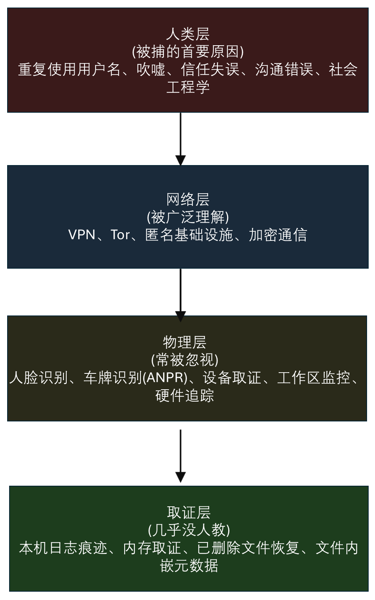
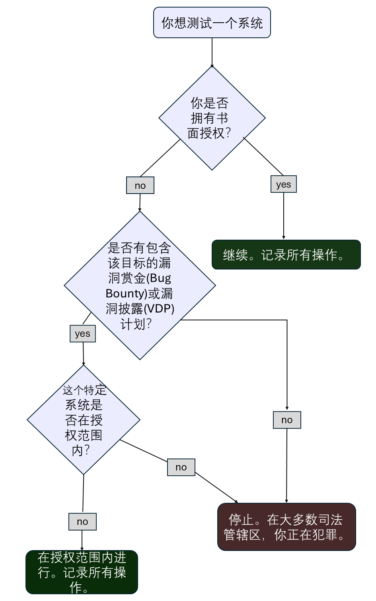
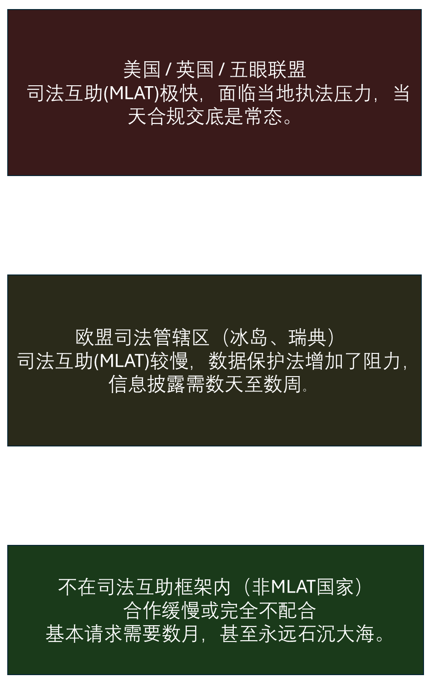
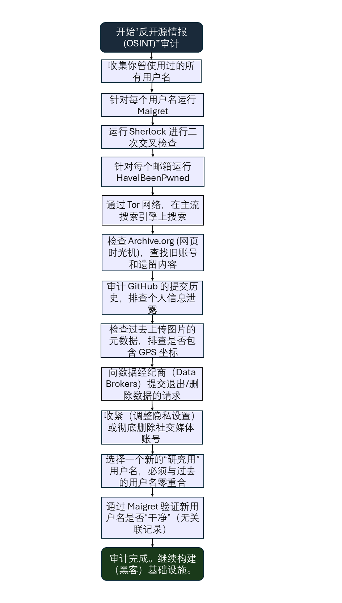
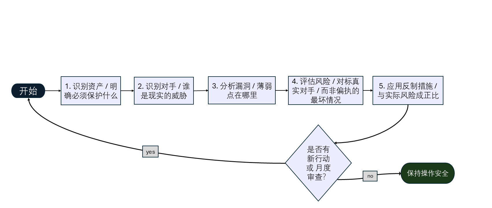

# 阶段 -1：作战安全与基础设施

**作者：** Sagar Biswas（[@SagarBiswas-MultiHAT](https://github.com/SagarBiswas-MultiHAT)）<br/>
**规范仓库：** [The BlackHAT Roadmap](https://github.com/SagarBiswas-MultiHAT/The-BlackHAT-roadmap)<br/>
**许可协议：** [CC BY-SA 4.0](https://github.com/SagarBiswas-MultiHAT/The-BlackHAT-roadmap/blob/main/LICENSE-DOCS)<br/>
**版本：** v1.1.0 · 2027 版<br/>
**状态：** 从这里开始。早于 Linux。早于 Python。早于一切。

<div align="right">

**习惯先于工具。纪律先于代码。活下来先于拿 shell。**

</div>


> “每一个落网的操作者，都不是因为漏洞利用失败。他们是被人的层面的某个决定烧掉的。”

---

## 目录

1. [为什么这一阶段必须放在最前面](#1-为什么这一阶段必须放在最前面)
2. [真实操作者、真实失败、真实教训](#2-真实操作者真实失败真实教训)
3. [法律框架：先读这一节](#3-法律框架先读这一节)
4. [反 OSINT：动手之前先弄清自己的暴露面](#4-反-osint动手之前先弄清自己的暴露面)
5. [威胁建模：想清楚再动手](#5-威胁建模想清楚再动手)
6. [通讯安全：最常见的被捕原因](#6-通讯安全最常见的被捕原因)
7. [手机与移动端 OPSEC](#7-手机与移动端-opsec)
8. [匿名基础设施搭建](#8-匿名基础设施搭建)
9. [匿名化链路：VPN、Tor 与层层串联](#9-匿名化链路vpntor-与层层串联)
10. [浏览器指纹：你正在被识别](#10-浏览器指纹你正在被识别)
11. [加密货币：为什么用 Monero，它是怎么运作的](#11-加密货币为什么用-monero它是怎么运作的)
12. [身份隔离与文体学](#12-身份隔离与文体学)
13. [安全研究操作系统](#13-安全研究操作系统)
14. [物理 OPSEC：大多数指南忽略的一层](#14-物理-opsec大多数指南忽略的一层)
15. [时间与行为模式 OPSEC：看不见的指纹](#15-时间与行为模式-opsec看不见的指纹)
16. [元数据：无声的杀手](#16-元数据无声的杀手)
17. [安全删除：不留痕迹](#17-安全删除不留痕迹)
18. [你碰过的每个系统上都有哪些日志](#18-你碰过的每个系统上都有哪些日志)
19. [你自己机器上的取证痕迹](#19-你自己机器上的取证痕迹) *（v1.0.0 新增）*
20. [冷启动与邪恶女佣：具体缓解措施](#20-冷启动与邪恶女佣具体缓解措施) *（v1.0.0 扩充）*
21. [出了事怎么办：燃烧协议](#21-出了事怎么办燃烧协议) *（v1.0.0 新增）*
22. [小组 OPSEC 与细胞结构](#22-小组-opsec-与细胞结构) *（v1.0.0 新增）*
23. [阶段 -1 里程碑清单](#23-阶段--1-里程碑清单)
24. [资源](#24-资源)

---

**周期：** 3-5 周 | **难度：** 入门 | **每周投入：** 10-20 小时 | **前置要求：** 无 | **完成率：** 90%（但只有 40% 的人真正做对了）

---

## 1. 为什么这一阶段必须放在最前面

大多数路线图把 OPSEC 塞到很后面的阶段，或者干脆跳过。这是灾难性的错误。

原因如下：**每一个落网的操作者，都不是因为漏洞利用失败。他们是被人的层面的某个决定烧掉的。** 复用了用户名。用私人邮箱发了邮件。用真手机发短信聊行动。用信用卡买了基础设施。在聊天室里吹嘘。把私人手机开机放在敏感地点附近。忘了清理 bash_history。

技术栈是能用的。人这一层塌了。

OPSEC 不是你学会入侵之后才去装的工具。它是一种在你写下第一行攻击代码**之前**就要刻进本能的纪律。早期养成的习惯会变成自动反应。事后才想补的习惯会一直别扭、一有压力就被跳过，并且恰好在失败代价最高的时候失效。

这个阶段放在最前面还有第二个原因：你的过去。在搭建新的安全基础设施之前，你得先知道自己已经暴露了什么。旧用户名。论坛发帖。你忘了的账号。带 GPS 元数据的图片。清理永远发生在建设之前。

**OPSEC 失效金字塔：** 大多数操作者先想到的是网络匿名。网络匿名只是中间那层。真正毁掉职业生涯的层，在它之上和之下。

<div align="center">
<table><tr><td>



</td></tr></table>
</div>

四层都需要关注。大多数指南只谈网络层。本阶段四层全讲。

现在就养成习惯。现在就审计过去。你在本阶段之后搭建的一切，都会因此更安全。

---

## 2. 真实操作者、真实失败、真实教训

认真研究这些案例。它们比任何技术教程都有教学价值。这些操作者每一个都有过硬的技术能力。他们每一个都栽在人的层面。

---

### 2.1 罗斯·乌布利希（Ross Ulbricht）：丝路

**他做了什么：** 一个价值 12 亿美元的暗网市场。技术架构很扎实：Tor 隐藏服务、比特币支付、PGP 通讯。

**他如何落网：** 2011 年，丝路上线之前，他用 `altoid` 这个用户名在一个比特币论坛上招 PHP 开发者。六个月后，另一个 `altoid` 在一个毒品论坛发帖提到“某个网站”。调查人员把两者关联了起来。同一个 `altoid` 账号绑定了一个包含他真名的 Gmail 联系邮箱。FBI 追踪到他在旧金山一家公共图书馆，趁他正在使用、笔记本开着且未锁屏时当场逮捕 —— 因为机器正在运行，全盘加密被完全绕过。

**他的失误：**
- 用户名在不同场景之间复用，中间相隔数年
- 用私人邮箱处理作战活动
- 在公共场所操作，且机器处于开机未锁状态
- 作战基础设施没有设置死手开关（dead man's switch）

**教训：** 即使间隔很久，用户名复用也是致命的。开机且未锁的机器会让全盘加密失效。装有监控摄像头的公共场所不是作战环境。

---

### 2.2 赫克托·泽维尔·蒙塞古尔（Sabu）：LulzSec

**他做了什么：** LulzSec 的核心成员，主导了对 Sony、Fox、CIA、Stratfor 等目标的高调攻击。

**他如何落网：** 某天夜里，在个人压力之下，他登录 IRC 频道时没有先走 Tor。真实 IP 暴露了几分钟。FBI 一直在监控那个频道。一次没有防护的连接就够了。被捕之后，他与 FBI 合作数月充当线人，导致他的 LulzSec 同伙落网。他的配合带来的逮捕数量，比 FBI 原本的调查还多。

**他的失误：**
- 他的 OPSEC 纪律需要主动用力维持，而不是本能反应；压力让他有了一次松懈
- 同伙的 OPSEC 同样是他的问题：他们的失误造成的暴露，他可以直接交给调查人员

**教训：** OPSEC 必须是本能，而不是每次做决定。“就这一次不走 Tor”会终结职业生涯。同伴的安全就是你的安全。

---

### 2.3 杰里米·哈蒙德（Jeremy Hammond）：AntiSec

**他做了什么：** 入侵 Stratfor（一家地缘政治情报公司），窃取 500 万封邮件以及 86 万客户的信用卡数据。

**他如何落网：** 身为 FBI 线人的 Sabu 把哈蒙德引向 Stratfor 这个目标。哈蒙德技术老练，基本把自己的真实身份隔离开了。但最终仍被指认，靠的是：Sabu 的直接证词（指认哈蒙德的 IRC 代号属于他见过面的真人）、他的 IRC 活跃时间与其真实所在地的关联，以及调查人员锁定地理范围后的实地监视。

**他的失误：**
- 信任了一个已经被策反的同伴
- 固定的活动时间形成了行为指纹
- 没有验证关键协作者是否已被策反的流程

**教训：** 信任本身就是攻击面。固定的时间就是身份信号。实地监视会顺着数字线索找上来。

---

### 2.4 分散蜘蛛团伙（Scattered Spider，2022-2023）

**他们做了什么：** 对 MGM 度假村、凯撒娱乐以及数十家其他大公司发动社会工程与网络入侵。手法包括 SIM 卡交换、冒充客服、MFA 疲劳攻击、中间人钓鱼（AiTM）。有据可查的损失超过 1 亿美元。

**他们如何落网：** 他们的技术手法确实老练，但作战安全却不行。核心失误：
- 协调沟通发生在 Discord 和 Telegram 上（2024 年之后这两者都不适合作战使用）
- 成员在调查人员监控的在线社区里吹嘘
- 多个成员在不同平台使用一致的网名
- 隔离做得很差，导致指认出一个人就能顺藤摸瓜找到其他人

逮捕从 2023 年开始。多名成员不到 21 岁。有几人完全是通过作战活动之外的社交媒体和论坛发帖被指认的。

**教训：** 没有 OPSEC 纪律的技术老练是不完整的。即使团队技术很强，安全通讯也不是可选项。网名隔离和网络隔离同等重要。

---

### 2.5 约书亚·舒尔特（Joshua Schulte）：CIA Vault 7 泄露

**他做了什么：** 作为 CIA 的软件工程师，舒尔特被指窃取了该局的 Vault 7 黑客工具（CIA 历史上最大的情报泄露），并于 2017 年交给 WikiLeaks。另外，他还因制作和持有儿童性虐待材料被定罪。

**他如何落网：** 技术层面的泄露本身只被部分归因于日志分析。真正让起诉无懈可击的，是对他自己机器的取证检查。调查人员发现：
- 他个人设备上的 VeraCrypt 加密容器，里面是他曾试图删除的证据
- 尽管清理过浏览器，仍有大量浏览历史和搜索记录
- 文件系统时间戳与他自述的时间线相互矛盾
- 未分配磁盘空间中留有证据（被删除但未被覆写的文件）
- 文档中嵌入的元数据把他与这些材料关联起来
- 他的私人笔记本里存有被"删除"但可恢复的聊天记录

他以为自己抹掉了痕迹。他没有。最致命的证据不是来自 CIA 的系统 —— 而是来自他自己的机器。

**他的失误：**
- 以为"删除"文件就等于移除
- 个人设备上没有使用全盘加密
- 浏览器历史即使清理过也能恢复
- 文档里的元数据没有清除
- 删除后没有擦除未分配的磁盘空间

**教训：** 删除不等于擦除。清理浏览器历史不等于擦除。除非显式清除，元数据会一直留在文件里。从第一天起就全盘加密不是可选项。你自己的机器往往是指向你的最有力证据。这个案例正是本阶段第 19 节的基础。

---

## 3. 法律框架：先读这一节

> 这一节放在所有技术内容之前。不是因为它最重要（不是，最重要的是 OPSEC），而是因为如果在开始之前不理解它，人们很容易在学习安全的过程中不知不觉触犯法律。

---

### 3.1 授权改变一切

整个路线图里的每一项技术都存在两种法律状态，取决于一个变量：**书面授权**。

有授权：渗透测试、安全研究、红队。合法。
没有授权：在几乎所有司法辖区都是刑事犯罪，无论你的意图如何、是否造成损害、是否只是“刚刚开始学”。

这条界线与伦理无关，与你多小心无关。它只关乎许可。一定要拿到书面文件。永远如此。

```
授权文件的最低要素：

- 所有相关方姓名（客户、测试者、公司）
- 范围：具体哪些系统、哪些 IP 段、哪些域名在授权范围内
- 排除范围：明确列出你不得触碰的系统
- 时间窗口：开始日期、结束日期、允许测试的时段
- 应急联系人：出问题时该联系谁
- 有法定授权权限的人签字
- 可收集哪些数据，以及必须如何处理
- 交战规则：允许使用哪些攻击类型

缺少以上任何一项要素，这份文件都不具备真正的法律效力。
```

<div align="center">
<table><tr><td>



</td></tr></table>
</div>

---

### 3.2 需要了解的主要法律

| 司法辖区 | 主要法律 | 覆盖内容 | 最高刑罚 |
|---|---|---|---|
| 美国 | 计算机欺诈与滥用法（CFAA） | 未经授权访问受保护计算机 | 每项罪名 10-20 年 |
| 英国 | 1990 年《计算机滥用法》 | 未经授权访问、修改 | 最高 10 年 |
| 欧盟 | NIS2 指令 + 各成员国刑法 | 关键基础设施攻击 | 因成员国而异 |
| 加拿大 | 刑法典第 342.1 条 | 未经授权使用计算机 | 最高 10 年 |
| 澳大利亚 | 1995 年刑法典法第 10.7 部分 | 未经授权访问与修改 | 最高 12 年 |

**美国司法部 2022 年 CFAA 善意研究指引：** 2022 年，美国司法部宣布不会依 CFAA 起诉善意的安全研究。请注意：这是**检察政策指引，不是法律**。任何后来的政府都可以推翻它。它不提供法律保护。不要把它当作护身符。

---

### 3.3 漏洞披露计划（VDP）与漏洞赏金范围

对自由研究者来说，HackerOne 或 Bugcrowd 上带书面范围的漏洞赏金项目，是在没有直接合同的情况下最接近“书面授权”的东西。

```
访问任何外部系统之前：

1. 确认存在 VDP（漏洞披露计划）或漏洞赏金项目，且有书面授权范围
2. 确认目标系统被明确列在范围内
3. 下载并保存当前的范围文档，附上时间戳
4. 只测试明确在范围内的目标
5. 如果发现范围边缘的漏洞：只上报，不利用
6. 为所有测试内容和测试方式保留带时间戳的记录
```

---

### 3.4 基础设施的司法辖区

你的基础设施托管在哪里，会直接影响执法机构迫使其服务商交出你数据的难易程度。

<div align="center">
<table><tr><td>



</td></tr></table>
</div>

选择基础设施的司法辖区，不是去找一个“安全”的国家。而是要制造法律摩擦，让强制披露的时间成本和金钱成本变高。

---

### 3.5 研究者的护盾：文档记录

无论你做的是授权渗透测试还是漏洞赏金研究，都要保留记录：
- 授权文件或 VDP 范围说明，下载并附上时间戳
- 你测了哪些系统、在什么时间测的记录
- 你发现了什么，以及你如何处理
- 与客户或项目方就发现的沟通记录
- 证明你始终在范围内的证据

在一位并没有亲历现场的检察官眼里，这些记录就是“正当研究者”和“罪犯”的区别。

---
## 4. 反 OSINT：动手之前先弄清自己的暴露面

> 在搭建新的安全基础设施之前，你得先知道自己已经暴露了什么。旧用户名。论坛发帖。带 GPS 元数据的图片。你十五岁时注册、后来忘了的账号。清理先于建设。跳过这一步，等于把完美的新 OPSEC 建在一处随时可能被调查人员拉出来的既有暴露之上。

---

### 4.1 反 OSINT 工作流程

<div align="center">
<table><tr><td>



</td></tr></table>
</div>

---

### 4.2 用户名审计工具

**Maigret** 是目前审计用户名在线存在的主力工具。它会搜索 3000 多个平台，生成结构化报告（HTML、PDF、JSON、CSV），并且误报过滤能力明显强于前代工具。

```bash
# 安装 Maigret
pip3 install maigret

# 基础扫描：在所有支持的网站上检查某个用户名
maigret your_username

# 生成 HTML 报告
maigret your_username --html --folderoutput ./maigret_report

# 一次扫描多个用户名
maigret username1 username2 username3

# 通过 Tor 进行扫描
maigret your_username --tor-proxy socks5://127.0.0.1:9050
```

文档：https://github.com/soxoj/maigret

**Sherlock** 大约搜索 300 个平台。用作交叉复核：
```bash
git clone https://github.com/sherlock-project/sherlock
cd sherlock
pip3 install -r requirements.txt
python3 sherlock your_username
```

**WhatsMyName** 提供网页界面，无需本地安装即可快速检查：https://whatsmyname.app

三个工具都对着你用过的每一个用户名跑一遍。把结果完整记录下来。

---

### 4.3 邮箱与身份暴露审计

```bash
# 把你用过的所有邮箱地址拿去比对已知的数据泄露库
# 网站：https://haveibeenpwned.com
# 请用 Tor Browser 操作 —— 检查自己邮箱时不要暴露真实 IP

# 检查 GitHub 提交历史里泄露的个人信息
# 如果你曾向 GitHub 提交过代码，你的邮箱可能留在提交记录里
git log --all --format="%ae %ce" | sort -u

# 在 archive.org 上核查旧账号
# 搜索：site:web.archive.org [你的用户名]
# 也搜索：site:archive.org [你的邮箱]

# 检查图片元数据：如果你在网上发过图片，
# 回想分享之前它们是否带有 GPS 坐标
exiftool your_image.jpg | grep -i "gps\|location\|lat\|lon"
```

---

### 4.4 数据经纪商退出

数据经纪商会聚合你的个人信息拿去卖，执法机构也会用这些服务。把自己从这些网站上撤下来。

**优先处理的退出目标（美国）：**
- Spokeo：https://www.spokeo.com/optout
- WhitePages：https://www.whitepages.com/suppression-requests
- BeenVerified：https://www.beenverified.com/faq/opt-out
- MyLife：https://www.mylife.com/ccpa/index.pubview
- Intelius：https://www.intelius.com/opt-out
- PeopleFinder：https://www.peoplefinder.com/optout.php
- Radaris：https://radaris.com/page/how-to-remove
- FastPeopleSearch：https://www.fastpeoplesearch.com/removal
- TruthFinder：https://www.truthfinder.com/opt-out/

**时间投入：** 手动退出主要经纪商需要 4-8 小时。
**自动化替代方案：** DeleteMe（约 129 美元/年）可自动完成流程，并监控是否被重新收录。

**重要：** 数据经纪商会在一段时间后把你重新收录。设一个日历提醒，每 6 个月重做一次这个审计。

---

### 4.5 社交媒体审计

对你拥有的每一个社交媒体账号：
- 把隐私设置调到最严
- 移除所有帖子里的位置信息
- 删除含 GPS 元数据的照片（先用 exiftool 检查）
- 删除暴露你的位置、雇主或日常作息规律的帖子
- 考虑彻底删除已经不再活跃使用的账号
- 删除前先下载账号数据存档（里面是平台掌握的你的一切）

---

## 5. 威胁建模：想清楚再动手

> 威胁建模就是清晰地想清楚：谁可能盯上你、他们想要什么、他们能做什么、以及怎么让他们的活更难干。它能同时防止偏执（做得太多）和疏忽（做得太少）。

---

### 5.1 五个问题

**问题 1：我需要保护什么？**

要具体。不要说“我的隐私”（太模糊）。把真实资产列出来：
- 你的法定身份（姓名、住址、与政府证件的关联）
- 你的物理位置
- 你研究的内容
- 你的作战工具和基础设施
- 你的社会关系和合作者
- 你的资金活动
- 你的通讯历史
- 你的过往活动（旧账号、旧研究）

**问题 2：我要防的是谁？**

| 对手 | 能力 | 对大多数研究者来说现实吗？ |
|---|---|---|
| 平台滥用团队 | 能看到你在其平台上的活动；封禁账号 | 现实，最常见 |
| 企业安全团队（SOC、应急响应） | 记录流量、检测入侵、关联事件 | 现实，只要打企业目标就会遇到 |
| 执法机构（地方、国家） | 向服务商发传票、扣押硬件、强制作证 | 现实，只要从事未授权活动 |
| 情报机构（NSA、GCHQ） | 大规模监控、流量关联、机密手段 | 不现实，除非你的工作与国家层面相关 |
| 同行竞争对手 | 手段和动机各不相同 | 视情况 |
| OSINT 研究者／记者 | 开源工具、社交图谱分析 | 如果你公开活跃，有可能 |

对大多数安全研究者来说，现实中的对手是**平台滥用团队**和**企业安全团队**，而不是 NSA。校准到正确的对手，才能决定你实际需要什么防护。为了防 NSA 级别的对手而偏执，既浪费时间，又会制造让你有压力时想跳过的 OPSEC 摩擦。

**问题 3：我需要在多大程度上保护它？**

在 HackerOne 目标上做授权研究的漏洞赏金猎人，与在未授权目标上测试的人，风险画像完全不同。对自己真实的活动程度要诚实。

**问题 4：如果防护失败，后果有多严重？**

- 被平台封号／账号停用：轻微，可恢复
- 被开盒／公开身份曝光：较重，部分可恢复
- 被目标组织提起民事诉讼：严重，花费高昂
- 被刑事起诉、逮捕、审判：极严重，改变一生
- 人身危险：取决于具体情境

**问题 5：我愿意接受多大的不便？**

每一层 OPSEC 都会增加不便。Tor 很慢。分设备很麻烦。Monero 交易要等。你不愿意接受的这部分不便，就是你在压力下会跳过的那一层。对自己的承受限度要诚实，并围绕它来设计 OPSEC。一套你能持续使用的不完美方案，胜过一次不方便就被你放弃的完美方案。

---

### 5.2 威胁建模流程

<div align="center">
<table><tr><td>



</td></tr></table>
</div>

---

### 5.3 对手校准示例

```
场景 A：在授权的 HackerOne 目标上工作的漏洞赏金研究员

现实中的对手：平台滥用团队（如果你违反范围）
现实中的对手：目标企业的 SOC（如果你触发了告警）
不现实的对手：NSA、GCHQ

合适的防护：
  - 独立的科研身份（用户名、邮箱）
  - 研究机上使用 VPN
  - 始终停留在项目授权范围内
  - 完整记录你的测试过程

对这个场景属于过度防护（留给更高风险的工作）：
  - 完整的 Qubes + Whonix 组合
  - 用 Monero 购买的 VPS
  - 物理隔离的硬件

---

场景 B：测试未授权目标、练习高级技战术

现实中的对手：有传票权的执法机构
现实中的对手：目标组织里比对日志的应急响应团队

合适的防护：全套。本阶段的所有内容。没有例外。
重定向架构。Monero 基础设施。Qubes 环境。
所有连接走 Tor。通讯安全完整落地。
```

---

## 6. 通讯安全：最常见的被捕原因

> 如果本阶段只有一节能救你，那就是这一节。因通讯记录落网的操作者，比因技术失误落网的多得多。分散蜘蛛团伙的技术手法非常出色。他们的通讯是他们的覆灭点。

---

### 6.1 平台威胁光谱（2027）

| 平台 | 加密 | 服务器日志 | 执法配合度 | 风险级别 |
|---|---|---|---|---|
| 短信 | 运营商层面无加密 | 记录详尽 | 配合 | 极高 |
| WhatsApp | 端到端加密内容（Signal 协议） | 元数据记录详尽 | 在元数据上配合 | 高 |
| Telegram（普通聊天） | 无 —— 服务器能读内容 | 全量记录 | 2024 年后主动配合 | 极高 |
| Telegram（私密聊天，仅 1:1） | 端到端加密 | 仅私密聊天记录极少 | 无法提供私密聊天内容 | 高（元数据仍在） |
| Discord | 无 | 记录详尽 | 高度配合 | 极高 |
| Signal | 端到端加密 + 密封发件人 | 仅注册日期和最后连接时间 | 无法提供消息内容 | 低 |
| SimpleX Chat | 端到端加密，无用户 ID | 无中心服务器 | 无数据可提供 | 极低 |
| Briar | 端到端加密 + Tor 路由 | 无中心服务器 | 无数据可提供 | 极低 |
| Session | 端到端加密，无需手机号 | 去中心化 | 无身份数据 | 低 |
| Matrix/Element（自建） | 端到端加密（可选） | 取决于你自己的服务器 | 只有你自己服务器的日志 | 极低（自建情况下） |
| ProtonMail | Proton 用户之间端到端加密 | 记录元数据 | 受瑞士法律约束 —— 会部分配合 | 中 |

---

### 6.2 Telegram：硬性禁止（2027）

**任何层级的作战用途，都不要用 Telegram。**

2024 年 8 月，帕维尔·杜罗夫在法国被捕。这对 Telegram 用户造成的影响是永久性的：

- 杜罗夫 2024 年 9 月公开表示：在多数司法辖区，只要收到合法法律请求，Telegram 会向执法机构提供用户数据（IP 地址、手机号）
- 此后 Telegram 已在欧盟、英国、美国的执法请求中配合了数千次
- Telegram 的私密聊天仅对 1:1 会话提供端到端加密 —— **不存在群组私密聊天**
- 所有普通聊天（含全部群聊）都以 Telegram 可读的形式存放在其服务器上
- Telegram 普通聊天使用的是自家的 MTProto 实现，而不是 Signal 协议

2024 年之前那种“Telegram 有不予配合政策”的假设，已经不再成立。就执法配合度而言，请把 Telegram 等同于 WhatsApp 或 Discord。

**作战通讯只能用：** Signal、SimpleX Chat、Briar，或自建 Matrix。别的都不行。

---

### 6.3 Signal：主要的安全通讯工具

Signal 是作战通讯的黄金标准。
- 使用 Signal 协议进行端到端加密
- 密封发件人：Signal 服务器不知道是谁给谁发了消息
- 阅后即焚：配置起来；按你的情形用最短的时限
- 元数据极少：在收到法律程序时，Signal 能提供的只有注册日期和最后连接时间

Signal 的弱点：注册需要手机号。用一个在 Tor 上注册的 VoIP 号码（JMP.chat，接受 Monero），不要用你的真实号码。

```
Signal 的作战用途配置：

设置 > 隐私：
  屏幕锁定：开启
  屏幕安全（防止截屏）：开启
  匿名键盘：开启

设置 > 隐私 > 高级：
  始终中继通话：开启（防止向通话对方暴露你的 IP）
  密封发件人：开启（默认开启，保持开启）

对每一个会话：
  阅后即焚消息：最长 1 周；推荐 1 天；敏感工作用 1 小时

设置 > 通知：
  显示内容："不显示名称或消息"
```

---

### 6.4 SimpleX Chat、Session 与 Briar

**SimpleX Chat（完全没有用户 ID）：**
SimpleX 没有用户 ID。没有手机号，没有用户名，没有邮箱地址。每个会话都会生成一个新的队列标识符。服务器只负责中转消息，无法把不同会话关联起来。当你需要彻底切断身份关联时，它是最佳选择。
下载：https://simplex.chat

**Session（不需要手机号）：**
Session 使用去中心化网络中转消息。注册时不要求手机号。
下载：https://getsession.org

**Briar（走 Tor，可离线工作）：**
Briar 把所有通讯都经 Tor 转发。必要时还能在蓝牙和 WiFi 上工作，不需要互联网接入。
下载：https://briarproject.org

---

### 6.5 用 GPG 加密邮件

如果你必须用邮件做敏感通讯，GPG 加密是必需的，不是可选项。

```bash
# 为你的研究身份生成一对 GPG 密钥
gpg --full-generate-key
# 选择：RSA and RSA，4096 位，有效期 1 年
# 使用你的研究身份名称和邮箱，不要用真名

# 导出公钥以便分享给他人
gpg --armor --export your_research_email@proton.me > research_pubkey.asc

# 导入别人的公钥
gpg --import their_pubkey.asc

# 给收件人加密一条消息
gpg --encrypt --recipient their_email@domain.com --armor message.txt

# 解密发给你的消息
gpg --decrypt encrypted_message.asc

# 签名一条消息（证明它来自你）
gpg --sign --armor message.txt

# 验证已签名的消息
gpg --verify signed_message.asc
```

---

## 7. 手机与移动端 OPSEC

> 就 OPSEC 而言，你的手机是你拥有的最危险的设备。它 24 小时知道你在哪。它绑定着你的真实身份。它运行的操作系统，是那些会配合执法机构收集数据的厂商设计的。

---

### 7.1 为什么手机是关键 OPSEC 载体

- **位置数据：** 基站会持续对你的位置做三角定位。这些数据由运营商保留，并受法律请求约束。你的真实手机不能出现在敏感行动附近。
- **IMEI 追踪：** 设备的 IMEI（硬件标识）会广播给它连接过的每一个基站并被记录。换 SIM 卡不会改变 IMEI。
- **IMSI 捕获器（Stingray）：** 执法机构和技术成熟的对手会部署冒充基站的 IMSI 捕获器。它们会抓取范围内所有手机的 IMEI 和 IMSI。Stingray 常部署在重点目标附近、抗议现场和法院建筑周边。
- **探测请求：** WiFi 扫描时，你的设备会广播自己的 MAC 地址和它之前连过的 SSID 列表。公共场所的被动扫描器可以记录这些信息。
- **云备份：** 默认情况下，iOS 和 Android 会备份到 Apple/Google 云端。执法机构凭一份标准法院命令就能调取这些备份。
- **生物特征强制解锁：** 在很多司法辖区，执法机构可以合法强制你用指纹或人脸解锁设备。在美国，PIN 码可能受第五修正案保护（相关争议仍在诉讼中，各辖区不同）。生物特征一般不受保护。

---

### 7.2 IMSI 捕获器：你需要知道的

IMSI 捕获器是一种冒充基站的设备。你的手机会自动连上它。它能抓取：
- 你的 IMEI（硬件标识：与设备永久绑定）
- 你的 IMSI（与你的 SIM 卡绑定的标识）
- 你相对于捕获器位置的位置
- 某些配置下：通话内容和短信内容

**防御：**
- GrapheneOS + 仅 LTE 模式（关闭 2G，因为 2G 对 IMSI 捕获器毫无防护）
- 在敏感地点不使用时放进法拉第袋
- 尽可能不要带手机进入敏感地点

---

### 7.3 GrapheneOS：作战用 Android

GrapheneOS 是为 Google Pixel 设备打造的加固版 Android 系统。它是目前作战用手机的最佳选择。

```
安装步骤：

1. 购买一台 Google Pixel（当前世代）。
   买无锁版，尽量用现金。

2. 开启 OEM 解锁：
   设置 > 开发者选项 > OEM 解锁

3. 使用网页安装器：https://grapheneos.org/install/web
   安装器会自动处理全部流程。

4. 安装完成之后：
   - 不要登录任何 Google 账号
   - 安装 F-Droid：https://f-droid.org
   - 如果你确实需要某个 Google Play 应用：
     设置 > 应用 > 安装 Google Play（沙箱化，最小权限）

安装后的关键安全设置：

   用 PIN 码，不要用指纹/人脸
     （多数司法辖区存在强制解锁生物特征的风险）

   自动重启：18 小时
     （设备长时间无人看管时会定期锁定）

   胁迫 PIN：
     设置 > 安全 > 屏幕锁定 > 胁迫密码
     （输入特定 PIN 时立即清空设备；
       用于你在物理或法律压力下被强制解锁的场合）

   仅 LTE 模式：禁用 2G
     设置 > 网络和互联网 > SIM 卡 > 首选网络类型
     设为仅 LTE。这会消除 IMSI 捕获器所利用的 2G 回落。

   USB 外设：不用时关闭
     （减少 USB 攻击面）

   定位服务：默认关闭；按应用单独授权

   云备份：禁用（GrapheneOS 默认不向 Google 备份）

   传感器：对不需要的应用关闭摄像头和麦克风权限

   漏洞利用防护：默认开启，不要关闭
```

---

### 7.4 不关联身份地购买 SIM 卡

**美国：** 预付 SIM 卡可以在便利店用现金购买。主流预付运营商通常不需要身份证明就能激活。在远离住宅的店里用现金买。

**用于注册 Signal：** 用 VoIP 号码而不是真实 SIM 卡。
- JMP.chat 接受 Monero，提供基于 XMPP 的号码用于接收短信
- MySudo 提供相互隔离的多个号码
- 在 Tor 上注册任何 VoIP 服务

---

### 7.5 设备隔离规则

```
规则 1：绝不把个人手机和作战手机同时带到敏感地点。
        两台设备同时开机且相隔很近：基站日志会把它们关联到
        同一个物理位置，从而把你的作战设备关联到你的真实身份。

规则 2：在敏感地点，先关闭个人手机，再打开作战手机。
        或者干脆把个人手机留在家里。

规则 3：高敏感场合使用法拉第袋。
        法拉第袋能屏蔽所有无线电信号（蜂窝、WiFi、蓝牙、GPS）。
        成本：20-60 美元。
        信任它之前先测试：把手机放进袋子，然后拨打它。
        如果响了，说明袋子有问题。
        蜂窝、WiFi、蓝牙要分别测试。

规则 4：关掉你不需要的功能。
        蓝牙：不用时关闭
        WiFi：不用时关闭
        定位服务：默认关闭
        AirDrop / 附近分享：关闭

规则 5：物理遮挡摄像头。
        摄像头贴片很便宜，用起来。
        在 GrapheneOS 上：对不需要的应用
        撤销摄像头和麦克风权限。
```

---

## 8. 匿名基础设施搭建

> 目标：搭起一套无法被轻易归因到你身上的基础设施。“轻易”是关键词。现实中的对手是有标准法律手段的企业安全团队或执法机构，而不是机密情报项目。

---

### 8.1 支付链

<div align="center">
<table><tr><td>


</td></tr></table>

每一步都重要。跳过任何一步都会削弱整条链。

</div>

---

### 8.2 接受 Monero 的 VPS 服务商

**匿名作战绝不要用：** AWS、GCP、Azure、DigitalOcean、Linode、Vultr。
原因：总部或基础设施在美国、执法配合迅速、要求实名认证的支付方式。

| 服务商 | 司法辖区 | 是否接受 XMR | 备注 |
|---|---|---|---|
| Njalla | 瑞典 | 是 | 注重隐私；以自己的名义持有域名；由海盗湾联合创始人 Peter Sunde 创办 |
| 1984 Hosting | 冰岛 | 是 | 冰岛隐私法强；历史上 MLAT 协助较慢 |
| BuyVM | 英属维尔京群岛 | 是 | BVI 辖区增加法律摩擦 |
| Privex | 特立尼达和多巴哥 | 是 | 注重隐私 |

---

### 8.3 VPS 搭建流程

```
1. 只用 Monero 购买 VPS。
   绝不要用信用卡、PayPal、银行转账或直接使用比特币。

2. 用 Tor Browser 访问服务商并完成购买。
   创建账号时不要使用你的真实 IP。

3. 只通过 Tor 或匿名购买的 VPN 连接你的 VPS。
   绝不从家里的 IP 连。一次都不行。哪怕是"只想快速看一眼"。

4. 只用 SSH 密钥认证。不要用密码。
```

```bash
# 生成 Ed25519 SSH 密钥对
# Ed25519 优于 RSA：密钥更小、速度更快、安全性等同
ssh-keygen -t ed25519 -C "ops_key"
# 私钥保存在加密卷上
# 把公钥加入 VPS 的 authorized_keys
```

---

### 8.4 VPS 加固脚本

```bash
#!/bin/bash
# 首次登录新 VPS 后以 root 身份运行
# 环境：Ubuntu 24.04 LTS

# 创建非 root 的运维用户
useradd -m -s /bin/bash operator
mkdir -p /home/operator/.ssh
cp ~/.ssh/authorized_keys /home/operator/.ssh/
chown -R operator:operator /home/operator/.ssh
chmod 700 /home/operator/.ssh
chmod 600 /home/operator/.ssh/authorized_keys
usermod -aG sudo operator

# 关闭 root 远程登录和密码认证
sed -i 's/^PermitRootLogin.*/PermitRootLogin no/' /etc/ssh/sshd_config
sed -i 's/^PasswordAuthentication.*/PasswordAuthentication no/' /etc/ssh/sshd_config

# 把 SSH 换到高端非标准端口（在 49152-65535 范围内随机挑一个）
# 把 54231 换成你自己选的端口
SSH_PORT=54231
sed -i "s/^#Port 22/Port ${SSH_PORT}/" /etc/ssh/sshd_config

# 防火墙：默认拒绝所有入站，只放行你选的 SSH 端口
apt update && apt install -y ufw unattended-upgrades fail2ban

ufw default deny incoming
ufw default allow outgoing
ufw allow ${SSH_PORT}/tcp comment 'SSH 非标准端口'
ufw --force enable

# 自动安装安全更新
dpkg-reconfigure --priority=low unattended-upgrades

# fail2ban：封禁反复失败的 SSH 登录尝试
systemctl enable fail2ban
systemctl start fail2ban

# 降低 SSH 日志详细程度
sed -i 's/^LogLevel.*/LogLevel QUIET/' /etc/ssh/sshd_config

# 关闭会泄露操作系统版本的 SSH banner
echo "DebianBanner no" >> /etc/ssh/sshd_config

# 限制 SSH 使用的加密算法（移除弱算法）
cat >> /etc/ssh/sshd_config << 'SSHEOF'
KexAlgorithms curve25519-sha256,curve25519-sha256@libssh.org
Ciphers chacha20-poly1305@openssh.com,aes256-gcm@openssh.com
MACs hmac-sha2-256-etm@openssh.com,hmac-sha2-512-etm@openssh.com
SSHEOF

systemctl restart sshd
echo "加固完成。请退出，然后用 operator 身份从 ${SSH_PORT} 端口重连。"
```

**关于端口选择的说明：** 高端口随机值（49152-65535）比 22 或 2222 端口更难被自动化扫描发现。在这个区间里挑一个随机数并固定使用。若要在这个端口上做到最大隐蔽，可以考虑加端口敲门（fwknop 软件包）：端口默认完全关闭，直到收到一串特定的 UDP 包序列，才会短暂放行你的 SSH 连接。

---

### 8.5 域名注册

```
方案一：Njalla（推荐）
  Njalla 以自己的名义注册域名，再把使用权转售给你。
  你的身份永远不会出现在 WHOIS 记录里。
  接受 Monero。
  https://njal.la/domains/

方案二：Epik
  接受加密货币，提供 WHOIS 隐私保护。
  https://www.epik.com
```

**C2 域名的选择策略：**

```
1. 老域名更容易混入正常流量。有 1 年以上历史的域名具备：
   - 与其声称类别相符的历史 DNS 记录
   - 更不引人怀疑的流量模式
   - 可能已被企业代理缓存过分类结果

2. 与类别匹配的域名能混入企业流量。
   目标类别：IT/计算机、商业/金融、科技、SaaS
   避开："未分类"（会引发审查）、"匿名代理/VPN"（直接被封）

3. 购买前的检查：
   - Web Archive 历史记录：https://web.archive.org
   - 黑名单检查：https://urlvoid.com
   - DNS 信誉：https://mxtoolbox.com/SuperTool.aspx

4. 向分类服务提交申诉，以绕过企业代理过滤：
   - Bluecoat/Symantec：https://sitereview.bluecoat.com
   - Cisco Talos：https://talosintelligence.com/reputation
   - Fortinet：https://www.fortiguard.com/webfilter
```

---

### 8.6 重定向器架构

最重要的基础设施原则：**你的真实 teamserver IP 绝不能暴露给目标网络。** 用一个牺牲性的重定向器作为对外暴露层。

<div align="center">
<table><tr><td>


</td></tr></table>

如果重定向器被烧：换掉它。开一台新 VPS、注册新域名。teamserver 保持干净。

</div>


**Apache mod_rewrite 重定向器：**

```bash
apt install -y apache2
a2enmod rewrite proxy proxy_http ssl headers

cat > /etc/apache2/sites-available/redirector.conf << 'EOF'
<VirtualHost *:443>
    ServerName your-c2-domain.com
    SSLEngine on
    SSLCertificateFile /etc/letsencrypt/live/your-c2-domain.com/fullchain.pem
    SSLCertificateKeyFile /etc/letsencrypt/live/your-c2-domain.com/privkey.pem

    RewriteEngine On
    # 只代理匹配你 C2 URI 模式的请求
    RewriteCond %{REQUEST_URI} ^/api/v1/update.*$ [NC]
    RewriteRule ^(.*)$ http://TEAMSERVER_IP%{REQUEST_URI} [P,L]

    # 非 C2 流量：跳转到正规网站（不留溯源线索）
    RewriteRule ^(.*)$ https://www.microsoft.com/ [L,R=302]

    # 抹掉可识别的响应头
    RequestHeader unset X-Forwarded-For
    Header always unset X-Powered-By
    Header always unset Server
</VirtualHost>
EOF

a2ensite redirector.conf
systemctl reload apache2
```

**Nginx 重定向器替代方案：**

```nginx
server {
    listen 443 ssl;
    server_name your-c2-domain.com;

    ssl_certificate /etc/letsencrypt/live/your-c2-domain.com/fullchain.pem;
    ssl_certificate_key /etc/letsencrypt/live/your-c2-domain.com/privkey.pem;

    # C2 流量：反向代理到 teamserver
    location ~* ^/(api|sync|update)/ {
        proxy_pass http://TEAMSERVER_IP;
        proxy_set_header Host $host;
        proxy_hide_header X-Powered-By;
    }

    # 非 C2 流量：跳转到正规网站
    location / {
        return 302 https://www.google.com/;
    }
}
```

**Let's Encrypt 证书：**

```bash
apt install -y certbot python3-certbot-apache
certbot --apache -d your-c2-domain.com

# 自动续期（加入 crontab）
echo "0 12 * * * certbot renew --quiet" | crontab -
# 验证续期流程是否正常
certbot renew --dry-run
```

---

### 8.7 洋葱服务 C2：最强的架构选项

把 C2 teamserver 作为 Tor 隐藏服务（.onion）运行，可以彻底消除“出口到入口”的流量关联攻击。因为没有出口节点，所以没人能同时观测到进入流量和目标端。

<div align="center">
<table><tr><td>


</td></tr></table>
</div>

```bash
# 在 teamserver 的 VPS 上配置 Tor 隐藏服务
# 编辑 /etc/tor/torrc：
nano /etc/tor/torrc

# 加入以下行（把 8080 换成你的 C2 端口）：
HiddenServiceDir /var/lib/tor/c2_service/
HiddenServicePort 80 127.0.0.1:8080
HiddenServiceVersion 3

# 重启 Tor
systemctl restart tor

# 查看你的 .onion 地址
cat /var/lib/tor/c2_service/hostname
# 输出：[something].onion
# 这就是你的隐藏服务地址

# 你的植入程序连接 [something].onion:80
# 流量全程走 Tor，你的 VPS 真实 IP 永远不会暴露给目标
```

**权衡：**
- 比明网重定向器慢（Tor 每跳延迟 100-500ms）
- 植入程序必须自带 Tor，或通过 Tor 转发
- .onion 地址很长，某些载荷类型里不好嵌入
- 对于阶段 4 的 C2 工作：可以考虑混合方案，明网重定向器保证速度，.onion 用于敏感行动

---

### 8.8 家庭网络隔离

<div align="center">
<table><tr><td>


</td></tr></table>
</div>

**方案 A：专用的物理研究路由器（推荐，约 40 美元）**

买一台 TP-Link Archer A7 或类似的能刷 OpenWrt 的路由器。把它和你的个人路由器分开接入家庭网络。在路由器层面配置 Mullvad 或 IVPN（OpenWrt 的 LuCI VPN 插件）。所有实验流量自动经 VPN 出口。

还可以在研究路由器上配置本地递归 DNS 解析器（unbound），以避免在路由器层面发生 DNS 泄露：

```bash
# 在研究用 OpenWrt 路由器上安装 unbound
opkg install unbound-daemon

# 配置 /etc/unbound/unbound.conf 作为本地递归 DNS
# 它会直接查询 DNS 根服务器，绕过任何上游 DNS 服务商
cat > /etc/unbound/unbound.conf << 'EOF'
server:
    interface: 127.0.0.1
    port: 5335
    do-ip4: yes
    do-ip6: no
    do-udp: yes
    do-tcp: yes
    root-hints: "/etc/unbound/root.hints"
    harden-dnssec-stripped: yes
    use-caps-for-id: no
    edns-buffer-size: 1232
    prefetch: yes
    num-threads: 1
    so-rcvbuf: 1m
EOF

# 把路由器的 dnsmasq 指向 5335 端口上的 unbound
```

**方案 B：VLAN 分段**
企业级家用路由器支持这种方式（Ubiquiti UniFi、Netgear Orbi Pro）。为个人流量、研究流量、分析流量分别划 VLAN。

**虚拟机网络规则（不可协商）：**

```
NAT 模式：虚拟机通过主机的网络栈访问互联网。
  如果主机连着 VPN，虚拟机的流量也走 VPN。
  大多数研究用虚拟机都用这个模式。

桥接模式：虚拟机在家里网络上表现为一台独立设备。
  你的 ISP 能直接看到虚拟机的流量。
  研究用虚拟机绝对不要用桥接模式。

仅主机模式：虚拟机只能和主机通信，没有互联网。
  用于：恶意软件分析虚拟机、沙箱、隔离测试环境。

内部网络模式：虚拟机之间只能互相通信。
  用于：多机实验场景（受害机和攻击机在同一网段）。
```

---

### 8.9 基础设施卫生规则

```
规则 1：一次行动、一台 VPS、一个域名。
  绝不在不同行动之间复用基础设施。
  只要彼此独立，一次行动中烧掉的 VPS 就不会污染另一次。

规则 2：为你搭建过和拆除过的所有基础设施保留加密台账。
  只存在本地，不要放在任何云服务里。
  记录内容：VPS IP、域名、创建日期、拆除日期、用途。

规则 3：行动结束后拆除基础设施。
  不要让没有用途的基础设施继续在线运行。
  它会不断累积日志数据，日后被发现时还会成为溯源跳板。

规则 4：绝不直接访问你的 teamserver。一定要经过重定向器或跳板机。

规则 5：为自己的基础设施建档，以便在日志里认出它。
  清楚自己的 IP 段、自己的域名、自己的证书。

规则 6：关注 VPS 服务商的"搜查令金丝雀"声明。
  Mullvad、ProtonVPN 以及注重隐私的 VPS 服务商会维护金丝雀声明
  （公开声明他们未收到传票或封口令）。
  如果声明消失或措辞改变，就把它当作该服务商
  已被送达法律程序的信号。
  每月检查一次：https://www.eff.org/pages/warrant-canary-faq
```

---
## 9. 匿名化链路：VPN、Tor 与层层串联

> 弄清每一层保护了什么、没保护什么，以及如何正确地把它们串起来 —— 这是真匿名与虚假安全感的区别。

---

### 9.1 链路架构

<div align="center">
<table><tr><td>


</td></tr></table>
</div>

---

> 📚 **架构蓝图：** 关于把这条链路整合在一起的速查指南和 7 层验证清单，见 **[Maximum Anonymity Workflow](../black-bag/Max_Anonymity_Workflow.md)**。

---

### 9.2 VPN 选择（2027）

**VPN 能做什么：** 让你的流量对运营商不可见，并在日志里用 VPN 服务器的 IP 取代你的 IP。把信任从运营商转移到 VPN 服务商。

**VPN 不能做什么：** 它不能让你完全匿名。VPN 服务商能看到你的 IP 和你的流量（如果没有进一步加密）。要选择有无日志政策、经过独立审计、且所在辖区能提供法律摩擦的服务商。

| 服务商 | 所在地 | 接受 XMR | 审计情况 | 关键说明 |
|---|---|---|---|---|
| Mullvad | 瑞典 | 是 | 多次独立审计 | 不需要邮箱；只有账号编号；隐私最佳 |
| IVPN | 直布罗陀 | 是 | 经独立审计 | 数据收集极少；支持多跳 |
| ProtonVPN | 瑞士 | 是 | 经独立审计；开源 | 透明的金丝雀声明；有免费档 |
| AirVPN | 意大利 | 是 | 社区审计 | 支持端口转发；配置选项丰富 |

**WireGuard 配置（推荐协议）：**

```bash
# 安装 WireGuard
apt install -y wireguard

# 从 VPN 账号后台下载服务商提供的 WireGuard 配置文件
# 把它复制到 /etc/wireguard/wg0.conf

# 连接 VPN
wg-quick up wg0

# 断开连接
wg-quick down wg0

# 开机自启（研究机用）
systemctl enable wg-quick@wg0
```

**断线保护（强制项）：**

```bash
# 在你的 WireGuard 配置里加入 PostUp 和 PreDown 规则
# 作用：VPN 掉线时封锁所有流量（关键：防止断连时泄露真实 IP）

[Interface]
PrivateKey = YOUR_PRIVATE_KEY
Address = 10.x.x.x/32
DNS = 10.x.x.1
PostUp = iptables -A OUTPUT ! -o %i -m mark ! --mark $(wg show %i fwmark) -m addrtype ! --dst-type LOCAL -j REJECT
PreDown = iptables -D OUTPUT ! -o %i -m mark ! --mark $(wg show %i fwmark) -m addrtype ! --dst-type LOCAL -j REJECT

[Peer]
# ……其余 peer 配置
```

**测试断线保护：** 手动断开 VPN。确认所有互联网流量都停了（`curl ifconfig.me` 应该失败或超时）。如果它返回了你的真实 IP，说明断线保护没生效。

---

### 9.3 Tor 的安装与配置

Tor 会让你的流量经过至少三个中继（入口、中间、出口），每一跳都重新加密，因此没有任何单个中继同时知道你是谁、以及你在访问什么。

```bash
# 安装 Tor
apt install -y tor

# 启动 Tor 并设置开机自启
systemctl start tor
systemctl enable tor

# 确认 Tor 正在运行
ss -tlnp | grep 9050
# 应该显示：LISTEN on 127.0.0.1:9050

# 配置 proxychains4 把流量导向 Tor
nano /etc/proxychains4.conf
# 设置以下选项：
#   strict_chain
#   proxy_dns
#   [ProxyList]
#   socks5 127.0.0.1 9050

# 测试 Tor 路由是否生效
proxychains4 curl https://check.torproject.org | grep Congratulations
# 应该返回："Congratulations. This browser is configured to use Tor."

# 通过 Tor 做 DNS 泄露测试
proxychains4 curl https://dnsleaktest.com/json
# 不应该出现任何运营商的 DNS 服务器
```

---

### 9.4 串联配置

**VPN → Tor（多数场景推荐）：**

```
你的机器 --> VPN --> Tor 网络 --> 目标

防范的对象：
        运营商知道你用了 Tor（在 Tor 使用本身就可疑的国家里很重要）
        Tor 入口节点知道你的真实 IP（它看到的是 VPN 的 IP）
        VPN 服务商知道你的最终目的地

你的 ISP 看到：发往 VPN 的加密流量
VPN 服务商看到：你的 IP + Tor 流量（若为无日志服务商：什么都不留）
Tor 入口节点看到：VPN 的 IP（不是你的真实 IP）
目标看到：Tor 出口节点的 IP
```

**Tor → VPN（仅限特定场景）：**

```
你的机器 --> Tor --> VPN --> 目标

使用场景：当目标屏蔽 Tor 出口节点时
风险：VPN 服务商会看到你的流量内容
      （但它仍然看不到你的真实 IP，因为流量是经 Tor 到达它的）
```

**proxychains 配合 Tor（让任何工具都走 Tor）：**

```bash
proxychains4 nmap -sT -Pn target.example.com
proxychains4 curl https://target.example.com
proxychains4 python3 exploit.py
proxychains4 sqlmap -u "https://target.example.com/?id=1"
```

---

### 9.5 Tor 网桥与流量混淆（受限制环境用）

在某些环境里，Tor 会被封锁，或者它的使用本身就能被检测到：
- 存在深度包检测的国家（中国、伊朗、俄罗斯、白俄罗斯）
- 封锁 Tor 出口节点 IP 的企业网络
- 会标记 Tor 流量特征的运营商

Tor 网桥是未公开的中继，更难被封锁。混淆协议会把 Tor 流量伪装成普通 HTTPS 或其他被允许的流量。

```bash
# 从 Tor Project 获取网桥：
# 方式一：https://bridges.torproject.org —— 申请 obfs4 网桥
# 方式二：用 Gmail 或 Riseup 向 bridges@torproject.org 发信
#   邮件主题：get transport obfs4
# 方式三：在 Tor Browser 内操作：
#   设置 > 连接 > 使用网桥 > 向 torproject.org 申请网桥

# 安装 obfs4proxy：
apt install -y obfs4proxy

# 在 torrc 里配置网桥：
nano /etc/tor/torrc

# 加入以下行：
UseBridges 1
ClientTransportPlugin obfs4 exec /usr/bin/obfs4proxy
Bridge obfs4 IP:PORT FINGERPRINT cert=XXXXXX iat-mode=0
# （替换成你在 bridges.torproject.org 拿到的真实网桥行）

systemctl restart tor
```

| 混淆协议 | 规避什么 | 局限 |
|---|---|---|
| obfs4 | 能识别 Tor 流量特征的基础 DPI | 国家级的大规模主动探测 |
| meek | 运营商层面的封锁（靠 CDN，看起来像微软/亚马逊流量） | 非常慢；高带宽场景不实用 |
| Snowflake | 运营商层面的封锁（用 WebRTC，看起来像浏览器间通信） | 资源充足的国家级主动探测 |
| WebTunnel | 看起来像访问普通网站的 HTTPS；除非封掉那个站点，否则很难拦 | 主动测量活动 |

对多数威胁模型来说：**obfs4 网桥就够了。**

---

### 9.6 防止 DNS 泄露

DNS 泄露指的是 DNS 查询绕过了你的 VPN 或 Tor 隧道，直接发给运营商的 DNS 服务器，从而暴露你在访问哪些域名。

```bash
# 检测 DNS 泄露（通过 Tor Browser 或 proxychains 运行）
# https://dnsleaktest.com
# https://ipleak.net

# 在研究用操作系统上配置加密 DNS
# 编辑 /etc/systemd/resolved.conf：
[Resolve]
DNS=1.1.1.1#cloudflare-dns.com 9.9.9.9#dns.quad9.net
DNSOverTLS=yes
DNSSEC=yes

systemctl restart systemd-resolved

# 备选方案：用 dnscrypt-proxy 实现 DNS-over-HTTPS
apt install -y dnscrypt-proxy
systemctl enable dnscrypt-proxy
systemctl start dnscrypt-proxy
```

---

### 9.7 链路端到端验证

```bash
# 第一步：确认你的基础 IP（接 VPN 或 Tor 之前）
curl https://ifconfig.me
# 记下来。这就是你绝对不能暴露的那个 IP。

# 第二步：连接 VPN，确认 IP 变了
wg-quick up wg0
curl https://ifconfig.me
# 应该显示 VPN 服务器 IP，而不是你的真实 IP

# 第三步：让流量走 Tor
systemctl start tor
proxychains4 curl https://ifconfig.me
# 应该显示某个 Tor 出口节点的 IP

# 第四步：测试通过 Tor 的 DNS 泄露
proxychains4 curl -s https://dnsleaktest.com/json | python3 -m json.tool
# 应该显示 Tor 出口节点的 DNS；不应出现任何能定位运营商的 DNS

# 第五步：测试 WebRTC 泄露（浏览器层面）
# 打开 Tor Browser 访问：https://browserleaks.com/webrtc
# 应该看不到任何 IP 泄露

# 第六步：确认确实在走 Tor
proxychains4 curl https://check.torproject.org | grep Congratulations

# 第七步：验证访问 VPS 的链路
# 在连上 VPN + Tor 之后：
proxychains4 ssh -p YOUR_SSH_PORT operator@your-vps-domain.com
# 到了 VPS 上，查看这次 SSH 连接显示的来源
who   # 显示的是最后一跳 IP（Tor 出口节点，不是你的真实 IP）
```

---

## 10. 浏览器指纹：你正在被识别

> 每个浏览器都会留下指纹：一组特征组合起来，即使没有 Cookie，也能跨会话识别你。理解机制而不只是记修补方法，才能让你的对策真正可靠。

---

### 10.1 浏览器指纹的运作机制

当你的浏览器加载页面时，JavaScript 可以查询几十个 API 并拼出一份画像。关键认识在于：**大多数指纹信号都是浏览器正常功能的副产品** —— 你的显卡、音频子系统、已安装字体被暴露，不是因为浏览器有恶意，而是因为 Web 应用本来就需要合法地使用它们。

**Canvas 指纹 —— 它是怎么真正工作的：**

当 JavaScript 调用 `canvas.toDataURL()` 或 `canvas.getImageData()` 时，浏览器会用这台机器特定的 GPU、字体渲染引擎和抗锯齿算法来绘制文字或图形。GPU 固件、驱动版本和操作系统渲染栈的细微差异，会在像素层面产生差别 —— 对同一台机器稳定，在不同机器之间高度独特。

```javascript
// 指纹脚本大致做了什么（简化版）
const canvas = document.createElement('canvas');
const ctx = canvas.getContext('2d');

// 绘制文字，触发字体渲染和 GPU 抗锯齿差异
ctx.textBaseline = 'top';
ctx.font = '14px Arial';
ctx.fillStyle = '#f60';
ctx.fillText('BrowserFingerprint', 2, 2);

// 绘制图形，触发 GPU 渲染管线的差异
ctx.fillStyle = 'rgba(102, 204, 0, 0.7)';
ctx.beginPath();
ctx.arc(50, 50, 50, 0, Math.PI * 2, true);
ctx.fill();

// 把像素数据提取成哈希值
const fingerprint = canvas.toDataURL();
// 这个字符串在你的机器上稳定不变，而与其他所有人的都不同
```

**AudioContext 指纹 —— 它是怎么真正工作的：**

Web Audio API 会构建音频处理图。当音频经过 `OscillatorNode` 和 `AnalyserNode` 处理时，输出的波形会因宿主的音频硬件和操作系统音频栈不同而变化。

```javascript
// 音频指纹脚本大致做了什么（简化版）
const audioCtx = new AudioContext();
const oscillator = audioCtx.createOscillator();
const analyser = audioCtx.createAnalyser();
const gainNode = audioCtx.createGain();

gainNode.gain.value = 0; // 不真正发声
oscillator.connect(analyser);
analyser.connect(gainNode);
gainNode.connect(audioCtx.destination);

oscillator.start(0);

// 从分析器读取频率数据
const frequencyData = new Float32Array(analyser.frequencyBinCount);
analyser.getFloatFrequencyData(frequencyData);

// 把数值求和作为指纹
const fingerprint = frequencyData.reduce((a, b) => a + b, 0);
// 这个值在你机器上稳定不变，且与其他人不同
```

**字体枚举：**

JavaScript 可以测量文本在不同字体下的渲染尺寸。如果某个字体已安装，用该字体渲染的文字尺寸会与回退字体不同。系统上已安装字体的完整集合，对每台机器都是独特的。

```javascript
// 字体枚举大致是这样做的
const testFonts = ['Arial', 'Calibri', 'Cambria', 'Comic Sans MS', 'Georgia', 'Impact', 'Palatino'];
const installedFonts = [];
const baselineWidth = measureText('mmmmm', 'monospace');

testFonts.forEach(font => {
    // 如果实测宽度与基准不同，说明该字体已安装
    const testWidth = measureText('mmmmm', `${font}, monospace`);
    if (testWidth !== baselineWidth) installedFonts.push(font);
});
// 这份已安装字体清单就是你的字体指纹
```

---

### 10.2 完整指纹面清单（2027）

| 指纹要素 | 它暴露什么 | 独特性 | 缓解方式 |
|---|---|---|---|
| User-Agent 字符串 | 浏览器类型、版本、操作系统 | 中（同款浏览器的用户共享） | 标准化（Tor Browser 已处理） |
| 屏幕分辨率与色深 | 显示器配置 | 中 | 信箱模式（Tor Browser 已处理） |
| 视口尺寸 | 浏览器窗口大小 | 高（人们会改变窗口大小） | 不要调整 Tor Browser 窗口 |
| 已安装字体 | 系统级字体集合 | 高 | 限制为标准字体集（Tor Browser 已处理） |
| Canvas 指纹 | GPU + 驱动 + 系统渲染栈 | 极高 | Tor Browser 与 Mullvad Browser 已拦截 |
| WebGL 指纹 | 基于 GPU 的渲染签名 | 极高 | Tor Browser 已拦截；可通过 about:config 关闭 |
| WebGPU 指纹 | 下一代 GPU API（比 WebGL 更精确；2025 年后逐步部署） | 极高 | 通过 about:config 关闭（见下文） |
| AudioContext 指纹 | 音频子系统签名 | 高 | Tor Browser 已拦截 |
| 时区 | 地理位置线索 | 中 | 设为 UTC；Tor Browser 已处理 |
| 语言设置 | 身份线索 | 单独看低；组合起来更高 | 按身份标准化 |
| WebRTC IP 泄露 | 即使挂了 VPN 也暴露真实 IP | 严重 | 在所有研究用浏览器里关闭 WebRTC |
| 浏览器插件与扩展 | 每个扩展都是独特的 | 高 | 除 uBlock Origin 外不装任何扩展 |
| 电池状态 API | 部分已废弃但仍存在 | 低 | 通过 about:config 关闭 |
| 媒体设备 | 摄像头和麦克风的有无及名称 | 中 | 对所有站点撤销权限 |
| Do Not Track 头 | 反直觉：它很罕见，反而让你独特 | 低到中 | 不要开；它让你更显眼 |
| 键盘布局 | 语言与地区线索 | 低 | 按身份设为标准布局 |
| 打字动力学 | 行为生物特征（节奏与速度） | 高（在收集这类数据的站点上） | 保持意识；极端情况下用硬件随机化装置 |

**现在就可以测你的指纹：** https://coveryourtracks.eff.org

大多数使用默认设置的浏览器，**仅凭指纹就能被唯一识别**，无论是否挂了 VPN 或 Tor。

---

### 10.3 WebRTC IP 泄露：关键修补

WebRTC 是一个用于实时通信的浏览器 API。它的 ICE 协议会查询你真实的本地和公网 IP 地址，并且可以完全绕过 VPN 隧道。

**立刻测试：** https://browserleaks.com/webrtc

```
各浏览器的关闭方法：

Firefox：
  about:config > 搜索 "media.peerconnection.enabled" > 设为 false

Chrome/Chromium：
  chrome://flags/#disable-webrtc-hide-local-ips-with-mdns
  或者：设置 > 隐私和安全 > WebRTC > 禁用非代理的 UDP

Tor Browser：WebRTC 默认关闭。
Mullvad Browser：WebRTC 默认关闭。
```

---

### 10.4 WebGPU 指纹：2026-2027 的威胁

WebGPU 是 WebGL 的继任者，让浏览器能以更底层的方式访问 GPU。它已在 Chrome（2023 年底起）、Safari 和 Firefox 中广泛部署。WebGPU 指纹提供的精度高于 WebGL，而且尚未被所有注重隐私的浏览器拦截。

```
Firefox（about:config）：
  dom.webgpu.enabled = false

Chrome/Chromium：
  目前没有干净的界面开关。
  改用 Mullvad Browser 或 Tor Browser。

Tor Browser：默认拦截 WebGPU。
Mullvad Browser：默认拦截 WebGPU。

测试：https://webgpureport.org —— 如果它显示出 GPU 信息，说明 WebGPU 是开启的。
```

---

### 10.5 加固版 Firefox 的 user.js 配置

```javascript
// 保存为：~/.mozilla/firefox/[profile_dir]/user.js
// 只应用到你的研究用 Firefox 配置文件

// 禁用 WebRTC（关键 —— 防止通过 VPN 时的 IP 泄露）
user_pref("media.peerconnection.enabled", false);

// 禁用 WebGPU（2026-2027 年的指纹威胁）
user_pref("dom.webgpu.enabled", false);

// Canvas 与指纹对抗（把许多指纹要素标准化）
user_pref("privacy.resistFingerprinting", true);

// 信箱模式：标准化视口尺寸，防止视口指纹
user_pref("privacy.resistFingerprinting.letterboxing", true);

// 禁用 WebGL（缩小 GPU 指纹面）
user_pref("webgl.disabled", true);

// 禁用 AudioContext 指纹
user_pref("media.webaudio.enabled", false);

// 禁用电池 API
user_pref("dom.battery.enabled", false);

// 禁用媒体设备枚举
user_pref("media.navigator.enabled", false);

// 彻底关闭遥测
user_pref("toolkit.telemetry.unified", false);
user_pref("toolkit.telemetry.enabled", false);
user_pref("datareporting.policy.dataSubmissionEnabled", false);
user_pref("toolkit.telemetry.reportingpolicy.firstRun", false);

// 禁用地理定位
user_pref("geo.enabled", false);

// DNS over HTTPS
user_pref("network.trr.mode", 2);
user_pref("network.trr.uri", "https://mozilla.cloudflare-dns.com/dns-query");

// 第三方 Cookie 隔离
user_pref("network.cookie.cookieBehavior", 1);

// 一方隔离（每个源独立的 Cookie 和存储）
user_pref("privacy.firstparty.isolate", true);

// 关闭时清除敏感数据
user_pref("privacy.sanitize.sanitizeOnShutdown", true);
user_pref("privacy.clearOnShutdown.cookies", true);
user_pref("privacy.clearOnShutdown.history", true);
user_pref("privacy.clearOnShutdown.formdata", true);
user_pref("privacy.clearOnShutdown.cache", true);

// 关闭 Do Not Track（罕见的设置：它让你更显眼而不是更普通）
user_pref("privacy.donottrackheader.enabled", false);
```

社区维护的完整 user.js：https://github.com/arkenfox/user.js

---

### 10.6 研究工作可选的浏览器

**方案一：Tor Browser（指纹匿名性最好）**

每一个 Tor Browser 实例看起来都和其他实例一模一样。Canvas、WebGL、WebGPU 和 AudioContext 指纹都被拦截。字体限制为标准集。默认窗口尺寸在所有用户之间统一。

适用场景：需要最强的指纹匿名；通过 Tor 浏览；研究敏感话题。
规则：**绝不要调整 Tor Browser 窗口大小。** 默认尺寸是标准化的。改大小会让你的视口变得独特。
下载：https://www.torproject.org/download/

**方案二：Mullvad Browser（不走 Tor 时指纹性最好）**

由 Mullvad VPN 与 Tor Project 联合开发。基于 Firefox ESR，打上了 Tor Browser 的抗指纹补丁，设计上与 VPN（而不是 Tor）配合使用。所有 Mullvad Browser 实例彼此看起来完全一致。

适用场景：挂着 VPN，以正常速度做抗指纹浏览。
下载：https://mullvad.net/en/browser

**方案三：加固版 Firefox + user.js（按身份分配置）**

为不同的研究身份创建不同的 Firefox 配置文件。使用上面的 user.js 配置。每个配置文件有自己的 Cookie、历史和设置。绝不要用研究配置登录个人账号。

---

### 10.7 指纹实战规则

```
规则 1：行动前先测自己的指纹。
  https://coveryourtracks.eff.org
  先弄清你当前的暴露程度。

规则 2：绝不要在作战浏览器里装扩展。
  每个扩展都是一个指纹要素。不寻常的组合会让你独一无二。
  Tor Browser 和 Mullvad Browser 自带 uBlock Origin，够用了。

规则 3：不要调整 Tor Browser 窗口大小。
  默认尺寸是所有用户统一的。改大小就把你从人群里摘出来了。

规则 4：在所有作战用途的浏览器里关闭 WebRTC。
  验证是否生效：https://browserleaks.com/webrtc

规则 5：在所有作战用途的浏览器里关闭 WebGPU。
  验证：https://webgpureport.org

规则 6：不要用作战浏览器配置登录个人账号。
  一次登录就能摧毁所有基于指纹的匿名化。

规则 7：不同身份使用不同的浏览器配置文件。绝不交叉使用。

规则 8：不要开启"请勿追踪"。
  讽刺的是：DNT 太罕见，开启它反而让你更独特。
  向人群平均值靠拢：保持关闭。
```

---

## 11. 加密货币：为什么用 Monero，它是怎么运作的

> 比特币不是匿名的，它是假名的。每一笔交易都永久记录在公开区块链上。理解 Monero 为什么不同，以及这种不同的边界在哪，才是正确使用它的前提。

---

### 11.1 为什么比特币是假名而非匿名

每一笔比特币交易都永久记录在公开、全球复制的区块链上。任何人都能看到：
- 发送方地址
- 接收方地址
- 转账金额
- 时间戳
- 完整的交易历史链条

链分析公司（Chainalysis、Elliptic、CipherTrace）可以通过以下方式对比特币交易去匿名化：
- **聚簇分析：** 同一实体控制的地址往往会一起使用（多输入交易）
- **交易所关联：** 当你在 KYC 交易所买入或卖出比特币时，你的真实身份就与钱包地址绑定了
- **图谱分析：** 顺着币的流向往前往后追，找出可识别的起点或终点
- **粉尘攻击：** 向目标钱包发送极小额比特币，然后观察这些粉尘何时与其他 UTXO 一起被花掉

**比特币匿名性崩塌的地方就在交易所的法币出入金环节。** 如果你用信用卡或银行账户买比特币，那么从这个钱包转出的每一枚比特币，都能通过链分析追溯到你的真实身份。

---

### 11.2 Monero 为什么不同（以及它在 2027 年的局限）

Monero 用三种密码学机制来提供链上隐私：

<div align="center">
<table><tr><td>


</td></tr></table>
</div>

**Monero 在 2027 年的局限 —— 请看细则：**

1. **交易所出入金（2027 年的首要风险）：** 与比特币相同的弱点。如果你用真实身份在 KYC 交易所买入 XMR，这笔购买就是一份永久记录。**一律通过 Bisq、Haveno 或用现金的 P2P 获取。**

2. **链分析的说法（2024-2026）：** Chainalysis 和美国 CISA 曾公开声称具备部分追踪 Monero 的能力。具体技术手段未公开。目前的学术共识是：Monero 的链上隐私很强但并非绝对，尤其是非常老的交易（环签名尺寸为 16 之前）以及存在交易所间时间关联的场景。

3. **环签名尺寸不是无限的：** 环大小为 16 意味着每笔交易是 1/16 的概率。在足够多的关联交易和统计分析之下，理论上可以收窄匿名集。

4. **时间关联：** 收到 XMR 后几秒内就花出去，会形成一种时间模式，无需破解环签名就能与那笔收入关联起来。收到 XMR 后至少等 30 分钟再动用。

**必看（不是可选项 —— 在把 Monero 用于作战之前先看完）：** “Breaking Monero” YouTube 系列 —— 详细讲了 Monero 隐私模型里所有已知的弱点。https://www.youtube.com/playlist?list=PLsSYUeVwrHBnAUre2G_LYDsdo-tD0ov-y

---

### 11.3 Monero 的作战使用

```bash
# 安装 Feather Wallet（2027 年最好的 Monero 桌面钱包）
# 下载：https://featherwallet.org
# 运行任何钱包软件之前，务必验证 GPG 签名

# 钱包设置：
# 1. 新建钱包
# 2. 把助记词抄在纸上；离线保存，绝不以任何数字形式存储
# 3. 为每一种支付用途创建一个子地址

# 为什么子地址重要：
# 如果你用同一个 Monero 地址支付多种用途（VPS、域名、VoIP），
# 区块链观察者只要知道其中一笔付款，就能去找这个地址是否还出现在别处。
# 而子地址之间在密码学上无法被区块链观察者关联。
# 所有子地址的款项都进入同一个钱包，你在一处就能看到全部收入。
# 外界无法看出这些付款进了同一个人的口袋。

# 在 Feather Wallet 中：
# 钱包 > 子地址 > 新建地址
# 标签写："1984 Hosting"、"Njalla Domains"、"JMP VoIP"
# 每个供应商或用途用一个全新的、带标签的子地址
# 绝不在不同供应商之间复用子地址
```

---

### 11.4 逐步演练：第一次匿名购买基础设施

按顺序执行。不要走捷径。

```
第一天：获取 Monero

步骤 1：找一台接受现金、不要求身份证明的比特币 ATM。
  - 用 CoinATMRadar 查：https://coinatmradar.com
  - 筛选条件："No ID required"、"Bitcoin ATM"、"Buy Bitcoin"
  - 选一台远离你家、单位或日常路线之外的
  - 查看是否要求手机号；如果需要，用 VoIP 号码（JMP.chat）
  - 任何必须的短信验证，都用你的研究身份手机或 VoIP 号码

步骤 2：用现金买入比特币。
  - 单笔金额控制在 ATM 的身份核查阈值以下（常见为 900 美元或 3000 美元，视 ATM 而定）
  - 在研究机上用 Sparrow Wallet 生成一个新的比特币地址
    下载：https://sparrowwallet.com
  - 买完立刻转到你的 Sparrow 钱包
  - 不要把比特币留在 ATM 的托管钱包里

步骤 3：通过 Haveno 或 Unstoppable Swap 把比特币换成 Monero。

  方案 A：Haveno（首选；Monero 原生的去中心化交易所）
    下载：https://haveno.exchange
    创建账号（不需要任何个人信息）
    找一个 BTC/XMR 的报价，或自己挂单
    完成交易：付出比特币，收到 Monero
    等待 10 个以上 Monero 确认（约 20 分钟）

  方案 B：Unstoppable Swap（原子交换；无对手方风险）
    下载：https://unstoppableswap.net
    从列表中选择一个服务商
    输入你想兑换的 BTC 数量
    交换自动执行，不需要信任对方
    等待完成（视网络拥堵情况 15-60 分钟）

  收到 Monero 之后：
    - 至少等 10 个确认再动用
    - 收到后至少等 30 分钟再花出去（防止时间关联分析）
    - 等得越久越好

第二天：购买 VPS 和域名

步骤 4：通过 Tor Browser 访问你选定的 VPS 服务商。
  推荐：1984 Hosting（https://1984.hosting）或 Njalla（https://njal.la）
  创建账号时使用：
    - 研究身份邮箱（在 Tor 上注册的 ProtonMail）
    - 不要填写任何真实个人信息
  用 Monero 完成支付。

步骤 5：通过 Tor Browser 在 Njalla 注册域名。
  https://njal.la/domains/
  用 Monero 支付。
  Njalla 以自己的名义注册域名，你的名字永远不出现在 WHOIS 里。

步骤 6：把域名 DNS 指向你的 VPS。
  在 Njalla 的 DNS 管理里：添加一条指向 VPS IP 的 A 记录。
  等待生效（Njalla 的域名服务器通常 5-30 分钟）。

步骤 7：首次访问 VPS，且必须通过 Tor。
  proxychains4 ssh -p 22 root@YOUR-VPS-IP
  （首次登录用默认端口；你的加固脚本会把它改掉）

  立刻配置 SSH 密钥并关闭密码认证。
  运行第 8.4 节的 VPS 加固脚本。

  之后所有连接都使用你选的高位端口和密钥认证：
  proxychains4 ssh -p YOUR_PORT operator@YOUR-VPS-DOMAIN.COM
```

---

## 12. 身份隔离与文体学

> 你的各个身份必须彻底分离。不是“大体分离”。是彻底。而且你的写作风格本身就是一种身份指纹 —— 大多数操作者直到为时已晚才想到这一点。

---

### 12.1 三重身份模型

<div align="center">
<table><tr><td>


</td></tr></table>
</div>

---

### 12.2 什么会烧掉身份隔离

| 失效模式 | 它如何发生 | 预防 |
|---|---|---|
| 用户名复用 | 两个平台用同一个用户名：一搜就能关联 | 每个身份生成唯一用户名；使用前用 Maigret 校验 |
| 用私人邮箱做找回 | 研究账号把私人邮箱设为备用邮箱 | 每个身份一个专用一次性邮箱；在 Tor 上注册 ProtonMail |
| 两个身份共用同一 IP | 平台记录 IP：直接关联两个身份 | 使用不同物理机，或走不同网络路径的虚拟机 |
| 文件元数据 | 文档内嵌作者名、时间戳、软件版本 | 分享前清除全部元数据（mat2、exiftool） |
| 图片 EXIF 数据 | 照片含 GPS 坐标、相机型号、序列号 | 分享任何图片前先清除 EXIF |
| 浏览器指纹一致 | 不同身份指纹相同：即使没有 Cookie 也能关联 | 使用独立的浏览器配置文件；作战身份用 Tor Browser |
| 写作风格吻合 | 词汇、句式、标点习惯在不同身份间一致 | 见下文文体学一节 |
| 共用 PGP 密钥 | 个人和研究用同一把 GPG 密钥：密码学层面直接关联 | 每个身份使用独立的 GPG 密钥 |
| 支付方式关联 | 不同身份用同一种支付方式 | 用 Monero 严格隔离资金；每个身份独立钱包 |
| 时区元数据 | 文档时间戳暴露时区 | 把研究系统设为 UTC |
| 活动时间规律 | 总在同一个 UTC 时段行动 | 见第 15 节：时间 OPSEC |
| 个人观点 | 在不同身份下表达同样有辨识度的观点 | 每个身份设定独立观点；见下文文体学 |

---

### 12.3 文体学：你的写作就是指纹

文体学是通过写作风格做司法鉴定的分析方法。研究者曾在完全没有任何技术证据的情况下，仅靠文体分析就把匿名作者关联到真实身份。

**文体学测量什么：**
- 平均句长与方差
- 词汇丰富度（独特词与总词数之比）
- 虚词频率（the、and、or、but、in：这类词比实词更有辨识度，因为它们出自潜意识）
- 偏好的标点模式
- 大小写习惯（"internet" 还是 "Internet"）
- 常用语法结构与过渡短语
- 实时聊天中的回复节奏
- 表情使用模式与频率

**2027 年的威胁：基于大模型的文体学**

传统文体学使用统计分析（n-gram、Burrows's Delta）。这对中等规模文本的作者识别已经足够有效。而 2026-2027 年基于大模型的作者归属分析要强大得多：
- 微调过的语言模型能从比统计方法短得多的样本中识别写作风格
- 基于大模型的工具能发现人眼看不见的风格模式
- 一些平台和威胁情报公司正在部署这类工具做归属分析
- 归属准确率已超过统计方法 80-90% 的水平

**实用对策：**

```
1. 每个身份维持不同的写作人格。
   个人身份：你自然的写作风格。
   研究身份：在可量化的维度上刻意做得不同。

2. 研究人格的具体改动：
   - 改变逗号使用习惯（平时用得多就少用，反之亦然）
   - 改变句长分布（平均更短或更长）
   - 改变大小写习惯
   - 避免你在个人写作中的口头禅
   - 改变处理技术缩写的习惯（用 e.g. 还是 e.g.，用 i.e. 还是"也就是说"）
   - 改变段落长度分布
   - 对技术议题采取与你个人观点不同的立场

3. 非实时的作战通讯，用本地大模型改写一遍。
   配置方法见第 12.4 节。

4. 实时聊天：
   每个身份形成不同的缩写习惯。
   不同的表情使用模式。不同的回复节奏。
   不同的问候语和结束语。

5. 测量工具：
   Anonymouth：https://github.com/psal/anonymouth
   它会分析你的写作，并建议如何降低文体辨识度。
   用你的研究身份样本和个人写作样本分别跑一遍，
   量化两者到底差多少。把它当作校准工具。
```

---

### 12.4 配置本地大模型做反文体改写

把作战通讯交给云端大模型（ChatGPT、Claude、Gemini 等）改写本身就有隐私问题：云服务商能看到你发的内容。改用本地大模型。

```bash
# 安装 Ollama（本地大模型运行器，模型下载完成后可离线工作）
# https://ollama.ai

# Linux 上：
curl -fsSL https://ollama.com/install.sh | sh

# 拉取一个够用的模型（Mistral 速度快，做文本改写效果也不错）
ollama pull mistral

# 需要更强改写能力时（模型更大，占用内存更多）：
ollama pull llama3

# 测试 Ollama 是否正常
ollama run mistral "Rewrite this sentence with shorter words: The implementation is straightforward."

# 为你的研究身份做一个改写脚本
cat > ~/rewrite_for_research.sh << 'EOF'
#!/bin/bash
# 用法：echo "你的文本" | ./rewrite_for_research.sh
# 或者：./rewrite_for_research.sh < message.txt
TEXT=$(cat)
curl -s http://localhost:11434/api/generate -d "{
  \"model\": \"mistral\",
  \"prompt\": \"Rewrite the following text. Use shorter sentences than the original. Remove Oxford commas. Use a terse, technical writing style. British English spelling. Do not change any technical terms, URLs, commands, or code. Do not add explanations or preamble. Output only the rewritten text.\n\nText to rewrite:\n${TEXT}\",
  \"stream\": false
}" | python3 -c "import sys,json; print(json.load(sys.stdin)['response'])"
EOF
chmod +x ~/rewrite_for_research.sh

# 用法：
echo "This is a draft message I want to send..." | ~/rewrite_for_research.sh
```

**这个工具的关键规则：**
- 对同一身份，每次都用**完全相同**的风格指令（这是保证多条消息风格一致的来源）
- **绝不要**把作战内容粘贴进云端大模型（OpenAI、Anthropic、Google 等）
- 本地模型完全在你的机器上运行：初次下载完成后不需要网络
- 发送之前先审一遍输出：大模型偶尔会改动技术细节

---

### 12.5 构建作战人格

```
每个作战身份都需要一个经得起随口盘问的完整背景故事。

人格构建：
  姓名：与其声称的地理或文化来源相符、听起来真实
  背景：一贯的专业领域、履历与动机
  写作风格：有成文记录且保持一致（见文体学那一节）
  网络痕迹：极简但自洽；对某些平台来说"零历史"反而可疑
  邮箱：在 Tor 上注册；不与手机号或真实身份关联
  GitHub：如需要，放一些与声称专业相符的干净仓库

人格里绝不能包含：
  你对可识别话题的真实观点
  你的真实地理信息（哪怕经过编码或暗示）
  你的现实人脉（哪怕只是关注或互关）
  与个人身份基础设施的任何交集
  与你自己时区相符的固定活跃时段
  你的真实兴趣、爱好或生平细节
```

---

## 13. 安全研究操作系统

> 你用来做研究的操作系统，决定了会留下什么痕迹、什么能被恢复、你的活动有多暴露。按你的威胁模型来选。

---

### 13.1 操作系统对比表

| 系统 | 匿名性 | 持久化 | 难度 | 最适合 |
|---|---|---|---|---|
| Tails | 极高 | 无（设计上失忆） | 低 | 临时、不留痕迹的会话 |
| Whonix | 高 | 有（基于虚拟机） | 中 | 日常研究；出网只走 Tor |
| Qubes + Whonix | 极高 | 有（完全隔离） | 高 | 高安全性的多任务环境 |
| Kali Linux（加固后） | 中 | 有 | 低 | 练习、CTF、工具密集的工作 |
| Parrot OS | 中 | 有 | 低 | 开发、CTF、Kali 的轻量替代 |

---

### 13.2 Tails：失忆、不留痕迹

Tails 从 U 盘启动，不在宿主机器上留下任何痕迹。每次会话都是干净的。Tor 是唯一的网络出口。关机之后，这次会话里发生的一切都消失了。

**安装：**
```bash
# 从 https://tails.boum.org/install/ 下载 Tails
# 校验签名（Tails 文档里有逐步校验说明；务必执行）

# 把 Tails 写入 U 盘（把 /dev/sdX 换成你的 U 盘设备路径）
# 先确认 U 盘设备路径：
lsblk

# 写入 Tails：
sudo dd if=tails-amd64-VERSION.img of=/dev/sdX bs=16M oflag=direct status=progress
sync
# 这一步需要 5-15 分钟，不要中断
```

**启动流程：** 进入 BIOS/UEFI（启动时按 F2、F12、Del 或 ESC）。把 U 盘设为第一启动设备。在 Tails 欢迎界面选择语言，可选设置管理密码，点击“Start Tails”。

**持久化存储（可选）：** 应用 > Tails > 配置持久化存储。它会把选定的数据加密存在 U 盘上，可以跨重启保留。选择要保留的内容：Tor Browser 书签、GPG 密钥、研究笔记。其余一切在关机时被擦除。

---

### 13.3 Whonix：只走 Tor 的研究虚拟机

Whonix 是一个由两台虚拟机组成的系统：Gateway 虚拟机（把所有流量送进 Tor）和 Workstation 虚拟机（你工作的地方，所有流量都经 Gateway 出去）。即使恶意软件攻陷了 Workstation，它也无法绕过 Tor，因为网络完全由 Gateway 处理。

<div align="center">
<table><tr><td>


</td></tr></table>
</div>

```bash
# 安装 VirtualBox
# 下载：https://www.virtualbox.org/wiki/Downloads
# 同时安装 VirtualBox Extension Pack（同一页面）

# 下载 Whonix 的 OVA 镜像（两个文件：Gateway 和 Workstation）
# https://www.whonix.org/wiki/VirtualBox
# 导入前先校验 GPG 签名（说明在同一页面）

# 把两个 OVA 都导入 VirtualBox
# 文件 > 导入虚拟应用 > 选择 Whonix-Gateway.ova
# 文件 > 导入虚拟应用 > 选择 Whonix-Workstation.ova

# 关键网络配置：
# Whonix-Gateway：
#   网卡 1：NAT（连到真实互联网）
#   网卡 2：内部网络（Internal Network），名称填 "Whonix"
#
# Whonix-Workstation：
#   网卡 1：内部网络（Internal Network），名称必须是 "Whonix"（与 Gateway 完全一致）
#   不要配置任何其他网卡

# 先启动 Gateway，再启动 Workstation
# 在 Workstation 里验证 Tor 路由：
curl https://check.torproject.org | grep -i "congratulations"

# 首次启动后立刻更新两台虚拟机：
sudo apt update && sudo apt full-upgrade -y

# 初始配置完成后打快照：
# VirtualBox > 虚拟机 > 生成快照 > 标签名："Clean baseline - 日期"
```

---

### 13.4 Qubes OS：隔离式工作站

Qubes 用 Xen 虚拟机监控程序为不同活动创建相互隔离的安全域（qube）。某个 qube 里的漏洞无法影响其他 qube。

**硬件要求：**
- CPU：Intel 或 AMD 64 位，支持 VT-x/AMD-V 以及 VT-d/AMD-Vi（IOMMU）
- 内存：最低 16GB；强烈建议 32GB
- 存储：最低 128GB；建议 256GB 以上
- **先查硬件兼容性：** https://www.qubes-os.org/hcl/

**Qubes 研究环境搭建：**

```
个人 qube：        个人浏览、邮件、文档
工作 qube：        白天的本职工作
研究 qube：        安全研究（经 sys-whonix 出网）
恶意分析 qube：    沙箱化，无网络访问
不可信 qube：      打开可疑文件（使用一次性虚拟机）
sys-net qube：     管理网络硬件
sys-firewall qube：管控各 qube 之间的流量
sys-whonix qube：  研究流量统一走 Tor
```

---

### 13.5 任何研究操作系统的基线加固

```bash
# 启用全盘加密（Linux 上用 LUKS）
# 确认是否启用：
lsblk -o NAME,FSTYPE
# 主分区应该显示 TYPE=crypt

# 把系统时区设为 UTC
timedatectl set-timezone UTC
timedatectl
# 验证：输出显示 UTC

# MAC 地址随机化（防止硬件层追踪）
nmcli connection modify "Your Connection Name" wifi.cloned-mac-address random
nmcli connection modify "Your Connection Name" 802-3-ethernet.cloned-mac-address random

# 每次重连后验证 MAC 已变化：
ip link show | grep ether

# 屏幕锁定设为 5 分钟以内
# GNOME：
gsettings set org.gnome.desktop.session idle-delay 300
gsettings set org.gnome.desktop.screensaver lock-delay 0

# 配置系统自动更新
apt install -y unattended-upgrades
dpkg-reconfigure --priority=low unattended-upgrades
```

---

### 13.6 全盘加密口令的强度

全盘加密的强度，取决于用来派生密钥的那个口令。口令太弱，对 LUKS 头做离线暴力破解就可能成功。

```
LUKS 用 PBKDF2 或 Argon2（LUKS2）从你的口令派生出密钥。
Argon2（LUKS2）因为内存硬性，暴力破解难度显著更高。
如果你的 LUKS 卷是 LUKS1 格式，考虑升级到 LUKS2。

# 查看当前的 LUKS 版本：
sudo cryptsetup luksDump /dev/sdX | grep Version

# 如果是 LUKS1：转换成 LUKS2（转换前必须先备份）：
sudo cryptsetup convert /dev/sdX --type luks2

# 抵抗离线暴力破解的口令要求：
# 最低：从大词表里随机取 6 个词（Diceware 方法）
# 更好：8 个随机词
# 最好：8 个随机词 + 特殊字符

# 用 Diceware 生成强口令：
# 掷真实骰子，对照 EFF 大词表：
# https://www.eff.org/files/2016/07/18/eff_large_wordlist.txt

# 绝不要用：你的姓名、生日、键盘规律（qwerty123）、
# 未经变形的词典单词，或任何能从你的公开网络痕迹
# 猜出来的东西。

# 可选：在口令之外再加一个密钥文件作为第二因素
# 密钥文件存在 U 盘上：开机时必须插着这块 U 盘
dd if=/dev/urandom of=/path/to/keyfile bs=4096 count=1
sudo cryptsetup luksAddKey /dev/sdX /path/to/keyfile
```

---

### 13.7 气隙机：什么时候要加一台

气隙机是不装网卡、也从不接入任何网络的机器。它的用途：
- 为绝不能暴露在联网机器上的代码或文档签名
- 存放绝不能接触互联网的加密密钥
- 在真正隔离的环境里分析恶意软件
- 阶段 4 的工作，其中工具本身含有不能离开这台机器的信息

向气隙机传数据或从它取数据：只能用 U 盘。每一块 U 盘都要先在另一台机器上检查过再插进去。充电时可以考虑用 USB 数据阻断器（只供电、不走数据）。

阶段 -1 你不需要气隙机。但要把“将来什么情况下需要它”的流程先定下来，免得阶段 4 开始时才临时想起。

---

## 14. 物理 OPSEC：大多数指南忽略的一层

> 如果你的物理位置被记录、你的脸出现在监控里、你的设备被物理接触、工作区里的智能设备在录音，或者你离开时有人能碰到你的机器 —— 那么网络匿名化毫无意义。

---

### 14.1 为什么物理 OPSEC 重要

亚伦·斯沃茨（Aaron Swartz）被抓，是因为：
1. 他的笔记本被人在网络配线间里实际找到，并处于插线状态
2. 监控摄像头记录了他进出那个配线间
3. 学校网络日志把他的设备与那个物理位置关联起来

数字证据由物理证据得到确认和定位。这个模式在大多数起诉中反复出现：数字证据指向一个地点，物理证据确认有人在那里。

---

### 14.2 工作地点选择

```
理想特征：
  背靠墙壁或墙角（没人能从背后看到你的屏幕）
  屏幕不会被相邻区域、临街窗户或摄像头看到
  用现金支付（不留下把你定位在此的信用卡记录）
  人流适中，你不会被人记住
  有多个出入口
  入口没有人脸识别等生物识别门禁

要避开的场所：
  你就是唯一顾客的地方（你太显眼了）
  在屏幕高度布有大量近距离摄像头的地方
  需要出示身份证件或会员卡的地方
  紧邻常态化执法存在的地方
  你以前用真实身份活动过的地方
```

---

### 14.3 智能设备：工作区里的隐蔽信道

这是几乎没有任何指南提到的物理 OPSEC 要素。你工作区里的智能设备，既是潜在的隐蔽信道，也是日志来源。

<div align="center">
<table><tr><td>


</td></tr></table>
</div>

**作战工作区的规定：**

```
规则 1：作战工作区里不要放任何语音助手。
  Amazon Echo、Google Nest、Apple HomePod 之类的设备，麦克风长期在线，
  且音频在云端处理。一份有效的法律命令就能迫使厂商交出录到的音频。
  把它们从作战空间彻底移除。不是"关掉" —— 是搬走。

规则 2：作战工作区不要放联网的智能电视。
  智能电视用 ACR（自动内容识别）记录屏幕内容，很多还带麦克风。
  如果确实有一台：在路由器层面断网，或拔掉网线；把麦克风遮住。

规则 3：作战空间里的物联网设备要断网。
  智能灯、温控器、安防摄像头会产生网络流量日志，
  能精确标注你在场的时间。

规则 4：个人手机的位置。
  绝不要把个人手机带进作战工作区。
  如果非要带：进门之前关机并放进法拉第袋。

规则 5：打印机意识。
  大多数彩色激光打印机会在每页纸上嵌入不可见的微点，
  编码了序列号、日期和时间。不要在与你真实身份关联的
  打印机上打印作战材料。
  用现金买一台打印机，接在网络隔离的研究路由器上。
  或者：去营业性的文印店用现金打印，不要刷会员卡。
```

**检查你的打印机是否嵌入追踪点：**
- EFF 追踪点数据库：https://www.eff.org/pages/list-printers-which-do-or-do-not-print-tracking-dots

---

### 14.4 AI 人脸识别：2026-2027 年的物理层

自 2023-2024 年起，基于 AI 的人脸识别已在现实环境中大规模部署：

- **英国伦敦：** 全球摄像头密度最高的网络之一；伦敦警察厅在重点位置部署实时人脸识别摄像头。
- **中国：** 城区部署极为普遍；并与行动轨迹追踪系统打通。
- **美国：** 机场有部署（CBP 用于国际出境检查）、部分公共交通系统，零售场景也越来越多。
- **私营部门：** 大型连锁零售、赌场和体育场馆会独立于执法机构自行部署人脸识别。

**针对高敏感物理场景的实用缓解措施：**
- 去作战地点时换不同路线
- 戴帽子，穿不显眼的衣服遮住可识别特征，但不要显得可疑（刻意的伪装会让你被记住；自然融入则不会）
- 尽量避开与视线齐平的摄像头（大多数固定摄像头装得较高；低头能减小被抓拍的角度）
- 最高风险场景：在额头和鼻部使用阻隔红外线的材料，可以干扰部分基于可见光影像校准的人脸识别系统

进入一个空间之前先弄清摄像头在哪。事先勘察。

---

### 14.5 ANPR：车牌自动识别

如果你开车去敏感的作战地点，你的车辆就会被记录。

```
ANPR（车牌自动识别）摄像头网络：
  很多城市在主干道、路口和停车场都装了 ANPR 摄像头。
  某些辖区的警车在行驶时会持续扫描车牌。
  商业停车场通常按车牌记录进出。
  这些数据往往保留数周到数月。

应对：
  不要开自己的车去敏感地点。
  坐公共交通（不需要身份证的；用现金购票）。
  把车停在几个街区外的中性位置，再步行或骑车过去。
  在不要求证件的情况下，用现金乘坐公交或共享单车。

不要：
  把车直接停在敏感地点门口。
  用登记在你真实住址名下的车辆执行敏感行动。
```

---

### 14.6 硬件购买的痕迹

你用可追溯的支付方式买下的每一台设备，都会产生一条记录。这条记录可以从零售商那里被传票调取，也可以与设备日志比对。

```
采购研究用硬件：
  在实体店用现金（不要网购配送到家；收货地址就是一份记录）
  结账时不要刷任何会员卡或积分卡
  不要用信用卡，也不要用借记卡
  选一家远离你家和单位的店

序列号与设备追踪：
  序列号会被厂商和零售商记录
  Apple 设备在激活时登记序列号
  很多固件内置的 OEM 工具会在首次启动时回传数据
  对任何新研究设备，默认动作是：连任何网络之前先关闭全部遥测；
  首次作战使用之前，从已知干净的镜像重新安装系统
```

---

### 14.7 设备静置时的安全

```
当你需要离开设备（哪怕只是短暂离开）：
  屏幕锁定：闲置超时设为最长 5 分钟
  起身离开之前，手动开启屏幕锁定
  处理高敏感工作时：不用就彻底关机
  在公共场所给研究笔记本加物理防盗锁（20-40 美元）
  绝不把研究硬件独自留在车里

长期存放：
  设备在关机状态下被查扣时，全盘加密能保护你
  设备运行时，加密密钥只存在于内存（RAM）中
  关机意味着 RAM 里没有密钥，加密磁盘就只是一堆读不懂的密文
  休眠/睡眠会把密钥留在 RAM 或交换分区里；安全性弱于彻底关机
```

---

### 14.8 出行与过境

```
各国边境的设备检查权限：

美国（CBP）：
  可以在边境无需搜查令检查任何设备。
  美国公民拒绝提供密码是合法的（第五修正案；相关诉讼仍在进行中）
  但对非公民而言，这可能招致长时间扣留和设备扣押。

英国（《2019 年反恐与边境安全法》附表 3）：
  允许在无合理怀疑的情况下扣留、搜查和扣押。
  拒绝提供密码：依另一部法律构成刑事犯罪。

澳大利亚：
  澳大利亚边防局可以强制要求交出密码。
  依据《海关法》，拒绝提供构成刑事犯罪。

出行策略：

方案 1（推荐）：干净的出行设备
  带一台不含任何敏感内容的笔记本出行。
  到达之后再通过 VPN/Tor 远程访问研究资源。

方案 2："一次性"出行笔记本
  买一台便宜的笔记本专门用于出行。系统干净，里面没有值钱的东西。

方案 3：带全盘加密的研究设备，并考虑胁迫场景
  如果你必须带着研究设备出行：
  - 启用全盘加密
  - 进入任何边检站之前彻底关机（不是睡眠，不是休眠）
  - 考虑设置胁迫密码（输入即清空设备）
  - 了解你所在辖区赋予你的权利

如果设备在边境被扣押：
  1. 不要有肢体对抗。身体上配合，口头上主张权利。
  2. 索要被扣押设备的收据。
  3. 记下执法人员的姓名和警号。
  4. 设备归还之前先咨询律师。
  5. 归还后一律假定设备已被攻陷。再次使用之前重装系统。
```

---
## 15. 时间与行为模式 OPSEC：看不见的指纹

> 你的活动时间本身就是一种行为指纹。如果你总在 UTC 凌晨 2 点到 5 点之间行动，这个规律和你 IP 地址一样有识别度。调查人员会用时间分析从地理和人群两个维度收窄嫌疑范围。

---

### 15.1 时间分析能揭示什么

拿到服务器日志的调查人员可以确定：
- 你的行动发生在一天中的哪几个小时（收窄时区，进而收窄地理区域）
- 一周中的哪几天（暴露工作作息和个人规律）
- 单次会话持续多久（行为特征）
- 两次连接之间的间隔（暴露你的可支配时间规律）
- 你是否稳定地在某些天、而不是另一些天行动（暴露工作与个人生活的分界）

与其他数据点结合后，时间分析能把嫌疑范围从数千人收窄到几十人。杰里米·哈蒙德固定的 IRC 活跃时间窗，就是他被识别的一个促成因素。

---

### 15.2 时间层面的对策

```
规则 1：让作战时间窗口保持变化。
  不要总在同一个狭窄的 UTC 时段行动。
  如果你习惯熬夜，就把一周内的行动时间分散到不同时段。
  记录自己一个月的行动时间；如果出现明显聚集，就打散它。

规则 2：把基础设施搭建时间与作战使用时间分开。
  在 UTC 凌晨 2 点开好 VPS，然后每晚都在 UTC 凌晨 2 点用它作战，
  就会形成相关性聚集。用与日常作战时段不同的时间
  去搭建基础设施。

规则 3：把所有研究系统设为 UTC。
  检查：timedatectl
  设置：timedatectl set-timezone UTC
  这能防止你本地时区泄露到文件时间戳、
  文档元数据和日志条目里。

规则 4：用 UTC 思考，而不是本地时间。
  审阅自己的日志、服务器日志或安排行动时，
  一律用 UTC 来思考。这样可以消除思维层面的泄露：
  比如你习惯性说"我晚上 10 点到凌晨 2 点干活"（这句话就直接暴露了你的本地时区范围）。

规则 5：刻意加入中断和不规律。
  干 45 分钟，停 30 分钟，干 2 小时，停一周。
  不规律的会话模式比稳定的模式更难被指纹化。
```

---

### 15.3 流量关联：Tor 的时间攻击

流量关联攻击是指：一个能同时观测到你进入 Tor 网络的流量和从出口去往目标的流量的对手，仅凭时间模式就能把这两股流量对应起来，甚至不需要破解加密。

<div align="center">
<table><tr><td>


</td></tr></table>
</div>

**现实威胁评估：** 大规模流量关联要求对手同时控制或监控入口和出口。对多数威胁模型来说，这属于国家级能力。对针对企业目标的常规安全研究，这不是现实威胁。

**针对接近国家级的敏感行动：**
- Tor 洋葱服务（没有出口节点，见第 8.7 节）
- 长期保持的 Tor 线路，且不带关联锚点（路由变化会打断关联）
- 更高延迟的 Tor 配置（Tor 的低延迟设计本身是一种取舍；延迟会带来噪声）

---

### 15.4 文档与文件时间戳泄露

文件的创建时间、修改时间和访问时间，都可能暴露你的作战时区和工作时段。

```bash
# 检查你即将分享的文件上的时间戳
stat document.txt
# 会显示：访问时间、修改时间、变更时间，含完整时区信息

# 把所有研究系统的时间戳统一为 UTC（见第 13.5 节）
# 这样文件时间戳显示的是 UTC，而不是你的本地时区

# 分享之前清除文件元数据（mat2）：
apt install -y mat2
mat2 document.txt          # 清除元数据和时间戳
mat2 --inplace document.txt  # 原地修改
mat2 -l document.txt       # 清除前先看看有哪些元数据

# 输出文件已移除元数据
# 验证：mat2 --check document.txt
```

---

## 16. 元数据：无声的杀手

> 元数据是关于数据的数据。一份文档包含正文（数据），同时还包含：谁创建的、什么时候、用什么软件、在哪台机器上（元数据）。图片包含像素，同时还包含：GPS 坐标、相机型号、相机序列号、时间戳。每种文件格式都有元数据。大多数人从不去看它。调查人员永远会看。

---

### 16.1 文件元数据的类别

<div align="center">
<table><tr><td>


</td></tr></table>
</div>

---

### 16.2 读取元数据：exiftool

```bash
# 安装 exiftool
apt install -y libimage-exiftool-perl

# 读取文件里的全部元数据
exiftool document.pdf
exiftool photo.jpg
exiftool audio.mp3

# 只读图片里的 GPS 坐标
exiftool -gps:all photo.jpg

# 读取邮件元数据（先把邮件保存为 .eml）
exiftool email.eml

# 读取某个目录下所有文件的元数据
exiftool directory/

# 把元数据报告导出成文件
exiftool -csv *.jpg > metadata_report.csv

# 真实场景：分享之前先看看文件里都嵌了什么
exiftool suspicious_document.docx
# 重点看：Author、Creator、Producer、Software、GPS*、Latitude、Longitude
```

---

### 16.3 清除元数据：mat2（Metadata Anonymisation Toolkit 2）

```bash
# 安装 mat2
apt install -y mat2
# 或者通过 pip：pip3 install mat2

# 查看文件里有哪些元数据
mat2 --check document.pdf
mat2 --check photo.jpg

# 清除单个文件的全部元数据
# 会生成一个文件名带 "_cleaned" 的干净副本
mat2 document.pdf
# 输出：document_cleaned.pdf —— 确认分享的是这个文件

# 原地清除元数据（直接修改原文件）
mat2 --inplace document.pdf

# 批量清除多个文件
mat2 *.pdf
mat2 *.jpg *.png *.docx

# 支持的格式：PDF、DOCX、XLSX、PPTX、JPEG、PNG、MP3、MP4、ODF 等
# 检查不支持的格式：mat2 --check unknownfile.xyz

# 清除后务必验证：
mat2 --check document_cleaned.pdf
# 应返回：document_cleaned.pdf is clean
```

---

### 16.4 邮件头分析与来源 IP

每封邮件都带有记录其传递路径的邮件头。一封发送方式不当的邮件，就能暴露你的真实 IP 地址。

```bash
# 查看邮件的完整邮件头：
# Gmail：打开邮件 > 三个点 > "显示原始邮件"
# Outlook：文件 > 属性 > Internet 邮件头
# Thunderbird：查看 > 邮件头 > 全部

# 邮件头里要看什么：
# "Received: from" 这些行显示了邮件服务器的中转链
# 第一条（位于邮件头块最底部）"Received: from" 行
# 显示的是最初的连接来源 —— 那可能就是你的 IP 地址

# 危险邮件头的例子：
# Received: from 198.51.100.42 (dynamic-198-51-100-42.isp.example.com)
#         by mail.example.com (Postfix) with ESMTP
#         id ABC123; Mon, 1 Jan 2025 12:00:00 +0000
# 这个 IP 198.51.100.42 就是发信机器的 IP。
# 如果那是你家里的 IP，你刚刚暴露了自己的位置。

# 研究工作的安全发信方式：
# 通过 Tor 使用 ProtonMail（ProtonMail 会从邮件头里抹掉来源 IP）
# 通过 Tor 使用 Riseup.net
# 绝不要在非 Tor 连接下用 Gmail、Outlook、Yahoo 发送作战邮件
```

**ProtonMail 对 IP 的处理：** 通过 ProtonMail 的网页或客户端发信时，邮件头里不会包含你的来源 IP。因此经 Tor 访问时，它可用于研究身份的通讯。

---

### 16.5 网络层元数据

即使流量已加密，也会产生可被分析的元数据：

| 元数据类型 | 暴露什么 | 记录在哪 |
|---|---|---|
| 连接时间 | 你何时连接 | 运营商日志、服务器日志 |
| 连接时长 | 你活跃了多久 | 运营商日志、服务器日志 |
| 数据量 | 你传输了多少 | 运营商日志 |
| 目标 IP | 你连到了哪里 | 运营商日志、DNS 缓存 |
| DNS 查询 | 你查了哪些域名 | DNS 服务器、运营商 |
| TLS SNI（服务器名称指示） | HTTPS 连接中的域名 | 运营商、网络监控设备（即使不破解流量也能看到） |

**TLS SNI 泄露：** 当你的浏览器连接 `https://sensitive-domain.com` 时，域名会以明文出现在 TLS 握手（SNI 字段）里，尽管内容是加密的。使用加密客户端问候（ECH），或让流量走 Tor，来避免这一点。

---

## 17. 安全删除：不留痕迹

> 删除文件并不等于真的删掉。把它移到废纸篓再清空也不等于删掉。在大多数存储介质上，即使标称“已永久删除”的文件仍然可以被恢复，直到那些存储块被显式覆写。这是基础安全中最被误解的事实之一。

---

### 17.1 为什么常规删除不起作用

在大多数操作系统上“删除”一个文件时：
1. 操作系统从目录列表中移除该文件的条目（你看不到它了）
2. 系统把该文件原先占用的存储块标记为“可再次使用”
3. 真正的数据仍留在存储设备上，直到那些块被新数据物理覆写

拥有取证工具（Autopsy、FTK、Recuva）的调查人员可以扫描存储设备，找出这些已解除链接但仍然存在的块，并恢复原始文件 —— 常常是完整恢复，有时是部分恢复。

<div align="center">
<table><tr><td>


</td></tr></table>
</div>

---

### 17.2 机械硬盘与固态硬盘：关键区别

HDD 和 SSD 的安全删除思路本质不同。

**HDD（机械硬盘）—— 传统旋转盘片：**

数据写入特定的可寻址扇区。用随机数据覆写这些扇区，能可靠地破坏原始内容。对于采用垂直记录技术的现代 HDD，覆写一遍就够了。

```bash
# 在机械硬盘（HDD）上安全删除指定文件（shred）
shred -vzun 3 sensitive_file.txt
# -v：显示进度
# -z：最后再写一遍全零（掩盖"这里做过擦除"的痕迹）
# -u：擦除后删除文件
# -n 3：覆写三遍（现代 HDD 一遍就够；三遍是求个安心）

# 在 HDD 上安全删除整个目录
find ./sensitive_directory/ -type f -exec shred -vzun 3 {} \;
rm -rf ./sensitive_directory/

# 用全零填充剩余空间（覆写可能残留旧数据的未链接块）
dd if=/dev/zero of=/mount/point/zeros.tmp bs=1M; rm /mount/point/zeros.tmp

# 或者用 secure-delete 套件：
apt install -y secure-delete
srm -rfvz sensitive_file.txt   # 安全删除文件
sfill /mount/point             # 填充剩余空间，覆写未链接块
```

**SSD（固态硬盘）—— 关键区别：**

SSD 使用磨损均衡：控制器会把写入分散到所有存储单元以延长寿命。这意味着在逻辑地址上覆写一个文件，未必会覆写旧数据所在的物理单元。旧数据可能留在一处操作系统无法寻址的物理位置上。

```bash
# 在 SSD 上，文件级擦除并不可靠。
# SSD 的安全删除方式：

# 方案一：从第一天就全盘加密（最可靠）
# 如果磁盘在初始安装时就加密了：
# "删除"一个文件后，未链接块里留下的是加密密文。
# 没有密钥，这些密文无法还原。
# 这就是全盘加密是强制项而非可选项的首要原因。

# 方案二：用磁盘自带的命令做安全擦除（用于整盘清空）
# hdparm 的 ATA Secure Erase（通过固件命令擦除整块 SSD）：
# 首先：确认磁盘是否支持
hdparm -I /dev/sda | grep -i "security"

# 如果支持：
# 设置一个临时密码（执行安全擦除前必须先设置）：
hdparm --security-set-pass TempPass /dev/sda
# 执行安全擦除（视磁盘容量需 1-60 分钟）：
hdparm --security-erase TempPass /dev/sda
# 警告：这会清空整块磁盘。只在设备退役时使用。

# 方案三：NVMe 安全擦除（针对 NVMe SSD）
apt install -y nvme-cli
nvme format /dev/nvme0n1 --ses=1  # ses=1：擦除用户数据；ses=2：密码学擦除

# 在已加密的 SSD 上，作战文件的删除方式：
# 正常删除即可。因为卷是全盘加密的，
# 残留数据只是密文，对取证人员没有价值。
# 这就是为什么"第一天就全盘加密"是强制项。
```

**关于 SSD 的结论：** 从初始安装时就做全盘加密，才是可靠的方案。在未加密的 SSD 上做文件级安全删除，只会给你虚假的安全感。

---

### 17.3 不同场景下的安全删除

| 场景 | 推荐方法 |
|---|---|
| HDD 上的单个文件 | `shred -vzun 3 filename` |
| HDD 上的整个目录 | `find dir/ -type f -exec shred -vzun 3 {} \;` |
| HDD 上的剩余空间 | `sfill /mountpoint` |
| SSD 上的单个文件（加密卷） | 正常删除即可（留下的只是密文） |
| SSD 上的单个文件（未加密） | 无法可靠地安全删除；只能对整盘用 `hdparm` 的 ATA 安全擦除 |
| 整块盘（HDD） | `shred -vzun 3 /dev/sdX`（整盘） |
| 整块盘（SSD） | ATA Secure Erase（`hdparm --security-erase`）或 NVMe format |
| 存储卡 | 与 SSD 同理；从一开始就全盘加密；整盘清空用 ATA 擦除 |
| 物理销毁 | 在盘片上钻孔（HDD）或在 NAND 芯片上钻孔（SSD）—— 最可靠 |

---

### 17.4 Gutmann 方法（历史背景）

Gutmann 方法（35 遍覆写）是 1996 年为那个年代硬盘所使用的过时编码方式设计的。**对现代硬盘没有必要。** 对采用垂直记录的现代 HDD，单遍随机覆写在取证层面已经足够。跑 35 遍只是浪费时间，不会带来额外的安全收益。

---

### 17.5 内存与交换分区

在运行中的系统里打开过的文件，可能被缓存到内存，或被换页到磁盘的交换分区。删除之后，数据可能一直留在内存里直到被覆写，或者无限期地留在交换分区上。

```bash
# 研究工作时彻底关闭交换分区（内存要足够大）
swapoff -a
# 永久生效：把 /etc/fstab 里 swap 那一行注释掉

# 如果你确实需要交换分区：把它加密
# 在 /etc/crypttab 中：
# swap_crypt /dev/sdXY /dev/urandom swap,cipher=aes-xts-plain64,size=256

# 关机时清空内存（这不是默认行为）：
# 加入 /etc/rc.local 或关机脚本：
echo 3 > /proc/sys/vm/drop_caches

# 对 Tails 而言这是自动的 —— Tails 关机时会擦除内存
# 这是 Tails 的关键安全特性之一
```

---

## 18. 你碰过的每个系统上都有哪些日志

> 动手之前，先弄清什么会被记录。如果你根本不知道存在哪些痕迹，“我清理了痕迹”毫无意义。这一节就是你的地图。

---

### 18.1 一次行动涉及的日志层级

<div align="center">
<table><tr><td>


</td></tr></table>
</div>

**关于 SIEM 的关键提醒：** 在企业环境里，日志会实时转发到集中式 SIEM（Splunk、ELK、Microsoft Sentinel）。如果 SIEM 已经把日志收走，在本地服务器上清理日志毫无作用。你的 SSH 连接一碰到服务器，事件就可能已经离开了那台机器。不要指望靠清理日志来躲避检测。

---

### 18.2 你自己的机器：日志位置与控制

```bash
# ---- BASH 历史 ----
# 位置：~/.bash_history（每个用户一份）
# Bash 在会话退出时写入历史文件，或在 HISTFILE 刷新时写入

# 对本次会话关闭历史记录（在执行敏感命令之前）
unset HISTFILE
# 或者：在会话开始前设置 HISTFILE=/dev/null

# 清空当前会话的历史
history -c

# 永久关闭 bash 历史：
echo "HISTFILE=/dev/null" >> ~/.bashrc
echo "HISTSIZE=0" >> ~/.bashrc
echo "HISTFILESIZE=0" >> ~/.bashrc
source ~/.bashrc

# ---- SYSTEMD JOURNAL ----
# 位置：/var/log/journal/（持久化）或 /run/log/journal/（易失）
# 包含：服务的启停、内核消息、登录事件、SSH 连接

# 查看日志占用
journalctl --disk-usage

# 查看最近 100 条
journalctl -n 100

# 彻底清空日志（需要 root）
journalctl --vacuum-time=1s

# 配置日志不落盘（只存在内存）：
# 编辑 /etc/systemd/journald.conf：
# Storage=volatile
# RuntimeMaxUse=64M

# ---- SSH 认证日志 ----
# 位置：/var/log/auth.log（Debian/Ubuntu）
# 包含：SSH 登录（成功与失败）、sudo 使用、su 使用

# 查看 SSH 事件
grep sshd /var/log/auth.log | tail -50

# 降低 SSH 日志详细程度（在 sshd_config 中设置）：
# LogLevel QUIET  （只记录致命错误；不记录正常认证事件）

# ---- 系统日志 ----
# 位置：/var/log/syslog 或 /var/log/messages
# 包含：内核事件、CRON 任务、网络事件

# ---- CRON 日志 ----
# 位置：/var/log/syslog（搜索 CRON 条目）
# 显示：哪些定时任务在什么时候跑过

# ---- 应用日志 ----
# 浏览器历史：因浏览器而异；详见第 19 节
# Vim/nano 交换文件：/tmp/.file.swp；打开过的会话会残留
# Python pip 缓存：~/.cache/pip/
# wget/curl 历史：默认不记录，但 DNS 解析器会缓存查询
```

---

### 18.3 VPS 与远程基础设施日志

```bash
# 在你的 VPS 上：动手之前先弄清哪些东西会被记录

# 查看当前在线 SSH 连接
who
w
last | head -20

# 查看认证日志里的 SSH 事件
tail -f /var/log/auth.log

# Web 服务器访问日志（Apache）
tail -f /var/log/apache2/access.log

# Web 服务器访问日志（Nginx）
tail -f /var/log/nginx/access.log

# 防火墙日志
tail -f /var/log/ufw.log

# 降低日志详细程度（如果你跑过加固脚本，这一步已经完成）：
# sshd_config：LogLevel QUIET
# Apache：LogLevel warn
# Nginx：error_log /var/log/nginx/error.log warn;

# 把日志转发到本地加密存储，而不是留在 VPS 上
# 万一 VPS 被查扣，你希望上面几乎没有日志
# 可以考虑：日志只写到内存盘（易失，重启即丢）
```

---

### 18.4 你会触发的目标系统日志

与目标系统交互时，你就在产生日志。弄清自己触发了什么，有助于评估被检测的风险。

| 动作 | 会被记录什么 | 记录在哪 |
|---|---|---|
| 网页请求 | IP、时间戳、URI、User-Agent、来源页、响应码 | Web 服务器访问日志 |
| 登录失败尝试 | IP、尝试的用户名、时间戳 | 认证日志、应用日志、SIEM |
| 端口扫描 | 源 IP、被扫端口、时间戳 | 防火墙日志、IDS（Snort/Suricata） |
| SQL 注入尝试 | 完整查询串、IP、时间戳 | Web 应用日志、WAF 日志 |
| SSH 暴力破解 | 源 IP、用户名、时间戳 | 认证日志、fail2ban、SIEM |
| 文件下载 | IP、文件名、时间戳、大小 | Web 服务器访问日志 |
| 目录遍历尝试 | 完整 URI、IP、时间戳 | Web 服务器访问日志、WAF |
| 成功的远程代码执行 | 取决于 shell 做了什么 | 多处日志：shell、Web 服务器、SIEM |

**User-Agent：** 你的浏览器或工具发出的每一个 HTTP 请求都带有一个 User-Agent 头，标识出工具及其版本。Nmap、Nikto、sqlmap、Gobuster、Burp Suite 这类扫描器都有可识别的默认 User-Agent。要改掉它们：

```bash
# sqlmap：使用自定义 User-Agent
sqlmap -u "http://target.com/?id=1" --user-agent="Mozilla/5.0 (Windows NT 10.0; Win64; x64) AppleWebKit/537.36"

# Gobuster：使用自定义 User-Agent
gobuster dir -u http://target.com -w wordlist.txt -a "Mozilla/5.0 (compatible; Googlebot/2.1)"

# curl：指定 User-Agent
curl -A "Mozilla/5.0 (Windows NT 10.0; Win64; x64)" https://target.com
```

---

### 18.5 会记录你在场的第三方服务

| 服务 | 记录的数据 | 保留期限 |
|---|---|---|
| Shodan / Censys | 你发起的查询会记录到你的账号下 | 账号存续期间 |
| VirusTotal | 你上传的每个文件都会被保存，付费客户可访问 | 无限期 |
| Pastebin | 每一次粘贴都关联 IP 地址 | 不一；日志执法可取 |
| GitHub | 每次推送和克隆都记录 IP 地址 | 至少 90 天 |
| HackerOne | 所有报告、活动和 IP 都与你的账号关联 | 账号存续期间 |
| Google | 所有搜索都关联到你的账号或 IP | 因产品而异 |
| Shodan API | API 查询关联到你的 API 密钥 | 账号存续期间 |

**关于 VirusTotal 的关键提醒：** 你上传到 VirusTotal 的每个文件，拥有付费账号的安全研究者和威胁情报公司都能访问。**绝不要把你开发的工具、你做出来的载荷、或任何能暴露你行动的样本上传到 VirusTotal。** 分析恶意软件请用本地沙箱（Cuckoo Sandbox、离线的 ANY.RUN，或 FlareVM）。

---
## 19. 你自己机器上的取证痕迹

> *v1.0.0 新增。直接对应舒尔特案（第 2.5 节），也对应自学 OPSEC 中最常见的漏洞：人们把自己的行动对远程发现做了防护，却把自己的机器留成了一份记录完整的证据档案。*

约书亚·舒尔特案比任何其他案例都更清楚地说明了这一点：最致命的证据不是在 CIA 的系统中发现的，是在他自己的笔记本上发现的。他以为删掉的文件。他以为清理干净的浏览历史。他以为已经消失的聊天记录。他根本不知道存在的文档元数据。全部都被恢复，并用来对付他。

你的机器本身就是一个取证现场。每一个动作都会留下痕迹。有些痕迹很明显。很多在正常使用中看不见，但在取证工具面前一览无余。

这一节把研究用 Linux 机器上所有重要的痕迹类别、它们的位置以及如何控制，逐一梳理出来。

---

### 19.1 取证痕迹地图

<div align="center">
<table><tr><td>


</td></tr></table>
</div>

---

### 19.2 Shell 历史：最明显的痕迹

```bash
# 默认位置：~/.bash_history（bash）或 ~/.zsh_history（zsh）
# 在会话退出时写入

# 现在就看看你自己那份里有什么：
cat ~/.bash_history | head -100

# 敏感会话期间：开始之前就关掉历史记录
export HISTFILE=/dev/null
# 该设置只对当前会话生效

# 对所有会话生效：写进 ~/.bashrc
echo 'HISTFILE=/dev/null' >> ~/.bashrc
echo 'HISTSIZE=0' >> ~/.bashrc
echo 'HISTFILESIZE=0' >> ~/.bashrc

# 立刻清除已有历史
history -c
rm -f ~/.bash_history

# 针对 zsh（如果你用 oh-my-zsh 或 zsh）：
echo 'HISTFILE=/dev/null' >> ~/.zshrc
rm -f ~/.zsh_history ~/.zhistory

# 更安全的替代方案：仍然记录历史，但写到加密卷上
# 这样你自己能查，但它不在未加密分区里

# 验证是否生效：
echo "test_command_to_find_later"
# 新开一个终端会话
cat ~/.bash_history | grep test_command_to_find_later
# 如果 HISTFILE=/dev/null 设置正确，应该什么也查不到
```

---

### 19.3 编辑器交换文件与备份文件

```bash
# Vim 会为每一个打开的文档创建交换文件：
# 如果你用 Vim 打开 /home/user/notes.txt，它会生成 /home/user/.notes.txt.swp
# 如果 Vim 崩溃或被强制结束：交换文件会残留
# 取证工具能找到：你正在写的文档，哪怕原文件已被删除

# 找出系统上所有 Vim 交换文件：
find / -name "*.swp" 2>/dev/null
find / -name ".*.swp" 2>/dev/null
find /tmp -name "*.swp" 2>/dev/null

# 删除找到的所有交换文件
find / -name "*.swp" -delete 2>/dev/null

# 配置 Vim 不生成交换文件（写入 ~/.vimrc）：
echo "set noswapfile" >> ~/.vimrc
echo "set nobackup" >> ~/.vimrc
echo "set nowritebackup" >> ~/.vimrc

# nano 会生成带波浪号的备份文件（文件名~）：
# 如果你用 nano 编辑 /tmp/notes.txt：会生成 /tmp/notes.txt~ 作为备份
# 关闭 nano 备份（写入 ~/.nanorc）：
echo "set nobackups" >> ~/.nanorc

# 找出 nano 的备份文件：
find / -name "*~" -type f 2>/dev/null | grep -v ".cache"
```

---

### 19.4 浏览器取证痕迹

**无痕/隐私模式并不能让浏览历史变得不可恢复。** 无痕模式只是阻止浏览器在会话期间写入常规历史数据库。但是：
- 会话期间仍然发起了 DNS 查询（DNS 缓存、可能还有运营商）
- 保存到磁盘的文件，其下载历史仍然存在
- 浏览器本身被启动过（systemd 日志能看到进程启动）
- TLS 证书被缓存过
- 在浏览器得知要抑制之前，站点可能已经写入过磁盘缓存

```bash
# Firefox：历史、缓存、Cookie、自动填充都在配置文件目录里
ls -la ~/.mozilla/firefox/

# 找到配置目录（形如：xxxxxxxx.default-release）
ls ~/.mozilla/firefox/*.default*/

# Firefox 配置目录里的关键取证文件：
# places.sqlite       -- 浏览历史、书签、下载记录
# cookies.sqlite      -- 所有会话的 Cookie
# formhistory.sqlite  -- 表单自动填充数据
# key4.db             -- 保存的密码
# sessionstore.jsonlz4 -- 打开的标签页及其内容
# cache2/             -- 磁盘缓存（页面内容）
# thumbnails/         -- 访问过的网站的缩略图

# 查看历史数据库里的内容：
sqlite3 ~/.mozilla/firefox/*.default*/places.sqlite "SELECT url, visit_date, title FROM moz_places ORDER BY visit_date DESC LIMIT 50;"

# Chromium/Chrome 的对应位置在：
# ~/.config/chromium/Default/ 或 ~/.config/google-chrome/Default/
# 关键文件：History（SQLite）、Cookies、Cache/、Login Data

# 彻底清除浏览器历史：
# 方案一：删掉整个配置文件目录，重新生成
rm -rf ~/.mozilla/firefox/*.default*/

# 方案二：使用 BleachBit（自动化的浏览器痕迹清理工具）
apt install -y bleachbit
bleachbit --list | grep firefox
bleachbit --clean firefox.history firefox.cookies firefox.cache firefox.passwords

# 作战用途：用 Tor Browser，它默认在退出时清除状态
# 研究身份的 Firefox：配置成关闭时清除全部（见第 10.5 节的 user.js）
```

---

### 19.5 最近访问的文件（GNOME / KDE 最近文件）

GNOME 和 KDE 都会维护一份最近访问文件列表，它出现在文件管理器、应用的“最近打开”菜单等地方。这份列表会长期存在，取证工具可以完整读取。

```bash
# 最近文件列表（GNOME）：
# 位置：~/.local/share/recently-used.xbel
# 格式：XML；列出每一个最近打开的文件，含完整路径和时间戳

# 查看最近文件：
cat ~/.local/share/recently-used.xbel

# 清除最近文件：
rm ~/.local/share/recently-used.xbel
# 或者清空内容：
> ~/.local/share/recently-used.xbel

# 阻止 GNOME 记录最近文件：
gsettings set org.gnome.privacy remember-recent-files false

# 检查设置是否生效：
gsettings get org.gnome.privacy remember-recent-files
# 应返回：false

# KDE 的最近文件：~/.local/share/RecentDocuments/
rm ~/.local/share/RecentDocuments/*.desktop

# GNOME 里的最近应用（你启动过什么、什么时候）：
# ~/.local/share/applications/
# 以及 gnome-shell 的运行时数据

# 缩略图缓存（包含你看过的每张图片、每个视频、每份 PDF 的小图）：
# 位置：~/.cache/thumbnails/
# 原文件删除后，缩略图仍然存在
ls ~/.cache/thumbnails/

# 清除缩略图缓存：
rm -rf ~/.cache/thumbnails/*
```

---

### 19.6 SSH known_hosts 与配置痕迹

```bash
# ~/.ssh/known_hosts：
# 记录你曾经 SSH 连接过的每一台服务器的公钥指纹。
# 这就是一份你连过哪些服务器的日志（按 IP 或主机名）。
cat ~/.ssh/known_hosts

# 删除指定条目（如果你需要从 known_hosts 里移除某个目标 IP）：
ssh-keygen -R "TARGET_IP_OR_HOSTNAME"

# 或者手动编辑：
nano ~/.ssh/known_hosts
# 删掉包含你要移除的 IP/主机名那一行

# ~/.ssh/config：
# 可能包含服务器别名、用户名、端口号 —— 相当于你的基础设施说明书
cat ~/.ssh/config

# 行动结束后清理：
# 更好的做法：把 known_hosts 放在一个会被擦除的加密卷上

# 你自己机器上的 SSH 认证日志（如果你自己跑了 SSH 服务端）：
grep sshd /var/log/auth.log
```

---

### 19.7 Git 配置与提交历史泄露

```bash
# ~/.gitconfig：
# 里面存着 git 提交时使用的姓名和邮箱
# 即使你从未推送过仓库，这个文件也能指出你是谁
cat ~/.gitconfig

# 一个研究者的 .gitconfig 可能是这样的：
# [user]
#     name = 你的真实姓名
#     email = your.real.email@gmail.com
# 这会把你的每一次 git 提交（哪怕只在本地）关联到真实身份

# 按项目设置研究身份的 git 配置：
# 在研究项目目录下执行：
git config user.name "ResearchHandle"
git config user.email "research@protonmail.com"

# 或者把研究用的身份设为全局（做个人项目时再改回来）：
git config --global user.name "ResearchHandle"
git config --global user.email "research@protonmail.com"

# 检查提交历史里泄露的元数据：
git log --all --format="%an %ae %ad %cn %ce %cd" | head -20

# 如果你曾以个人身份提交过，而打算推送到研究项目：
# 重写提交历史，修改作者信息：
git rebase -i --root
# 然后把每个要改的提交标记为 "edit"
# 接着执行：git commit --amend --author="ResearchHandle <research@protonmail.com>"
# 再执行：git rebase --continue

# 备选方案：filter-branch（更强力，可处理整个仓库历史）
git filter-branch --env-filter '
    OLD_EMAIL="your.real.email@gmail.com"
    NEW_EMAIL="research@protonmail.com"
    NEW_NAME="ResearchHandle"
    if [ "$GIT_AUTHOR_EMAIL" = "$OLD_EMAIL" ]; then
        export GIT_AUTHOR_NAME="$NEW_NAME"
        export GIT_AUTHOR_EMAIL="$NEW_EMAIL"
    fi
    if [ "$GIT_COMMITTER_EMAIL" = "$OLD_EMAIL" ]; then
        export GIT_COMMITTER_NAME="$NEW_NAME"
        export GIT_COMMITTER_EMAIL="$NEW_EMAIL"
    fi
' --tag-name-filter cat -- --branches --tags
```

---

### 19.8 Python 与包管理器痕迹

```bash
# pip 会缓存下载过的包：
# 位置：~/.cache/pip/
# 内容：你装过的每一个包，带时间戳
ls ~/.cache/pip/

# 这就是一份"你装了什么工具、装了哪些包、大概什么时候装的"日志
# 清除 pip 缓存：
pip cache purge
rm -rf ~/.cache/pip/

# Python 交互历史（IPython / Jupyter）：
# ~/.python_history
cat ~/.python_history
rm ~/.python_history

# 包安装日志（apt/dpkg —— 显示你装了哪些工具）：
cat /var/log/dpkg.log | grep "install" | head -30
cat /var/log/apt/history.log

# apt 日志不容易伪造，但可以清空：
> /var/log/dpkg.log
> /var/log/apt/history.log
# 注意：之后的安装会重新写入这些文件
```

---

### 19.9 Udev 与挂载设备历史

```bash
# 操作系统会记录你插入过的每一个 USB 设备：
# 插入时内核日志会留下设备标识
dmesg | grep -i "usb\|ttyUSB\|sdb\|sdc"

# systemd-udev 会把 USB 设备事件持久化记录：
journalctl | grep "usb"

# /etc/udev/rules.d/ 里可能留有设备专属规则，等于记录了历史上插过哪些设备

# 块设备挂载历史：mount.log 或 systemd journal
journalctl | grep "mounted\|umounted"

# 这等于给每一块 U 盘、移动硬盘和其他外接设备建了一份日志
# 研究用途：用专门的研究 U 盘；不要和个人 U 盘混用

# 对 Tails 而言这不是问题（它失忆化；关机时所有设备历史都被擦除）
```

---

### 19.10 打印任务历史（CUPS）

```bash
# CUPS（通用 Unix 打印系统）会记录每一个打印任务：
# 位置：/var/log/cups/access_log
cat /var/log/cups/access_log

# 包含：时间戳、任务 ID、文档名、打印页数
# 其中的文档名往往就是你打印的那个文件名

# 关闭 CUPS 的打印任务日志：
cupsctl --no-debug-logging
# 或者编辑 /etc/cups/cupsd.conf：
# AccessLogLevel none
# LogLevel warn

# 清除已有的 CUPS 日志：
> /var/log/cups/access_log
> /var/log/cups/error_log

# 如果研究机不需要打印，干脆整个禁用 CUPS：
systemctl disable cups
systemctl stop cups
```

---

### 19.11 行动前痕迹检查清单

在需要长期使用的机器上，开始任何敏感会话之前运行一遍。

```bash
#!/bin/bash
# 每次研究会话开始时运行，作为自查提醒
# pre_session_check.sh

echo "=== 会话前痕迹检查 ==="
echo ""
echo "[1] shell 历史记录已关闭？"
echo "    当前 HISTFILE: ${HISTFILE:-'(使用默认值 —— 请关掉它)'}"
echo ""
echo "[2] 交换分区已关闭？"
swapon --show 2>/dev/null || echo "    交换分区：无（很好）"
echo ""
echo "[3] 是否有 Vim/nano 残留文件？"
find /tmp /home -name "*.swp" -o -name "*~" 2>/dev/null | head -10
echo ""
echo "[4] 最近访问文件列表："
cat ~/.local/share/recently-used.xbel 2>/dev/null | grep "href" | head -10
echo ""
echo "[5] 缩略图缓存大小："
du -sh ~/.cache/thumbnails/ 2>/dev/null
echo ""
echo "[6] Git 配置的身份："
git config --global user.email 2>/dev/null
echo ""
echo "[7] pip 缓存大小："
du -sh ~/.cache/pip/ 2>/dev/null
echo ""
echo "=== 检查结束 ==="
```

```bash
chmod +x pre_session_check.sh
./pre_session_check.sh
```

---

## 20. 冷启动与邪恶女佣：具体缓解措施

> *v1.0.0 扩充。上一版只记录了“知道存在这类攻击”。这一版记录的是“你实际该怎么应对”。*

---

### 20.1 冷启动攻击：完整解释与缓解措施

**攻击方式：**

DRAM（动态随机存储器）芯片在断电后，由于残余电荷，会在一段时间内保留其内容。室温下通常能保留几秒到几分钟。在低温条件下（对内存芯片喷冷凝剂），保留时间可延长到几分钟甚至几小时。对手若查获你正在运行或刚刚关机的机器，就能读取内存内容并提取：
- LUKS/全盘加密的密钥（磁盘解密期间它一直驻留在内存里）
- 你的 GPG 私钥（如果已加载）
- 打开中的文档和内存中的数据
- 活跃会话中的网络凭据
- 浏览器会话数据

<div align="center">
<table><tr><td>


</td></tr></table>
</div>

**具体缓解措施 —— 按有效性排序：**

**缓解措施 1：AMD 安全内存加密（SME/TSME）—— 硬件层**

自 Zen+ 架构（2018 年）起的 AMD 处理器内置安全内存加密，它用处理器在启动时生成的密钥加密 DRAM 中的全部数据。这种加密对操作系统是透明的。即使对手把内存芯片拆下来直接读取，内容也是加密的。

```bash
# 检查你的 AMD 处理器是否支持 SME：
dmesg | grep -i "SME\|TSME\|mem_encrypt"
# 关注："AMD Memory Encryption features: SME" 或 "AMD SME active"

# 在内核启动参数中启用 SME：
# 编辑 /etc/default/grub：
# GRUB_CMDLINE_LINUX_DEFAULT="quiet splash mem_encrypt=on"
sudo update-grub
sudo reboot

# 重启后确认 SME 已启用：
dmesg | grep -i "mem_encrypt"
# 应该显示："AMD Memory Encryption features: SME" + "mem_encrypt=on"
```

注：Intel 的大多数消费级处理器没有对应的硬件内存加密功能。Intel TDX（信任域扩展）是存在的，但需要特定硬件和云环境支持。

**缓解措施 2：TPM 绑定的全盘加密（安全启动 + TPM + LUKS）**

把 LUKS 全盘加密的口令绑定到 TPM（可信平台模块）芯片，意味着只有当系统在预期状态下启动（正确的 UEFI 固件、正确的引导程序、正确的内核）时才会释放解密密钥。这不能直接阻止冷启动攻击，但能封堵往往为冷启动提供前提的邪恶女佣攻击路径（见第 20.2 节）。

```bash
# 检查你的机器是否有 TPM：
ls /dev/tpm* 2>/dev/null
ls /sys/class/tpm/tpm0/ 2>/dev/null
# 如果存在 tpm0，说明有 TPM

# 用 systemd-cryptenroll 把 LUKS 绑定到 TPM（Ubuntu 22.04+）：
# 这会在口令之外增加一个基于 TPM 的解锁因素
sudo systemd-cryptenroll --tpm2-device=auto /dev/sdX
# 只要启动链未被篡改，TPM 会自动解锁磁盘
# 如果固件、引导程序或内核发生变化（Evil Maid 攻击）：TPM 会拒绝解锁

# 查看当前的注册情况：
sudo systemd-cryptenroll /dev/sdX
```

**缓解措施 3：作战关机流程**

最简单也最可靠的冷启动缓解措施：**在任何被查扣风险之前彻底关机。**

```
当查扣风险升高时的处置流程（怀疑被搜查、设备即将留在失控环境、
要通过边境检查）：

1. 把需要保留的工作成果存入加密容器或加密卷
2. 关闭所有应用程序
3. 执行彻底关机：sudo shutdown -h now
   不是睡眠（S3 状态：内存仍供电；密钥仍在内存里）
   不是休眠（S4 状态：内存写入磁盘；密钥持久留在磁盘上）
   不是挂起（与睡眠相同）
   不是锁屏（系统仍在运行；内存仍供电；密钥仍在内存里）
   只能彻底关机

4. 关机后至少等 90 秒再交出设备
   （在室温下，断电约 90 秒可显著降低内存残余电荷；
   具体时长取决于内存类型、使用年限和温度）

5. 如果对方可能动用液氮或冷凝喷雾（国家级对手场景）：
   硬件内存加密（缓解措施 1）是唯一可靠的对抗手段

标准操作规则：当你离开研究会话超过 10 分钟时，
执行关机 —— 不要睡眠。
```

**缓解措施 4：拆下内存条（极端场景）**

在最高敏感度的场合，关机后把内存条从机器上拆下来，分开存放。没有内存，系统无法启动，也就无从提取密钥。在室温断电 90 秒后，内存条本身不会保留有用数据。

---

### 20.2 邪恶女佣攻击：完整解释与缓解措施

**攻击方式：**

对手短暂物理接触你已关机的设备，安装恶意引导程序或硬件植入，它能够：
- 在你下次开机输入时截获全盘加密口令
- 安装一个内核级后门，在口令被正确输入后激活
- 从那一刻起记录所有键盘输入

“邪恶女佣”指的是这样一种场景：酒店房间的服务人员（或任何能短暂物理接触设备的人）在你离开时接触了你的设备。

<div align="center">
<table><tr><td>


</td></tr></table>
</div>

**具体缓解措施：**

**缓解措施 1：物理防拆证据**

```
材料：指甲油（深色、带闪粉 —— 更难精确复制）或
      商用防拆封条

操作流程：
1. 在以下位置点上指甲油点：
   - 机箱螺丝（打开机箱必须拧的那些）
   - USB 接口边缘
   - 机箱上的其他接缝处
   
2. 离开设备之前，给这些封记拍照，并使用可信的时间戳

3. 回来后，开机之前：在良好光照下
   把封记的当前状态与照片比对
   
4. 如果封记被动过：不要开机。把设备当作已失陷处理。
   如有需要，先做取证镜像，再通过 U 盘把数据转到干净机器上。
```

**缓解措施 2：UEFI 安全启动 + TPM PCR 度量**

启用 UEFI 安全启动、且引导程序、内核和 initramfs 都已签名时，对它们的任何修改（比如安装恶意引导程序）都会使签名失效。TPM 会度量启动链并与已存储的度量值（PCR）比对。一旦有变化：
- UEFI 安全启动会中止启动（未签名的修改无法通过）
- TPM 拒绝释放 LUKS 密钥（度量值不匹配）

```bash
# 检查 UEFI 安全启动状态：
mokutil --sb-state
# 应返回：SecureBoot enabled

# 在 UEFI 设置里启用安全启动：
# 开机时进入 UEFI/BIOS（F2、F12、Del 或 ESC）
# 找到 安全 > 安全启动 > 启用

# 启用之后：确保你的发行版引导程序已签名
# Ubuntu、Fedora、Debian：引导程序已预签名；安全启动开箱即用
# Arch Linux：需要手动签名，或使用已签名的引导程序 stub

# 查看 TPM PCR 度量值（配合 systemd-cryptenroll 的 LUKS2）：
sudo systemd-cryptenroll --tpm2-pcrs=0+7 /dev/sdX
# PCR 0：UEFI 固件
# PCR 7：安全启动状态
# 固件或安全启动状态一旦变化：TPM 拒绝交出密钥
```

**缓解措施 3：BIOS/UEFI 密码**

设置 UEFI 管理密码后，对手不知道密码就无法关闭安全启动或修改启动顺序。

```
设置 UEFI 管理密码：
  开机时进入 UEFI（POST 阶段按 F2、F12、Del 或 ESC）
  找到 安全 > 设置管理员密码（或 Supervisor Password）
  设置一个强且唯一的口令（与全盘加密口令不同）
  保存并退出

这可以阻止：修改安全启动设置、更改启动顺序、
修改会绕过安全启动的 UEFI 设置

这不能阻止：直接在电路板上植入的硬件后门、
用专用工具重刷 UEFI 固件（高级对手的手段）
```

**缓解措施 4：机箱入侵检测**

部分企业级笔记本和台式机带有开箱检测开关，会在机箱被打开时记录。检查你的 UEFI/BIOS 里有没有“Chassis Intrusion”或“Cover Tamper Detection”之类的选项，有就打开。

```bash
# 检查机箱入侵状态（IPMI 服务器和部分企业级笔记本支持）：
ipmitool sel list | grep -i "chassis\|intrusion"
# 关注："Chassis | Chassis Intrusion | Intrusion"
```

**缓解措施 5：通过行为异常发现**

启动一台可能被动手脚的设备后，留意：

```bash
# 把当前 UEFI 固件版本与留存的基线对比
# 保存基线：dmidecode -t bios > baseline_bios.txt
dmidecode -t bios
# 与基线比对：任何版本变化都可疑

# 检查引导程序完整性：
sha256sum /boot/grub/grub.cfg
sha256sum /boot/vmlinuz-$(uname -r)
# 与存放在另一台干净系统上的基线哈希比对

# 检查是否有异常的 USB/HID 设备：
lsusb
dmesg | grep -i "usb\|hid"
# 硬件键盘记录器有时会伪装成一个额外的 USB HID 设备

# 运行中进程审计：
ps aux | sort -k11
# 留意不是你启动的、不认识的进程

# 开机后设备的网络连接：
ss -tulpn
# 留意意外出现的监听端口或已建立连接
```

---

## 21. 出了事怎么办：燃烧协议

> *v1.0.0 新增。这一节区分了“干了两年”和“干了十年”的操作者。一套完美但在出事时没有燃烧协议的 OPSEC，就像一艘没有救生艇的船。*

燃烧协议是一套决策树，用于你确信或怀疑某个行动已经暴露、你的基础设施已经被识别、或你本人可能已被调查的时候。大多数操作者只想着怎么进场。燃烧协议讲的是怎么退场。

---

### 21.1 暴露迹象：你怎么知道出了问题

<div align="center">
<table><tr><td>


</td></tr></table>
</div>

---

<div align="center">
<table><tr><td>


</td></tr></table>
</div>

---

<div align="center">
<table><tr><td>


</td></tr></table>
</div>

---

### 21.2 决策树：先评估，再行动

<div align="center">
<table><tr><td>


</td></tr></table>
</div>

---

### 21.3 低确定性响应：监控与记录

当你只有一个低确定性的迹象时（流量异常、VPN 变慢、感觉哪里不对），最糟的应对是立刻把所有东西烧掉。冲动燃烧：
- 毁掉本可帮你弄清到底发生了什么的证据
- 制造本身可能被记录的新活动
- 向尚未确定你问题的对手确认了你的心虚

**低确定性处置流程：**

```
1. 先不要对可疑基础设施采取任何动作。

2. 先为这个异常建立基准：
   - 具体哪里与预期行为不同？
   - 它从什么时间开始？
   - 能否复现？
   - 有没有非恶意的解释？

3. 立刻记录一切（加密，仅本地）：
   - 你观察到了什么
   - 何时观察到的
   - 截图或日志片段
   - 你当前的基础设施清单

4. 调查期间，不要从已失陷或可能失陷的基础设施上
   发起新的行动。

5. 给自己设一个决策期限：
   "如果 48 小时内我解释不了这个异常，就执行局部燃烧。"

6. 问一句：是否有同伴的基础设施或账号已经被拿下？
   如果有：直接升级到中等确定性。不要再等。
```

---

### 21.4 局部燃烧：某一项资产失陷

当某一项具体资产（一台 VPS、一个域名、一个身份）被确认或很可能失陷时：

```
局部燃烧流程：

第 1 步：立刻停止使用受影响资产。
        不要断网，不要清理它 —— 停止使用就行。
        监控它的对手会看到你的断连动作。
        让它继续空转，你能观察到的信息比触发他们反应得到的信息更多。

第 2 步：假定相邻资产已被打上标记。
        如果 VPS-A 失陷：
        - 任何曾指向 VPS-A 的域名都可能被关联
        - 任何连过 VPS-A 的 IP 都在他们的日志里
        - 任何从 VPS-A 操作过的身份都已暴露

第 3 步：逐个独立评估相邻资产。
        对每一个都问："它能否通过那个失陷资产关联到我的真实身份？"
        能：烧掉。不能：继续监控它是否出现失陷迹象。

第 4 步：搭建替代基础设施。
        用全新的 Monero 钱包买新 VPS（不要用买失陷那台的钱包）。
        通过全新身份注册新域名。
        新的通讯账号。
        与已烧资产没有任何基础设施交集。

第 5 步：即使风声过去，也不要复用任何已烧的基础设施。
        调查人员会长期保留日志。
        烧过一次的基础设施永远是烧过的。
```

---

### 21.5 完全燃烧：确定或高概率暴露

当你高度确信自己正被实际调查，或你的真实身份已经被关联到作战活动时，执行完全燃烧。

**这不是演习。按顺序执行。**

```
完全燃烧流程：

立即执行（30 分钟内）：

1. 停止所有进行中的行动。关闭所有会话。断开与所有作战 VPS 的连接。
   断开过程中不要在 VPS 上留下任何日志。

2. 评估人身安全。如果有任何理由认为执法人员在附近或正在赶来：
   这已经是法律问题，不是技术问题。
   停下来。在做任何事之前先咨询律师。
   以下所有步骤仅适用于你还有时间的场景。

3. 关闭研究机。彻底关机。不是睡眠。

短期（24 小时内，如果还有时间）：

4. 拆除作战基础设施。
   通过一条全新的 Tor 线路登录每一台 VPS（不要用你之前用过的线路）。
   删除所有数据：rm -rf /home /var/www /root/.*
   然后：挂起或销毁该 VPS 实例。
   先删数据的原因：部分服务商在挂起时并不会真的擦除磁盘。

5. 域名方面：让它们过期，或转到 Njalla 名下保管。不要更新 DNS。

6. 擦除研究机。
   方案 A：从 Tails U 盘安全启动；使用 Tails 的磁盘擦除工具。
   方案 B：Linux 上：sudo shred -vzn 1 /dev/sdX（针对 HDD）
             SSD 上：hdparm --security-erase（如果支持）
   方案 C：物理销毁（在 HDD 盘片或 NAND 芯片上钻孔）

7. 擦除通讯设备。
   GrapheneOS 的胁迫 PIN，或恢复出厂设置。
   Signal：设置 > 隐私 > 高级 > 删除账号（会清除服务端数据）。

8. 销毁作战身份。
   归档（加密）或删除旧通讯记录。
   任何与该作战身份关联的账号：删除或弃用。

9. 通知相关同伴。
   用一条他们从未见过的新通讯渠道。
   绝不要用与已烧身份关联的任何渠道。
   消息内容："这条渠道已失陷。保持静默，等新的联络方式。"

更长期的：

10. 等待。不要立刻搭建新基础设施。
    燃烧刚结束的这段时间，正是你最容易犯错的时候。
    如果执法机构正在盯：在旧设施断联后立刻冒出新设施，
    是一条他们能追下去的相关性线索。
    等数周到数月，再建立任何新的作战存在。

11. 从这次燃烧中学习。
    失陷是怎么发生的？第一张多米诺骨牌是什么？
    记录下来。在下一套基础设施里修掉它。

12. 法律咨询。
    如果你认为可能面临法律后果：先找一位
    专攻计算机犯罪法的律师，再跟任何人说话，
    包括执法人员。在没有律师在场时对执法人员说的每一句话，
    都可能、也将会被用来对付你。
```

---

### 21.6 燃烧时不要做的事

```
不要做：
  在执法人员注视下销毁证据
  （销毁证据往往罪加一等；属于妨碍取证）

不要做：
  用已失陷的渠道联系同伴去警告他们
  （那些渠道都被记录；你的警告恰恰证明你知情）

不要做：
  从家里的 IP 搭建新基础设施"只是想确认一下"
  （你的家庭 IP 很可能已经被记录为线索）

不要做：
  在已被执法监控的 VPS 上试图清理日志
  （制造妨碍取证的新证据；他们可能早已拿到日志）

不要做：
  和非律师的朋友讨论案情
  （他们可能被约谈；他们知道的，调查人员都会知道）

不要做：
  慌乱。恐慌必然出错。缓慢而果断地执行燃烧流程，
  胜过快而不彻底。
```

---

## 22. 小组 OPSEC 与细胞结构

> *v1.0.0 新增。杰里米·哈蒙德信任了 Sabu。LulzSec 共用一个 IRC 频道。分散蜘蛛团伙用 Discord 协调。每一起案例里，一次信任上的失守都扩散到了整个团伙。这一节讲的是如何在与他人协作时不落入同样的失效模式。*

---

### 22.1 核心问题：你的安全取决于最弱的同伴

<div align="center">
<table><tr><td>


</td></tr></table>
</div>

你们这个团伙的安全性，等于其中最弱那名成员的安全性。这不是抽象说法。这正是每一起重大团伙案件的成因机制。

---

### 22.2 审查同伴

你无法验证网上某人是否真的是他自称的那个人。但你能够评估他实际表现出的 OPSEC 行为。

```
判定同伴值得信任的最低可观测信号：

1. 始终只使用加密通讯。
   从不通过未加密渠道发送敏感材料。
   不会"只想快速说一句"就随手切到 Telegram 或 Discord。

2. 作战代号与任何可追溯的历史隔离。
   用 Maigret 跑一遍对方的代号。如果其研究代号能关联到一个
   有五年个人发言的 Reddit 账号：说明隔离做得很差。

3. 他们清楚自己在做什么。
   能讲清自己的威胁模型吗？如果讲不清，他们的 OPSEC 就不是有原则的，
   而是模仿来的。模仿来的 OPSEC 一旦环境变化就会失效。

4. 他们有切身的利害关系。
   一个没有任何可失去之物的同伴，在压力下最可能配合执法。

5. 时间 + 观察。
   信任没有捷径。要在时间里观察行为。
   压力下他们如何反应？疲惫时会不会走捷径？
   会不会用作战渠道聊私人事情？

危险信号：

  - 索要超出其职责范围的信息
  - 关于自己的说法前后不一致
  - 突然出现来源不明的收入或资源
  - 行为突变：突然异常地配合
  - 最近被捕或陷入法律纠纷（可能是线人）
  - 在你认为 OPSEC 不足时仍推动行动继续
  - 提出一些只有"替别人做记录"才会关心的作战问题
```

---

### 22.3 细胞结构：最小知悉原则

细胞结构模型把信息分割开来，使得任何单个同伴都无法暴露整个行动。

<div align="center">
<table><tr><td>


</td></tr></table>
</div>

**最小知悉原则：** 每位同伴只知道完成自己那份角色所必需的信息。仅此而已。

```
实践中的应用：

做侦察的人不需要知道
谁会拿着这些侦察数据去执行行动。

开发工具的人不需要知道
这些工具会被用在什么目标上。

管理基础设施的人不需要知道
这套基础设施上跑的是什么行动。

当同伴 C 被捕并配合调查时：他只能供出
他自己知道的部分。如果最小知悉原则被严格执行：他知道的非常少。
这就限制了爆炸半径。

常见的最小知悉原则违规：
  - 在群组频道里讨论行动规划（于是所有人都知道了一切）
  - 在协作关系确立之前就让同伴互相认识
  - 在早期规划阶段就讨论完整行动方案
    （方案会变；早期退出的人仍然记着旧方案）
  - 把目标细节透露给只需要搭 VPS 的基础设施人员
```

---

### 22.4 小组通讯规程

```
规则 1：一对一一条渠道，而不是所有人共用一条。
  把所有同伴拉进同一个 Signal 群，就等于一个单点故障。
  每一段一对一关系单独开一条 Signal 会话。
  在一对一里分享的信息只流向那一个人。

规则 2：不同身份之间不得交叉污染。
  不要在作战场景里使用研究身份的代号。
  每个角色都有自己的通讯身份。

规则 3：行动细节要分割。
  规划只在最小的知情范围内进行。
  执行细节只交给执行者。
  基础设施细节只交给基础设施负责人。

规则 4：最敏感的实时讨论用当面沟通。
  最高敏感度的协调：面对面，在确认干净的地点，
  不带手机（关机并放进法拉第袋，或留在家中）。
  这并不总是可行。但在最高风险的决策上：它可行。

规则 5：用死信箱方式交换数据。
  不要通过共用渠道发送文件（这会关联发送方和接收方）：
  把文件上传到共用的加密存储位置。
  各方用自己的基础设施独立访问。
  文件不会通过直接传输与任何一方的身份关联。

  最简单的死信箱实现：
  - 密码管理器里的安全笔记（Bitwarden、KeePassXC），通过秘密链接共享
  - 共享匿名托管服务上的加密文件（OnionShare over Tor）
  - 一个只有双方知道的约定 OnionShare 地址
```

---

### 22.5 当同伴被捕或失联

```
同伴被捕或突然莫名失联，会立刻改变你的威胁模型。
他可能已经被策反。他的基础设施和通讯，现在可能正被调查人员监控或操控。

立即行动：

1. 在所有渠道上停止与他的一切通讯。
   不只是他最后用的那个渠道。是所有渠道。
   调查人员可能会在一段时间内接管同伴的账号，
   以继续绘制关系网络（"钓线延续"）。

2. 假定他已经供出了他所知道的一切。
   你的代号、你的通讯模式、行动细节、
   他视野范围内的任何基础设施。

3. 评估他能接触到或知道哪些资产。
   他知道的任何 VPS：烧掉。
   他知道的任何域名：烧掉。
   他知道与你有关联的任何身份：停用。

4. 通过全新渠道通知其他同伴。
   不要用任何被捕同伴知道的渠道。
   消息："同伴 X 已失联。假定共享上下文已完全暴露。"
   保持简短。通知里不要出现任何行动细节。

5. 你自己也暂时静默一段时间。
   让局势稳定下来。调查人员可能会盯守，
   看团伙成员被捕后还有哪些网络成员会活跃起来。

同伴被捕后从事线人活动的迹象：
  - 他们很快恢复联系，并询问当前行动的澄清性问题
  - 他们推动你把过去行动写成文档或详细讨论
  - 在你已经谨慎的情况下，他们仍鼓励你继续行动
  - 他们介绍你尚未审查过的"新同伴"
  - 他们的 OPSEC 突然变好（有办案人员支持）
  - 他们提起一些本不该还记得那么准确的行动细节
```

---
## 23. 阶段 -1 里程碑清单

> 这份清单上的每一项都有两种状态：“我读过相关资料”和“我验证过它确实有效”。只有第二种才算数。验证通过之后再打勾。

---

### 验收标准

**读过资料：** 你明白它做什么、为什么这么做。
**验证有效：** 你跑过测试、看到过输出、用自己的工具观察过它确实生效。

下表中的每一项都写明了验收标准。如果某一项没有写出验证步骤，标准就是：尝试去攻破它，并确认它扛住了，以此亲自证明这层防护有效。

---

### A 部分：反 OSINT 与过往暴露（第 1 周）

- [ ] 对用过的每一个用户名都跑了 Maigret，并记录了结果
- [ ] 对用过的每一个邮箱地址都跑了 HaveIBeenPwned
- [ ] 在 Archive.org 上查过旧用户名下发布过的内容
- [ ] 审计了你参与过的所有仓库的 Git 提交历史；确认提交历史中没有个人邮箱
- [ ] 用 exiftool 检查了你公开过的所有图片；确认 EXIF 中没有 GPS 坐标
- [ ] 至少向五家主要数据经纪商提交了退出请求；并设置了 6 个月后重新审计的日历提醒
- [ ] 选定了一个研究用化名；并用 Maigret 确认其干净（在 3000 多个平台零命中）
- [ ] 在 ProtonMail 创建了研究身份邮箱；账号通过 Tor Browser 注册；未关联真实手机号

---

### B 部分：通讯安全（第 1 周）

- [ ] 已安装 Signal，并配置：阅后即焚最长 1 周、通话中继开启、匿名键盘开启、屏幕锁定开启
- [ ] 已把 Telegram 从作战用途中移除；没有通过 Telegram 发送任何作战通讯
- [ ] 为研究身份创建了 GPG 密钥对；生成时只使用研究身份的姓名和邮箱
- [ ] GPG：加密并解密了一条测试消息，验证流程可用
- [ ] GPG：签名并验证了一条测试消息
- [ ] 安装了 SimpleX Chat 或 Session，作为备用的安全通讯方式

---

### C 部分：手机与移动端（第 1-2 周）

- [ ] 在 Google Pixel 上安装了 GrapheneOS；使用网页安装器；没有登录任何 Google 账号
- [ ] GrapheneOS：设置了 PIN（不是指纹或人脸）；生物识别已关闭
- [ ] GrapheneOS：自动重启设为 18 小时
- [ ] GrapheneOS：已启用仅 LTE 模式（2G 关闭）；在设置中确认
- [ ] GrapheneOS：USB 外设设为不用时关闭
- [ ] GrapheneOS：已配置胁迫 PIN
- [ ] 已购买法拉第袋；把设备放进去、再用另一台设备拨打它来测试：不响 = 袋子可用；响了 = 袋子失效，需更换
- [ ] 已确认个人手机与作战手机是两台独立设备；隔离流程已写成文档
- [ ] 用于研究通讯的 SIM 卡或 VoIP 号码已获取，且未关联真实身份

---

### D 部分：网络匿名化（第 2 周）

- [ ] 选定了 VPN 服务商（Mullvad、IVPN 或 ProtonVPN）；用不含任何个人信息的方式注册；用 Monero 或等价方式支付
- [ ] 配置了 WireGuard；测过 `wg-quick up wg0`；`curl ifconfig.me` 显示 VPN 服务器 IP 而非真实 IP
- [ ] 在 WireGuard 配置里配好了断线保护（PostUp/PreDown 的 iptables 规则）；手动断开 VPN 测试，确认所有流量停止；断开状态下 `curl ifconfig.me` 失败或超时
- [ ] 安装了 Tor；`systemctl start tor` 确认可用；`proxychains4 curl https://check.torproject.org` 返回 "Congratulations"
- [ ] DNS 泄露测试通过：`proxychains4 curl -s https://dnsleaktest.com/json` 中没有运营商 DNS 服务器
- [ ] 研究用浏览器已关闭 WebRTC：`https://browserleaks.com/webrtc` 无 IP 泄露
- [ ] 研究用浏览器已关闭 WebGPU：`https://webgpureport.org` 显示无法访问 GPU
- [ ] 完整的 VPN + Tor 链路已端到端验证（第 9.7 节流程已完成）
- [ ] 已能通过 Tor 成功访问 VPS（`proxychains4 ssh -p YOUR_PORT operator@VPS`）；在 VPS 上执行 `who` 显示 Tor 出口节点 IP 而非真实 IP

---

### E 部分：浏览器指纹（第 2 周）

- [ ] 用研究用浏览器访问了 `https://coveryourtracks.eff.org`：记录了结果；目标是达到“Strong Protection”评级
- [ ] 从 `https://www.torproject.org` 下载了 Tor Browser；运行前校验了 GPG 签名
- [ ] 下载并安装了 Mullvad Browser，作为不走 Tor 时的研究替代方案
- [ ] 按第 10.5 节的 user.js 配置创建了加固版 Firefox 研究配置
- [ ] 已确认研究用浏览器配置与个人账号、个人浏览会话零交叉
- [ ] 已确认浏览器配置的关闭时清除设置生效（打开研究配置，登录测试账号，关闭再打开 —— 账号应该不在了）

---

### F 部分：加密货币与匿名基础设施（第 2-3 周）

- [ ] 下载了 Feather Wallet；校验了 GPG 签名；安装到研究机上
- [ ] 创建了 Monero 钱包；助记词抄在纸上；纸张离线存放并做了物理保管
- [ ] 为每一种支付的用途，至少创建并标记了一个子地址
- [ ] 通过非 KYC 方式获得 Monero（Haveno、Bisq 或现金 P2P）；没有经过 KYC 交易所
- [ ] 用 Monero 购买了 VPS；注册账号和之后所有会话都只通过 Tor 访问
- [ ] 执行了 VPS 加固脚本（第 8.4 节）；SSH 在高位非标准端口；root 登录已禁用；密码认证已禁用；UFW 已配置；fail2ban 已启用
- [ ] 在加固后的高位端口上用密钥认证测试了新 SSH 连接：`proxychains4 ssh -p YOUR_PORT operator@VPS`，确认可用
- [ ] 通过 Njalla 用 Monero 注册了域名；DNS 指向 VPS；确认能解析
- [ ] 通过 certbot 签发了 Let's Encrypt 证书；`certbot renew --dry-run` 成功；自动续期已写入 crontab
- [ ] 配置并测试了重定向器（Apache 或 Nginx）；非 C2 流量跳转到正规网站；只有 C2 路径的流量被代理到目标
- [ ] 收藏了 VPS 服务商的搜查令金丝雀页面；在日历里设好了检查计划

---

### G 部分：身份隔离与文体学（第 3 周）

- [ ] 三重身份模型已写成文档：个人、研究、作战，并为每个身份定义了规则
- [ ] 从 `https://github.com/psal/anonymouth` 安装了 Anonymouth；用研究身份样本测试过；完成了基线分析
- [ ] 安装了 Ollama；拉取了 Mistral 模型；测试过 `rewrite_for_research.sh` 脚本；确认可离线工作
- [ ] 研究身份的写作人格已写成文字，并在至少十条研究场景消息中实际演练过
- [ ] 安装了 mat2；用研究环境里的一份文档做了测试；`mat2 --check` 确认输出干净
- [ ] 研究机上创建的所有文件，已确认作者元数据中不含个人身份信息：`exiftool sample_file.txt`
- [ ] 已确认研究系统时区为 UTC：`timedatectl` 输出显示 UTC
- [ ] 已确认研究用 git 配置使用研究身份邮箱：`git config --global user.email` 返回研究邮箱

---

### H 部分：安全研究操作系统（第 3 周）

- [ ] 基于威胁模型选定了主要研究系统（Tails、Whonix、Qubes）；已安装配置完毕
- [ ] 已启用全盘加密（LUKS）；FDE 口令至少使用 6 词 Diceware；确认能从实机解密
- [ ] 如果卷是 LUKS1：已评估升级到 LUKS2 以使用 Argon2 派生密钥
- [ ] 已确认 MAC 地址随机化：`ip link show` —— 每次重连网络 MAC 都会变
- [ ] 屏幕锁定设为 5 分钟以内；经实际观察确认
- [ ] 已关闭交换分区（`swapoff -a`；并从 /etc/fstab 移除）或确认交换分区位于加密卷内
- [ ] 如果用 Whonix：Gateway 与 Workstation 两台虚拟机都已更新；打了标为“Clean baseline”的快照
- [ ] 如果用 Qubes：硬件兼容性检查通过；为研究、个人、恶意软件分析分别创建了独立 qube；确认 sys-whonix 路由生效

---

### I 部分：物理 OPSEC（第 3-4 周）

- [ ] 作战工作区里的语音助手（Amazon Echo、Google Nest、HomePod）已移除，或确认不存在
- [ ] 作战工作区里的智能电视已断网，或麦克风已禁用
- [ ] 作战工作区里的物联网设备已评估，并已隔离到独立 VLAN 或断开连接
- [ ] 打印机型号已对照 EFF 追踪点数据库核查；打印流程已写成文档
- [ ] 已复查工作地点选择标准；按第 14.2 节的标准评估了当前工作区
- [ ] 设备关机流程已熟记并演练：彻底关机，等 90 秒 —— 不是睡眠，不是休眠
- [ ] 已选定防拆方法（指甲油或商用封条）；第一次应用已拍照记录
- [ ] 如涉及出行：出行设备策略已写成文档；已针对相关辖区复查过边检流程
- [ ] 物理反监视意识：过去一个月内，去作战地点的路线至少更换过三次

---

### J 部分：时间与行为模式 OPSEC（第 4 周）

- [ ] 记录了自己一周的作战会话时间；识别出规律并做过打散
- [ ] 已确认所有研究系统时钟为 UTC：`timedatectl`
- [ ] 过去两周内，研究会话的开始时间分散在至少四个不同的 UTC 时段
- [ ] 已确认研究机上的文件时间戳显示 UTC（没有本地时区泄露）

---

### K 部分：元数据（第 4 周）

- [ ] 安装了 exiftool；对自己的文档、图片、音频文件做了测试；复查了输出
- [ ] 安装了 mat2；对 PDF、DOCX、JPEG 做了测试；`mat2 --check` 确认输出文件干净
- [ ] 已确认与研究身份相关的所有图片都不含 GPS 数据
- [ ] 已确认邮件是通过 Tor 经 ProtonMail 或 Riseup 发出；并已通过向自己控制的地址发测试邮件、查看原始邮件头，确认来源 IP 被抹掉
- [ ] 以研究身份分享过的所有文件，分享前都过了一遍 mat2（近 30 天）

---

### L 部分：安全删除（第 4 周）

- [ ] 已确认研究机的存储类型：HDD 或 SSD
- [ ] 如果是 HDD：在测试文件上跑过 `shred`；用 `testdisk` 或类似工具确认无法恢复
- [ ] 如果是 SSD：确认从初始安装起就启用了全盘加密；理解了为什么 SSD 上的文件级擦除不可靠
- [ ] 对 SSD：执行过 `hdparm -I /dev/sdX | grep Security`，确认将来可以使用安全擦除
- [ ] 已确认交换分区的状况：要么已关闭，要么已加密
- [ ] 浏览器配置为关闭时清除全部数据；已测试确认

---

### M 部分：日志认知（第 4 周）

- [ ] 已确认 `~/.bash_history` 被禁用（在 .bashrc 或 .zshrc 中设置 HISTFILE=/dev/null）
- [ ] 研究机上的 systemd journal 已配置为只在内存中保存（journald.conf 中 `Storage=volatile`）
- [ ] 已定下 VirusTotal 使用规矩：绝不上传作战工具或载荷；改用本地沙箱
- [ ] 已降低 VPS 的认证日志详细程度（VPS 上 sshd_config 的 `LogLevel QUIET`）；通过查看日志确认
- [ ] 目标日志认知：复查过第 18.4 节的表格；每次行动前，先确定该目标有哪些具体日志来源，并据此校准 OPSEC

---

### N 部分：取证痕迹（第 4-5 周，v1.0.0 新增）

- [ ] 已禁用 Vim 交换文件（~/.vimrc 中 `set noswapfile`）；找出现有交换文件并删除
- [ ] 已禁用 nano 备份文件（~/.nanorc 中 `set nobackups`）
- [ ] 已关闭 GNOME 最近文件记录（`gsettings set org.gnome.privacy remember-recent-files false`）；用 `gsettings get` 确认
- [ ] 已清理缩略图缓存：`rm -rf ~/.cache/thumbnails/*`；确认已空
- [ ] 第 19.11 节的会话前痕迹检查脚本已保存，并至少运行过一次
- [ ] 已确认 git 全局配置使用研究身份的邮箱和姓名
- [ ] 已清理 pip 缓存：`pip cache purge`；确认 `~/.cache/pip/` 已空或已删除
- [ ] CUPS（打印）日志已禁用，或不需要时已移除 CUPS
- [ ] 已复查 SSH 的 `known_hosts`；清掉了旧系统或测试系统的条目

---

### O 部分：冷启动与邪恶女佣（第 4-5 周，v1.0.0 新增）

- [ ] 已确认彻底关机流程：`sudo shutdown -h now` —— 不是睡眠，不是休眠
- [ ] AMD 处理器：已检查 SME 可用性（`dmesg | grep -i SME`）；如可用，已在 GRUB 中启用并验证
- [ ] 已检查 UEFI 安全启动状态：`mokutil --sb-state`；硬件正常支持时已启用安全启动
- [ ] 已设置 UEFI 设置（BIOS）密码；不知道密码就无法修改安全启动相关设置
- [ ] 已检查 TPM 是否存在：`ls /dev/tpm*`；如有，已评估用 systemd-cryptenroll 做 LUKS 绑定
- [ ] 机箱螺丝已做防拆处理；已拍照；验证流程至少演练过一次
- [ ] 压力场景下的关机流程已演练：无论处于什么工作状态，都能在 60 秒内完成

---

### P 部分：燃烧协议与小组 OPSEC（第 5 周，v1.0.0 新增）

- [ ] 已阅读并背下第 21 节的燃烧协议；不看文档也能回忆起关键步骤
- [ ] 基础设施台账维护在本地加密文件中；内容更新到今天
- [ ] 与所有作战同伴约定了“静默”信号：一句事先确定的话，含义是“全部烧掉，进入静默”
- [ ] 已找到相关辖区的律师并记录联系方式，加密存在本地（用于需要立刻打电话的场合）
- [ ] 如果与他人协作：已按第 22.2 节的标准评估每位同伴的 OPSEC
- [ ] 已落实最小知悉原则：把每位同伴知道你哪些基础设施和行动的情况写成了文档

---

### 里程碑总结

```
第 1 周：反 OSINT 审计、通讯安全、手机配置
第 2 周：网络匿名化、浏览器指纹、基础设施起步
第 3 周：加密货币、匿名 VPS、身份与文体学、安全操作系统
第 4 周：物理 OPSEC、时间模式、元数据、安全删除、日志认知
第 5 周：取证痕迹、冷启动/邪恶女佣、燃烧协议、小组 OPSEC

最终验证：运行阶段 -1 自测。
```

**阶段 -1 自测（所有项目打勾后运行）：**

```bash
#!/bin/bash
# 阶段 -1 自测
# 在研究机上通过 VPN + Tor 运行

echo "=== 阶段 -1 自测 ==="
echo ""

echo "[身份] 研究出口 IP（应为 Tor 出口节点）："
proxychains4 curl -s https://ifconfig.me
echo ""

echo "[身份] DNS 解析（不应出现你的运营商）："
proxychains4 curl -s https://dnsleaktest.com/json | python3 -c "import sys,json; data=json.load(sys.stdin); [print(f'  DNS: {d[\"ip\"]} - {d[\"isp\"]}') for d in data]"
echo ""

echo "[身份] Tor 确认："
proxychains4 curl -s https://check.torproject.org | grep -o "Congratulations.*Tor" | head -1
echo ""

echo "[shell 历史] HISTFILE 设置："
echo "  HISTFILE=${HISTFILE:-未设置 —— 警告：bash 历史正在记录}"
echo ""

echo "[交换分区] 当前启用的交换："
swapon --show 2>/dev/null && echo "  警告：交换分区已启用" || echo "  通过：无交换分区"
echo ""

echo "[VIM] 交换文件："
SWPCOUNT=$(find / -name "*.swp" 2>/dev/null | wc -l)
echo "  找到 $SWPCOUNT 个交换文件 $([ $SWPCOUNT -gt 0 ] && echo '（警告：请清理）' || echo '（通过）')"
echo ""

echo "[最近文件] 最近文件记录："
RF=$(gsettings get org.gnome.privacy remember-recent-files 2>/dev/null)
echo "  $RF $([ "$RF" = "false" ] && echo '（通过）' || echo '（警告：请关闭）')"
echo ""

echo "[时区] 系统时区："
timedatectl | grep "Time zone"
echo "  $([ "$(timedatectl | grep 'Time zone' | grep UTC)" ] && echo '通过：UTC' || echo '警告：不是 UTC')"
echo ""

echo "[GIT] Git 身份："
echo "  $(git config --global user.email 2>/dev/null || echo '没有全局 git 配置')"
echo ""

echo "=== 自测完成 ==="
echo "进入阶段 0 之前，先处理所有标为警告的项目。"
```

---

## 24. 资源

> 资源分三档列出：必需、进阶、参考。必需项在阶段 -1 中不可省略。进阶层能显著提升你的能力。参考层用于深入研究。

---

### 24.1 必需：进入阶段 0 之前必须完成

**案例研究与 OPSEC 基础：**

- **The Grugq 谈 OPSEC**（CCC 2012 的 Phreaking 演讲）—— 关于黑客作战安全的奠基性演讲。此前的一切都可视为铺垫：https://www.youtube.com/watch?v=9XaYdCdwiWU
- **“Breaking Monero” 视频系列** —— 把 Monero 用于任何作战用途之前必看。以技术深度覆盖了所有已知弱点。必看：https://www.youtube.com/playlist?list=PLsSYUeVwrHBnAUre2G_LYDsdo-tD0ov-y（总时长约 3 小时；每一集都要看）
- **凯文·米特尼克《隐身艺术》** —— 面向初学者，讲真实世界的 OPSEC 失败案例；逐章案例分析。无技术门槛。
- **Tor Project 官方文档** —— Tor Browser、独立 Tor 守护进程和网桥的官方文档：https://tb-manual.torproject.org/
- **EFF 的《监视自我防护》** —— 覆盖威胁建模，以及针对不同风险层级的工具选择：https://ssd.eff.org/

---

### 24.2 进阶：显著扩展能力

**工具文档：**

- **Maigret 文档** —— 用户名 OSINT 的完整说明：https://github.com/soxoj/maigret
- **Whonix 文档** —— 完整搭建指南与安全说明：https://www.whonix.org/wiki/Documentation
- **Qubes OS 文档** —— 安装指南、模板管理、qube 配置：https://www.qubes-os.org/doc/
- **Tails 文档** —— 从入门到高级配置：https://tails.boum.org/doc/
- **Feather Wallet 文档** —— Monero 钱包及子地址使用指南：https://docs.featherwallet.org/
- **arkenfox user.js** —— 一套全面的 Firefox 加固配置；读它的 wiki 来理解每一项设置：https://github.com/arkenfox/user.js
- **Anonymouth** —— 文体分析（反作者归属）工具：https://github.com/psal/anonymouth
- **mat2** —— 元数据匿名化工具包文档：https://0xacab.org/jvoisin/mat2

**指南与深度阅读：**

- **ProPublica：如何向记者泄密** —— 从消息源视角讲 OPSEC；很好的互补视角：https://www.propublica.org/article/how-to-leak-to-propublica
- **Micah Lee（The Intercept）：面向记者与消息源的 OPSEC** —— 有技术深度的新闻业 OPSEC：https://theintercept.com/2019/05/14/secured-drop-and-the-art-of-source-protection/
- **布鲁斯·施奈尔《数据与歌利亚》** —— 监控体系、大规模数据收集及其影响；作为背景阅读
- **格雷厄姆·伊万·克拉克（Xanthe）案例** —— 2020 年入侵 Twitter 的 17 岁少年；技术能力很强，OPSEC 很差；重点研究他被捕的经过

---

### 24.3 参考：用于深入研究

**学术与技术论文：**

- **《利用社交媒体对 Tor 去匿名化》**（多位作者；在 arxiv.org 检索）—— 从学术角度看身份关联攻击
- **Narayanan 与 Shmatikoff：《社交网络去匿名化》** —— 通过图结构做重识别的奠基性论文
- **Butt 等：《基于机器学习的文体分析》** —— 关于大模型辅助文体学攻击的综述；2023-2025 年 arxiv.org 上的论文

**可安装并练手使用的工具：**

- **Whonix wiki：MAC 地址匿名化** —— https://www.whonix.org/wiki/MAC_Address
- **Ollama**（本地大模型运行器）：https://ollama.ai
- **Haveno**（Monero 原生去中心化交易所）：https://haveno.exchange
- **Bisq**（比特币/XMR 去中心化交易所）：https://bisq.network
- **CoinATMRadar**（查找支持现金的比特币 ATM）：https://coinatmradar.com
- **Njalla**（注册域名不暴露 WHOIS）：https://njal.la
- **1984 Hosting**（冰岛辖区 VPS，接受 XMR）：https://1984.hosting
- **Sparrow Wallet**（比特币钱包，用于 BTC 换 XMR 这一步）：https://sparrowwallet.com
- **Feather Wallet**（目前最好的 Monero 桌面钱包）：https://featherwallet.org
- **JMP.chat**（接受 Monero 的 XMPP 号码；用于在不使用真实 SIM 卡的情况下注册 Signal）：https://jmp.chat
- **SimpleX Chat**：https://simplex.chat
- **Briar**（走 Tor，可离线工作）：https://briarproject.org
- **GrapheneOS 网页安装器**：https://grapheneos.org/install/web

**法律资源：**

- **EFF 的《了解你的权利》**（美国；面向开发者和安全研究者）：https://www.eff.org/issues/know-your-rights
- **搜查令金丝雀常见问题**（EFF）：https://www.eff.org/pages/warrant-canary-faq
- **记者新闻自由委员会：记者联邦法指南** —— 对非记者也有用；覆盖搜查、扣押和传票相关法律
- **EFF 程序员权利项目**：https://www.eff.org/issues/coders

**值得研究的 OPSEC 失败案例：**

- **美国诉罗斯·威廉·乌布利希案**（丝路；2013）—— FBI 的完整宣誓书是公开记录；重点读证据细节部分
- **美国诉赫克托·泽维尔·蒙塞古尔案**（LulzSec/Sabu；2011）—— 合作协议与认罪文书均为公开记录
- **美国诉杰里米·哈蒙德案**（AntiSec；2012）—— 政府量刑文书详细记录了调查过程
- **美国诉约书亚·舒尔特案**（CIA Vault 7；仍在进行）—— 公开的法院文书详细记录了对某个人机器的取证结果；对第 19 节最有参考价值
- **英国诉分散蜘蛛成员案**（2023-2024）—— 逮捕相关的新闻报道；执法机构声明中说明了哪些平台提供了证据

---

### 24.4 工具安装速查

```bash
# --- 核心工具 ---
# 在全新的 Debian/Ubuntu 研究系统上安装全部必需工具

sudo apt update && sudo apt install -y \
    tor proxychains4 curl wget git \
    wireguard wireguard-tools \
    exiftool mat2 secure-delete \
    gnupg2 gpgv \
    sqlite3 \
    vim \
    ufw fail2ban \
    bleachbit \
    nvme-cli hdparm \
    obfs4proxy

# pip 工具
pip3 install maigret

# Sherlock（辅助的用户名扫描器）
git clone https://github.com/sherlock-project/sherlock /opt/sherlock
cd /opt/sherlock && pip3 install -r requirements.txt

# Ollama（用于反文体分析的本地大模型）
curl -fsSL https://ollama.com/install.sh | sh
ollama pull mistral

# Feather Wallet
# 从 https://featherwallet.org/download/ 下载 —— 验证 GPG 签名
# gpg --import featherwallet-release.asc
# gpg --verify feather-x.x.x-x86_64.AppImage.asc

# VirtualBox（用于运行 Whonix）
# 从 https://www.virtualbox.org/wiki/Downloads 下载
# 同一页面还有 Extension Pack

echo "核心工具已安装。用 --version 或 --help 逐个验证。"
```

---

### 24.5 时间投入指南

| 活动 | 预计耗时 | 时间安排 |
|---|---|---|
| 反 OSINT 审计（完整） | 4-8 小时 | 第 1 周 |
| 数据经纪商退出 | 4-6 小时 | 第 1 周 |
| 通讯配置（Signal、GPG） | 2-3 小时 | 第 1 周 |
| 安装 GrapheneOS | 1-2 小时 | 第 1-2 周 |
| 网络链路搭建（VPN + Tor + 验证） | 3-4 小时 | 第 2 周 |
| 匿名 VPS 与域名 | 4-6 小时（获取 Monero 还需额外时间） | 第 2-3 周 |
| 安全系统安装与配置 | 3-8 小时（Qubes 需 8 小时以上） | 第 3 周 |
| 文体分析与人格塑造 | 4-6 小时 | 第 3 周 |
| 物理 OPSEC 工作区布置 | 2-4 小时 | 第 3-4 周 |
| 取证痕迹清理与预防 | 2-3 小时 | 第 4 周 |
| 燃烧协议设计与成文 | 1-2 小时 | 第 5 周 |
| 完成里程碑清单与自测 | 2-4 小时 | 第 5 周 |

**合计：3-5 周内投入 35-60 小时**

这不是一个周末项目。这些周数是用来练习、形成习惯和验证的 —— 不只是安装。你装过一次、测过一次的工具不叫 OPSEC。重复到成为本能的那个行为才叫 OPSEC。

---

### 24.6 什么时候算准备好进入下一阶段

满足以下条件时，你就准备好进入阶段 0 了：

1. 里程碑清单上的每一项都已勾选，且是**验证过**的（不只是读过相关资料）
2. 第 23 节的阶段 -1 自测脚本所有检查都通过，没有警告
3. 你已经在日常中使用了这套安全研究环境至少两周 —— 习惯在形成，而不只是工具装好了
4. 你能不看笔记地向别人解释清楚：
   - 你的威胁模型是什么，现实中的对手是谁
   - 你为什么选择这些特定的工具
   - 你的活动在每一层会产生哪些日志（你的机器、运营商、VPN、Tor、VPS、目标）
   - 如果你怀疑已经失陷，你会怎么做

5. 你已经把燃烧协议背下来了。不是写在哪里。是在脑子里。

如果你通过以上标准：你在作战安全上已经强于当今 99% 做安全研究的人。阶段 0 到阶段 4 的技术能力都会建立在这个基础之上。没有这个基础：那些能力就是建在沙子上的房子。

---

<div align="right">

**阶段 0 接下来讲什么：** Linux 基础与核心工具<br/>
*《The BlackHAT Roadmap》 | 维护者：Sagar Biswas（[@SagarBiswas-MultiHAT](https://github.com/SagarBiswas-MultiHAT)）*<br/>
*精选生态：[Awesome Cybersecurity Paths](https://github.com/SagarBiswas-MultiHAT/awesome-cybersecurity-paths) · [Penetration Testing Roadmap](https://github.com/SagarBiswas-MultiHAT/penetration-testing-roadmap) · [Awesome Cybersecurity Books](https://github.com/SagarBiswas-MultiHAT/awesome-cybersecurity-books)*<br/>
*依 Creative Commons 署名-相同方式共享 4.0 国际许可协议（CC BY-SA 4.0）授权*

</div>

---

